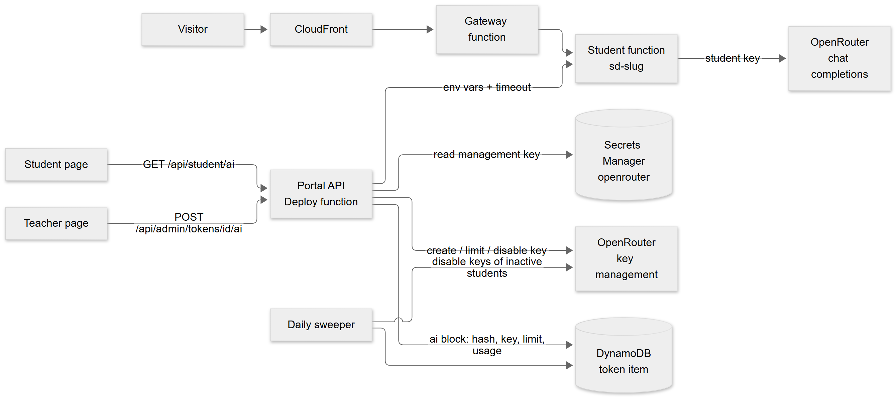
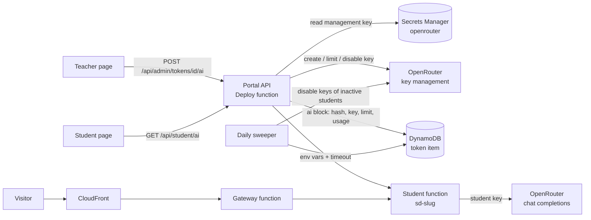
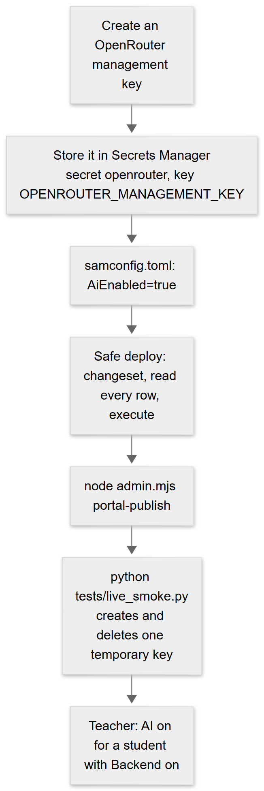
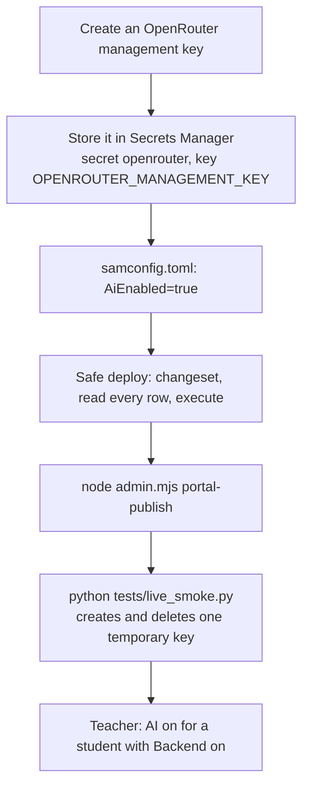
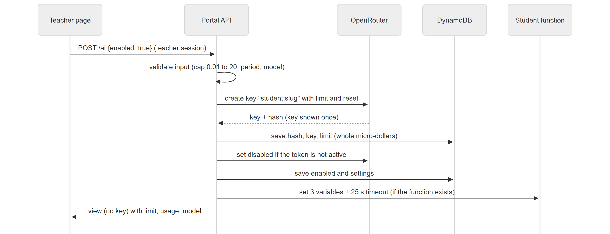
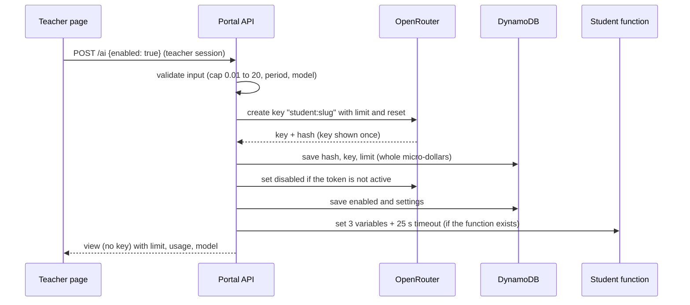
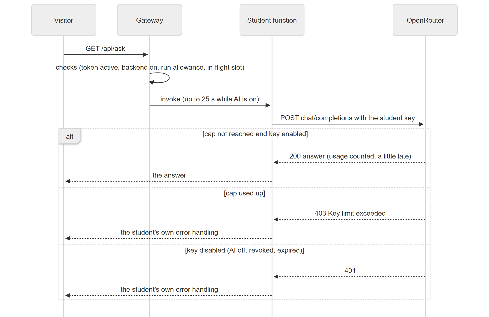
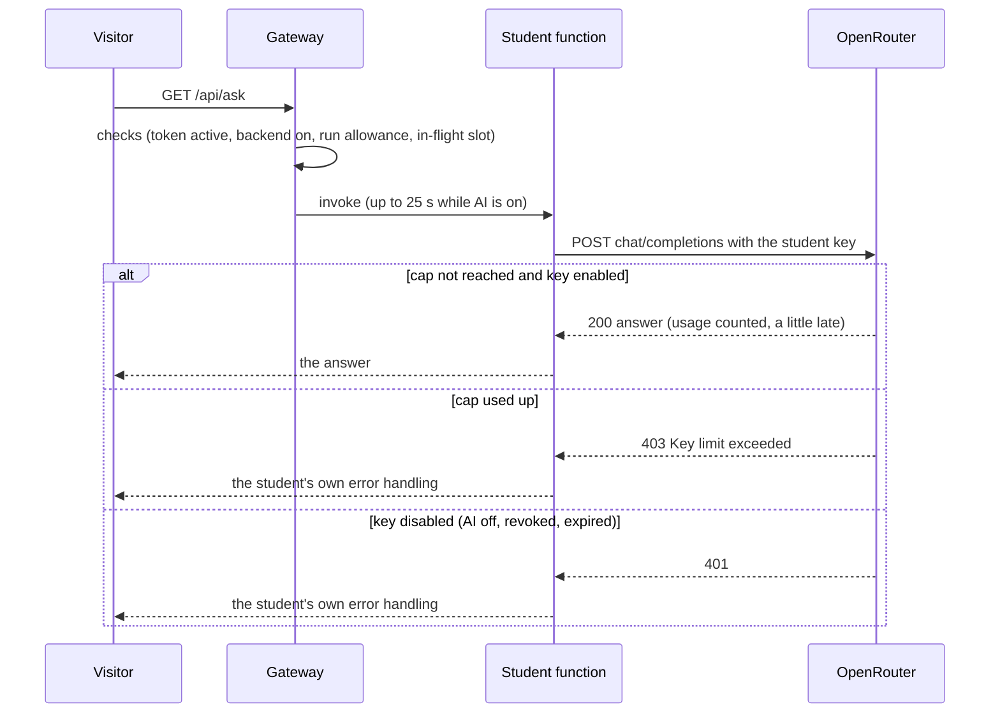
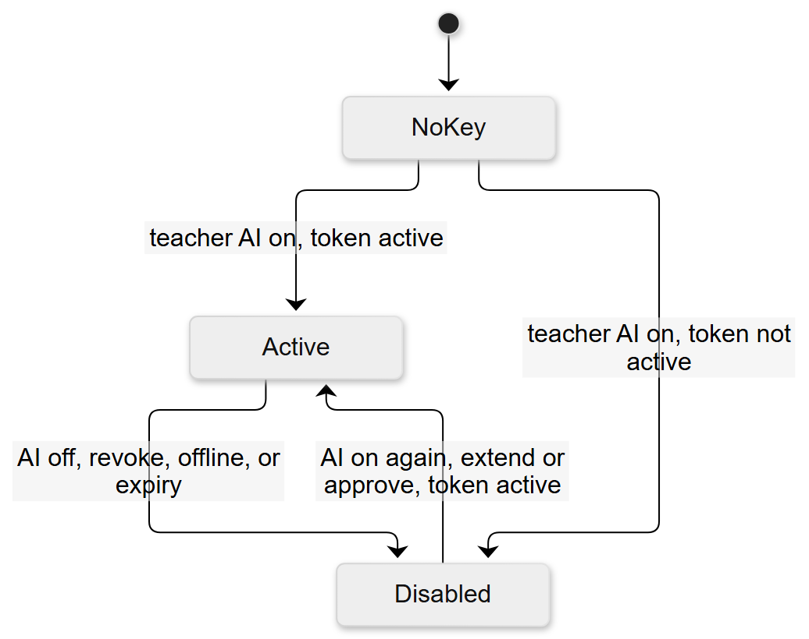
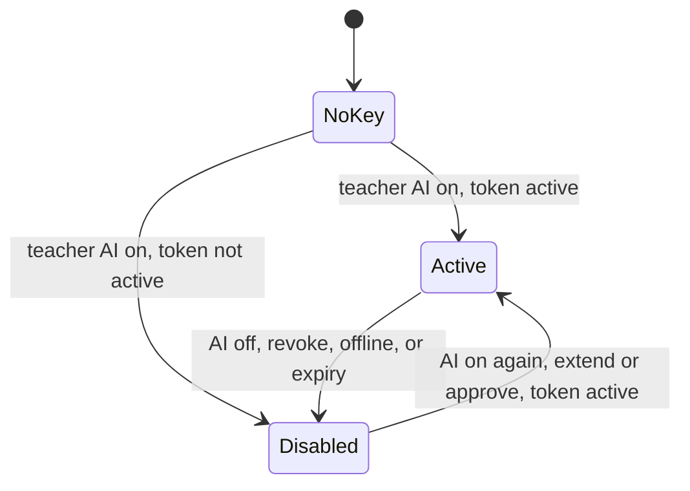

# Class AI connector: how it works, how to run it, how it is secured

> **Companion document.** The source of truth for this release is [TECHNICAL_SPECIFICATION.md](TECHNICAL_SPECIFICATION.md); if the two disagree, the specification wins. This document goes deeper on the class AI connector: flows, data map, threat model and runbook.

An optional feature. The teacher can give a student's **backend** an AI key that is capped, revocable and metered by OpenRouter, so students need no key of their own and none can overspend. Companion to [END_TO_END.md](END_TO_END.md) (section 3.3a), [API_REFERENCE.md](API_REFERENCE.md) and [../student/BACKEND.md](../student/BACKEND.md).

Diagrams use [Mermaid](https://mermaid.js.org/) (GitHub draws them; each is followed by the same steps in words).

## 1. At a glance

| | |
|---|---|
| What | Per student: a capped OpenRouter key, written into the student's function as `OPENAI_API_KEY`, `OPENAI_BASE_URL`, `AI_MODEL` |
| Who controls it | The teacher: on/off, dollar cap, period (day, month, total), model. Off by default for every student |
| Who enforces the cap | **OpenRouter** (not our code), so it holds even if the student's code misbehaves |
| Default model | `anthropic/claude-haiku-5.5` (template parameter `AiDefaultModel`) |
| Default cap | $0.25 per month, about 700 ordinary answers (`AiDefaultLimitUsd`) |
| What the platform holds | One **management key** in AWS Secrets Manager (it can create and disable keys but cannot make model calls) |
| What a student can ever reach | Only their own capped key. Never the management key |
| Code | `lambda/ai.py` (rules), `lambda/openrouter.py` (provider client), small hooks in `backends.py` and `portal.py` |

## 2. Who does what

| Actor | Does | Cannot |
|---|---|---|
| Teacher (portal login) | Switch AI on/off, edit cap, period and model, see usage | See any key (no API returns one) |
| Student (token) | Read the three variables in their function, see their own meter | Change the three variables while AI is on, raise their cap, call the teacher API |
| Platform (Deploy and Sweeper functions) | Create, change, disable keys; write the student's function settings | Make model calls with the management key |
| Student's function | Call the AI with the student's key | Spend more than the cap; use the management key |
| OpenRouter | Meter usage, enforce the cap, refuse disabled keys | |

## 3. Architecture

<!-- diagram:21ff6ba8 -->


<details><summary>Diagram source (Mermaid, editable; GitHub also draws it)</summary>



</details>
<!-- /diagram -->

In words: the teacher page calls the portal API, which talks to OpenRouter using the management key and stores the student's key on the token record and in the student's function. A visitor's request goes CloudFront, gateway, student function; the function calls OpenRouter **directly** with the student's key (the platform never sees the prompts or answers). The daily sweeper keeps keys in step with token status.

## 4. Workflows

### 4.1 One-time setup (you)

<!-- diagram:98575f47 -->


<details><summary>Diagram source (Mermaid, editable; GitHub also draws it)</summary>



</details>
<!-- /diagram -->

Full steps: [END_TO_END.md section 4.5c](END_TO_END.md). Never paste the management key into chat, files or the repository (a test fails if a key-like string is committed).

### 4.2 Teacher switches AI on for a student

<!-- diagram:4cbeaa52 -->


<details><summary>Diagram source (Mermaid, editable; GitHub also draws it)</summary>



</details>
<!-- /diagram -->

Steps in words: validate, create the key (or reuse the student's existing one), store it **before** touching anything else, set the key's disabled state to match the token status, save the settings, then update the function. If the function is mid-update the answer is HTTP 409; repeating the same request finishes the job and **never** creates a second key. If the student has no function yet, the first deploy creates it already carrying the variables.

### 4.3 A student's request uses the AI

<!-- diagram:75516ac0 -->


<details><summary>Diagram source (Mermaid, editable; GitHub also draws it)</summary>



</details>
<!-- /diagram -->

Two separate meters apply: each request to the function counts as one **run** against the Backend allowance (gateway), and each AI call spends **dollars** against the AI cap (OpenRouter). The timeout chain must stay ordered: student function 25 s, gateway 29 s, HTTP API 30 s (a template test pins it).

### 4.4 Lifecycle: when the key works

The key works only while **AI is on AND the token is active**.

<!-- diagram:cf179cae -->


<details><summary>Diagram source (Mermaid, editable; GitHub also draws it)</summary>



</details>
<!-- /diagram -->

| Event | Effect on the key | When |
|---|---|---|
| Teacher AI on | created (first time) or re-enabled | immediately |
| Teacher AI off | **disabled first**, then variables removed and timeout back to 10 s | immediately |
| Revoke, take offline | disabled | immediately |
| Token expires by itself | disabled | by the daily sweeper (03:00 UTC), at most about a day later; the gateway already stops serving the student at expiry |
| Extend, approve a regeneration | enabled again (if AI is on) | immediately |
| Provider outage during revoke or extend | the teacher's action still succeeds; the key state is retried | next sweep |
| Student removes their backend | key and settings kept; the next deploy gets the variables again | n/a |

### 4.5 Usage numbers

The student page asks `GET /api/student/ai` about once a minute; the server reads the key's usage from OpenRouter and caches it for 20 seconds. The teacher's row shows the last cached numbers; the **AI cap...** or switch actions refresh them. OpenRouter counts usage **late** (seconds to about half a minute in testing), so the meters lag and a cap can be overshot slightly.

## 5. Where each secret lives

| Item | Stored in | Readable by | Appears in an API response? |
|---|---|---|---|
| Management key | Secrets Manager secret `openrouter` | Deploy and Sweeper functions only (one named-secret IAM statement, pinned by a test) | Never |
| Student's key | the token item (`ai.key`) in DynamoDB, and the student's function environment | the platform roles that can read the table (Deploy, Gateway, Sweeper) and anyone with admin access to the account; the student's own code | **Never** (a test scans every response, including the teacher's list) |
| Cap, period, model | the token item (`ai`), cap as whole micro-dollars | same | Yes (not secret) |
| Usage | OpenRouter; cached copy on the token item | same | Yes |
| Prompts and answers | OpenRouter and the student's own logs; **never** the platform | | No |

## 6. Security model

### 6.1 Principles

1. **The platform's key never leaves the platform.** Students only ever receive a key that OpenRouter itself caps.
2. **The provider enforces the limit**, not our code, so a bug or a hostile student function cannot lift it.
3. **Safe order of operations.** Switching off disables the key before anything else; switching on stores the key before updating the function. A failure in between is retried with the same key.
4. **A provider problem never blocks the teacher** (revoke and extend always succeed; the sweeper retries).
5. **Least privilege.** One secret, one statement, only two functions; the student sandbox role can write logs and nothing else.

### 6.2 Threats and what stops them

| Threat | What stops it | Proven by |
|---|---|---|
| A student reads the platform's key | It is never given to a function; only Deploy and Sweeper can read the secret | `test_template_ai.py` (scope), `test_ai.py` (no key in any response) |
| A student overspends | OpenRouter's per-key cap; in the live test the provider refused the call with 403 once the cap was used | `live_smoke.py` section H |
| A student keeps using AI after being switched off, revoked or expired | The key is disabled (live: disabled key answers 401); the sweeper catches silent expiry | `test_ai.py` (revoke, offline, expiry, extend), live smoke |
| A student leaks their own key | It is capped and revocable; leaking it exposes at most the remaining cap | design; cap default $0.25 |
| A student overwrites the AI variables to bypass limits | The three names are reserved while AI is on (HTTP 400) | `test_ai.py` |
| The teacher API is called by a student | Student and teacher sessions use different signing keys | existing portal tests |
| Invalid or hostile input (negative or huge caps, odd model ids) | Strict validation before OpenRouter is called | `test_ai.py` (invalid input) |
| Key or secret committed to git | A test fails on any `sk-or-v1-` string in the repo; keys live in Secrets Manager | `test_template_ai.py` |
| Error text leaks a secret | Errors are built only from OpenRouter's own message; tested with a wrong management key | `test_ai.py` (provider failures) |
| DynamoDB rejects data | Money is whole micro-dollars; the tests use a store that fails on any float | `test_ai.py` (StrictStore) |
| A retry creates a second key (a hidden cost) | Idempotent: one key per student, reused | `test_ai.py` (409 retry) |
| The long wait breaks the chain | Timeouts ordered 25 s, 29 s, 30 s | `test_template_ai.py` |

### 6.3 Who can do what (IAM)

| Role | Table | Management key | Lambda functions |
|---|---|---|---|
| Deploy function (portal API) | read and write | yes | manage only `sd-*` |
| Sweeper | update, delete, scan | yes | no |
| Gateway | read, write | **no** | invoke `sd-*` only |
| Student sandbox role | none | **no** | none (logs only) |

### 6.4 Residual risks (honest list)

- **A student can use their own key from anywhere** until it is disabled or capped out. The cap is the bound. Keep the default small.
- **Student keys sit in DynamoDB and function settings in plain form** (AWS encrypts both at rest). The Deploy, Gateway and Sweeper roles and any account administrator can read them. They are low value (capped, revocable), unlike the management key.
- **Not a model allow-list.** A student's key can call any OpenRouter model. The cap limits the damage; a hard list would need a proxy (three concurrent Lambdas per call).
- **Prompts go to the AI provider.** Students are told not to send private data. The platform never stores prompts, but a student's own function may log them.
- **Usage lags**, so a burst can overshoot a cap by a few calls.
- **No "rotate this student's key" button yet.** If a key must be replaced, delete it in OpenRouter and clear that student's `ai` block (see 7.3).

## 7. Operations

### 7.1 Everyday

- Switch on or off from the teacher page. Check the row line: `AI: on · model · $used of $cap per month`.
- Watch the OpenRouter credit balance: it is the real class-wide ceiling. A student cap can exceed what is left.

### 7.2 Rotate the management key

Create a new management key, update the secret `openrouter` (functions re-read it within 5 minutes), then delete the old key at OpenRouter. Student keys are unaffected.

### 7.3 Emergencies

| Situation | Do this |
|---|---|
| One student is spending too fast | Teacher page: **AI: off** (disables the key at once), or lower **AI cap...** |
| Everything must stop now | OpenRouter dashboard: disable or delete the keys named `student:*` (setting `AiEnabled=false` only stops the platform managing keys; existing keys stay valid) |
| A student's key leaked | Disable it at OpenRouter (or switch AI off), then give them a new one: delete the key at OpenRouter, remove that student's `ai` attribute (`aws dynamodb update-item --table-name <TokensTable> --key '{"pk":{"S":"tok#<token id>"}}' --update-expression "REMOVE ai"`; the table name is the stack output `TokensTableName`), then switch AI on: a new key is created and written into the function |
| Management key leaked | Delete it at OpenRouter at once (it cannot make model calls, but can create keys), create a new one, update the secret |
| Provider outage | Students get errors from OpenRouter; the teacher can still revoke and extend; the sweeper retries key changes |

### 7.4 Read the signals

- The Deploy function log shows `could not disable the AI key of <slug>: <provider message>` when a disable failed (the sweeper retries).
- The sweeper result lists `ai_keys_changed` when it changed a key.
- The OpenRouter dashboard shows each key (`student:<slug>`), its limit and its usage.

## 8. Testing

| Where | What |
|---|---|
| `tests/test_ai.py` (15 scenarios) | on/off, cap, period, model, env injection, reserved names, usage cache, lifecycle, provider failures, 409 retry, nothing exposed, strict-store floats |
| `tests/test_template_ai.py` | AI off by default, one named secret and only two functions may read it, timeouts, no key committed |
| `tests/live_smoke.py` section H | real OpenRouter and production: capped key, function answers, usage read through the production portal (proves IAM and the secret), 403 at the cap, off disables, on re-enables, the temporary key is deleted |
| Mutation checks | 12 deliberate breaks of the safety behaviours, all caught |

Manual 5-minute check: teacher **AI: on** for a student with Backend on; the student's Backend card shows **Class AI**; deploy the example function and call it; the meter moves within about a minute; **AI: off** and call again: the call fails with 401.

## 9. Limits and known gaps

- Dollar cap only, no model lock, no streaming (longest wait 25 s).
- Free `:free` models are shared with all of OpenRouter and failed with 429 in every test, so the paid model is the default.
- Usage is counted late by the provider.
- Per-student key rotation is manual (7.3).
- The teacher list shows cached usage; there is no class-wide spend overview yet.

## 10. FAQ

**Does the student need an account anywhere?** No. The teacher switches it on; the variables appear in their function.

**Can a student use their own key instead?** Yes: ask the teacher to switch AI off, then set their own `OPENAI_API_KEY` as before.

**What happens at the cap?** Calls get HTTP 403 "Key limit exceeded". Nothing else breaks; the student's code should show a friendly message.

**What does it cost?** About $0.00035 for a typical Haiku 5.5 answer (1,000 tokens in, 500 out); prices change, check OpenRouter.

**Who sees the prompts?** The AI provider and the student's own logs. Not the platform.

## 11. Where the code is

| File | Role |
|---|---|
| `lambda/ai.py` | rules: validation, key lifecycle, function environment, usage, sweeper |
| `lambda/openrouter.py` | the provider client and the management-key reader |
| `lambda/backends.py` | injects the variables and timeout when a function is created; reserves the names |
| `lambda/portal.py` | the `ai` block in the token view, the two routes, lifecycle hooks, the sweeper call |
| `web/teacher.js`, `web/backend.js`, `web/common.js` | teacher controls, student card and meter, dollar formatting |
| `template.yaml` | parameters `AiEnabled`, `AiSecretName`, `AiDefaultModel`, `AiDefaultLimitUsd`; the one secret statement; timeouts |

## 12. Gemini as a second provider (optional)

The teacher can give a student **Google Gemini** instead of OpenRouter, per student, from the same **AI allowance** dialog (field "AI service": OpenRouter or `gemini-3.5-flash-lite`, the one Gemini model). For a student who never had AI, **Gemini is the default** when the server offers it; students already on OpenRouter stay there. It is off unless the stack is deployed with `AiGeminiEnabled=true`.

**Why a proxy.** OpenRouter can mint a capped key per student; Google cannot. So the platform's Google key is never given to a student. Instead:

```
student function --Bearer ga_<slug>.<secret>--> AI proxy API --> ai_proxy.py --Google key from Secrets Manager--> Gemini
```

| | |
|---|---|
| What the student's function gets | The same three variables as before: `OPENAI_API_KEY` (a private `ga_` key, useless anywhere else), `OPENAI_BASE_URL` (the proxy address plus `/v1`), `AI_MODEL`. Student code does not change |
| What the proxy checks on every call | Key (constant time), token active, teacher switch on, provider is Gemini, cap not yet reached. Then it forces the teacher's model, drops unknown request fields, caps output at 8,192 tokens (2,048 if the student gave none) and refuses `stream` and `n > 1` |
| The cap | Counted by the platform in an atomic counter per student and period (`aiu#<slug>#<period>`). The cost of an answer is added **after** the call, so the last answer can overshoot the cap by one answer; the output cap bounds that |
| Cost of an answer | `prompt * price_in + output * price_out` micro-dollars (one micro-dollar per token equals one dollar per million tokens). Gemini bills hidden "thinking" tokens as output; they are in `total_tokens` but not in `completion_tokens`, so output = total - prompt |
| Prices | Built into `lambda/gemini.py` (flash-lite 0.30 input / 2.50 output USD per million tokens). Override or add models with the `AI_GEMINI_PRICES` environment variable, for example `{"gemini-3.5-flash-lite": [0.3, 2.5]}` |
| The Google key | Field `GOOGLE_API_KEY` in the same Secrets Manager secret as the OpenRouter keys (`AiSecretName`). Only `AiProxyFunction` may read it besides the existing readers; never a student function |
| Switching provider | Moving a student to Gemini disables their OpenRouter key (and keeps it disabled in the daily sweep); moving back re-enables it. The model resets to the new provider's default. Their `ga_` key is kept, so switching on again restores it |
| Errors a student sees | OpenAI-shaped: 401 `invalid_api_key`, 403 `token_inactive` / `not_enabled`, 429 `insufficient_quota` (allowance used), 400 `stream_not_supported`, 502 `provider_error` (carries no key) |

**Turning it on (owner):** the `openrouter` secret already needs `GOOGLE_API_KEY` in it, then deploy with `AiEnabled=true BackendEnabled=true AiGeminiEnabled=true` (review the change set: it adds `AiProxyApi`, `AiProxyFunction` and gives the portal function `AI_PROXY_URL`), then `node admin.mjs portal-publish`.

**Tests:** `tests/test_ai_gemini.py` (switch, proxy, caps, cost, lifecycle, provider moves, no key in any response) and `tests/test_template_gemini.py` (off by default, one secret, narrow rights, own throttled API).
