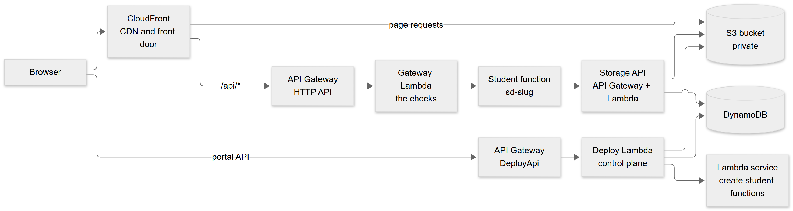
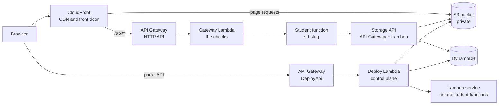
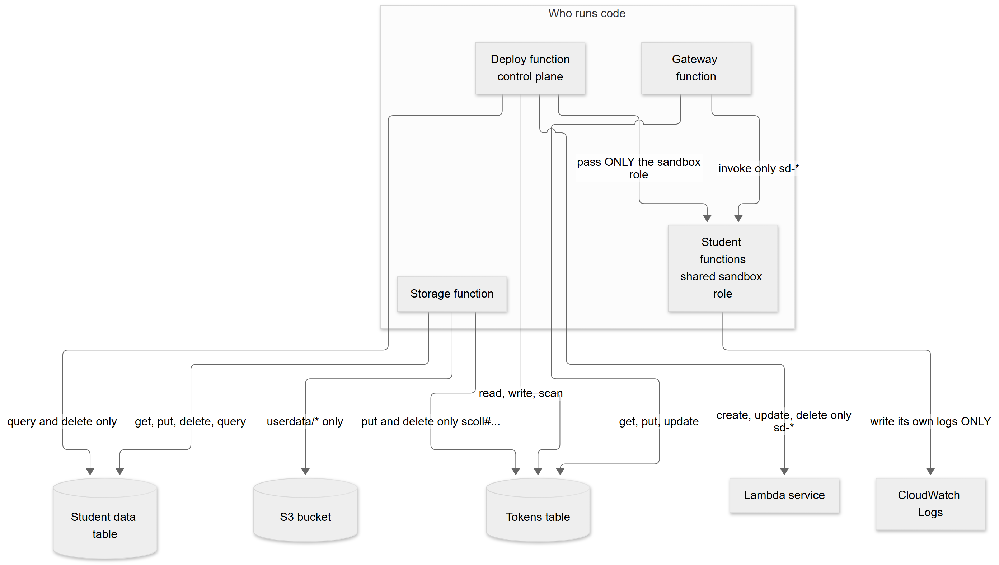
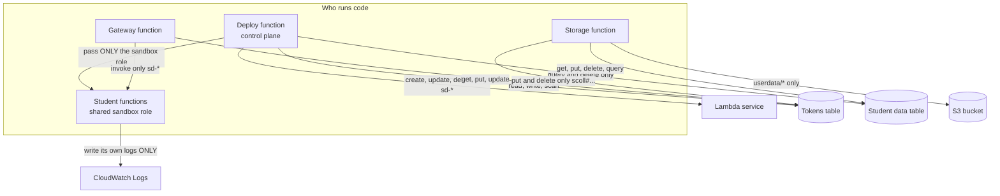

# What this project teaches about AWS (a learning guide)

> **Companion document, for learning rather than for operating.** The source of truth for how the system works is [TECHNICAL_SPECIFICATION.md](TECHNICAL_SPECIFICATION.md). This guide takes the real decisions, wiring and mistakes of this project and turns them into things worth understanding. Every chapter says *the idea*, *where it lives in this repository*, *what went wrong or nearly did*, and a *try it yourself* question. File names and resource names are real, so you can open them side by side.

Diagrams use [Mermaid](https://mermaid.js.org/) (an image comes first, the editable source is collapsed under it).

## 0. The mental model that makes the rest easy

Almost every AWS design is three questions asked in order:

1. **Who may do what?** (identity and permissions: IAM, bucket policies, tokens, keys)
2. **How does a request travel, and where can it be stopped, cached or rewritten?** (DNS, CDN, API front doors, functions)
3. **Where does the state live, and what does it cost to keep it?** (S3, DynamoDB, secrets, logs)

This project answers them for a class: students publish sites, run small backends and (optionally) use AI and storage, while the teacher keeps control and the bill stays small.

<!-- diagram:75a3a823 -->

Diagram source (Mermaid, editable; GitHub also draws it)

<!-- /diagram -->

Read it as three paths: **pages** (browser to CloudFront to S3, no code runs), **student code** (CloudFront to API Gateway to the gateway Lambda to the student's own Lambda) and **control** (the portal's own Lambda that creates and changes things). Keeping those three apart is the single most useful idea in the whole project.

## 1. CloudFront: the front door, the cache and the router

**The idea.** A distribution is a set of rules: for a request to *this* host and *this* path, ask *that* origin (S3, an API), apply *this* cache policy, and maybe run a small function first. Caching is what makes it fast and cheap, and also what makes "I changed the file but still see the old one" happen.

**Where.** `Distribution`, `PortalDistribution`, `RouterFunction`, `PortalFunction`, `BackendRouteFunction`, `SitesOAC` in [template.yaml](../template.yaml).

**What to understand**

- **Behaviors.** The default behavior serves static files from S3; `/api/*` is a second behavior that goes to API Gateway with **caching disabled** (an API answer must never be shared between visitors) and forwards the `Authorization` header. One distribution, two very different jobs.
- **Wildcard hosts as routing.** Every student site is `<name>.example.edu`. A DNS wildcard sends all of them to one distribution, and a **CloudFront Function** (JavaScript that runs at the edge before the cache is consulted) rewrites `alice.example.edu/cart` to the S3 key `sites/alice/cart`. No server, no per-student configuration. Open `RouterFunction` and read it: about 40 lines.
- **Single-page-app fallback.** The same function turns an unknown path into `index.html` so a React router can take over. This is routing logic you would otherwise need a server for.
- **Cache invalidation.** Publishing a site uploads files and then invalidates `/sites/<slug>/*`. Without it, visitors keep the old copy until the cache expires. Look at the invalidation calls in [lambda/app.py](../lambda/app.py).
- **Functions versus Lambda@Edge versus Lambda.** CloudFront Functions are tiny, fast and cheap but can only look at and change the request (no network, no AWS calls). That is exactly enough for routing and for adding the real viewer IP as a header.
- **Origin Access Control (OAC).** The bucket is **private**. CloudFront signs its requests to S3 (SigV4) and the bucket policy lets *only that distribution* read *only some prefixes*. Read `SitesBucketPolicy`: three statements, each with `AWS:SourceArn` pinning a distribution to one prefix (`sites/*` or `portal/*`). Nobody can reach `uploads/` or `userdata/` through the CDN.
- **A shared secret on the origin request.** CloudFront adds `x-origin-secret` when it calls API Gateway; the gateway Lambda refuses anything without it. API Gateway has a public URL, so this is how the code knows "the request came through the CDN, with the viewer IP set by us".
- **Custom domains at scale.** One student can bring `www.theirshop.com`. That needs a certificate for their name and a place for CloudFront to attach it. CloudFront's *multi-tenant distributions* give each domain a "distribution tenant" with a managed certificate. It was created by hand and is a known gap ("not in CloudFormation"). The student adds a **CNAME** to a routing endpoint; the platform polls for DNS, then certificate issue, then deployment (see [domains.py](../lambda/domains.py)).
- **Certificates for CloudFront must be in `us-east-1`.** Always. (`CertificateArn` in the template.)

**Try it yourself.** (1) Explain why `/api/*` has `CachingDisabled` but the site behavior uses `CachingOptimized`. (2) What would a visitor see if you forgot to invalidate after a publish, and for how long? (3) Why can the router function not simply fetch the student's `index.html` itself?

## 2. S3: more than a folder

**The idea.** A bucket is a flat key-value store. Prefixes (`sites/alice/…`) are just part of the key, but policies and lifecycle rules can target them, which makes them feel like folders with different rules.

**Where.** `SitesBucket`, `SitesBucketPolicy`; the prefixes are listed in section 3.2 of the specification.

**What to understand**

- **Private by default, public by exception.** `PublicAccessBlockConfiguration` is on. Content leaves through CloudFront (OAC) or through a **presigned URL**, never through an open bucket.
- **Presigned URLs.** A URL that carries a signature made with the *signer's* permissions, valid for a few minutes. The browser uploads a zip **straight to S3**, so large files never pass through a Lambda (which has a request size limit and bills by time). The Lambda only issues the URL and later reads the zip.
- **Signature versions bite.** In `us-east-1` an old boto3 default could produce a legacy (SigV2) presigned URL that S3 rejects with `SignatureDoesNotMatch` as soon as the browser adds a `Content-Type` header. The fix is explicit: `Config(signature_version="s3v4", s3={"addressing_style": "virtual"})` in [lambda/backends.py](../lambda/backends.py). This was found in a live run, not by reading docs.
- **Presigned POST can enforce limits.** For student files the storage API returns a presigned **POST** with a policy condition `["content-length-range", 1, size]` and the declared content type. S3 itself refuses a bigger file. A presigned PUT cannot do that. The live smoke test checks that S3 really answers 400 to an oversized file.
- **Versioning is the undo button.** With versioning on, an overwritten or deleted object is recoverable for 30 days (a lifecycle rule expires old versions). Cheap insurance for a class where students will overwrite things.
- **Lifecycle rules for housekeeping.** Temporary zips under `uploads/` expire after a day; incomplete multipart uploads are cleaned up.
- **S3 events are not used here.** Everything is explicit calls. Worth knowing the alternative exists, and why it was not needed: the publish step is a user action, so a direct call is simpler to reason about and test.

**Try it yourself.** (1) Find the lifecycle rule that deletes uploaded zips and say what would pile up without it. (2) Why is a presigned POST safer than a presigned PUT for letting a stranger upload? (3) What breaks if the signing region or addressing style is wrong?

## 3. CORS: the one that confuses everyone

**The idea.** CORS is a **browser** rule, not a server rule. When JavaScript on `https://alice.example.com` tries to read a response from `https://other.example.com`, the browser first asks that other server "may this origin read you?" (a *preflight* `OPTIONS` request for non-simple requests) and only lets the page see the answer if the response says yes (`Access-Control-Allow-Origin`). `curl` never does this, which is why "it works in curl but not in the browser" is the classic symptom.

**Where it appears in this project, and where it was avoided on purpose**

- **Avoided: the student's API.** The site and its `/api/*` are on the **same address** (CloudFront routes `/api/*` to API Gateway). Same origin means no CORS at all, no allow-lists to maintain, no preflights, and cookies/headers behave simply. This is the main reason the architecture puts the API *behind the same CDN* instead of on its own `api.` host.
- **Needed: browser uploads to S3.** The student page PUTs a zip to a presigned URL on the S3 domain: a different origin. So the bucket has a CORS rule (`CorsConfiguration` on `SitesBucket`): `PUT` allowed from the portal origin. For class storage, browsers also **POST** an upload form to S3 and **GET** a download link from a student's site, so a second rule allows `POST` and `GET` from any origin. Is `*` safe? Yes here, because the *signature* in the URL is what authorises the request; CORS only decides whether the browser lets a page read the answer. A request without a valid signature fails with 403 whichever origin sent it.
- **The tell-tale evidence.** The live test sends `Origin: https://zz-backendtest.example.edu` with the upload and the download and checks that S3 answers with `Access-Control-Allow-Origin`. If you ever see an upload that works in a script but fails in the page, check that header first.

**Try it yourself.** (1) Make `fetch('/api/health')` fail with a CORS error on purpose by pointing the page at the raw API Gateway URL; explain what you see in the browser console. (2) Why does an `` pointing at a presigned download URL work even without a CORS rule, while `fetch()` of the same URL does not?

## 4. IAM: who may do what (the part worth the most time)

**The idea.** Nothing in AWS is allowed unless a policy says so. A **role** is an identity a service assumes (a Lambda's *execution role*); its **trust policy** says who may assume it; its **permission policies** say what it may do. The default answer is *no* (implicit deny); an explicit deny always wins.

<!-- diagram:98c52aa2 -->

Diagram source (Mermaid, editable; GitHub also draws it)

<!-- /diagram -->

**Where.** Every `Policies:` block in [template.yaml](../template.yaml); `StudentSandboxRole` and `StudentSandboxBoundary`; the tests [test_template_ai.py](../tests/test_template_ai.py), [test_template_storage.py](../tests/test_template_storage.py), [test_template_backend.py](../tests/test_template_backend.py).

**What to understand**

- **Least privilege is concrete, not a slogan.** The portal's function may create and delete functions, but only ones named `sd-*` (the resource is `function:sd-*`). It can pass a role to Lambda, but **only** the sandbox role (`iam:PassRole` scoped to one ARN, otherwise the permission to create functions would let it hand a function *any* role: a classic privilege escalation). The gateway may *invoke* `sd-*` and nothing else.
- **Student code is untrusted, so its role is nearly empty.** All student functions share one role that can only write its own logs, and a **permission boundary** caps what that role could ever be given. Students cannot call DynamoDB or S3 directly; they reach data only through APIs the platform controls.
- **Conditions make a grant narrower than its resource.** The storage function may `PutItem` into the *tokens* table, but only for keys that start with `scoll#`: `Condition: ForAllValues:StringLike: dynamodb:LeadingKeys: ['scoll#*']`. Same table, tiny slice.
- **Why not one role per student?** It would give per-student isolation in IAM, but the portal would need `iam:CreateRole` (a very sensitive power), and every deploy would wait for IAM to propagate. Instead isolation is **built into the API**: a secret key names the student, and the server builds every database and S3 key itself. IAM answers "may this service touch this table"; application logic answers "whose rows". Knowing which layer should enforce which rule is the real skill.
- **Resource policies are the other half.** The bucket policy (who may read which prefix) lives *on the bucket*, not on a role. Many AWS permission puzzles are "identity allows it but the resource policy does not" or the reverse.
- **You can ask IAM instead of guessing.** The live smoke test calls the **IAM policy simulator** to prove the portal's role may `Query`/`DeleteItem` on the data table and may **not** `GetItem`/`PutItem`/`Scan` it.
- **The incident worth remembering.** The first live run of class storage failed with HTTP 500: the storage function's role had no `PutItem` on the tokens table, which the new "remember collection names" code needed. **Unit tests cannot see IAM** (in-memory fakes allow everything). Only running against the real account found it. See chapter 12.

**Try it yourself.** (1) Remove `iam:PassRole` scoping in a copy of the template and explain what a compromised portal function could then do. (2) Read `StudentSandboxBoundary`; what does the boundary add if the role's own policy already only allows logs? (3) Which layer should stop student A reading student B's notes: IAM, the bucket policy, or the application? Defend the answer.

## 5. Lambda: code without a server, with real limits

**The idea.** A function runs only when invoked, scales by running more copies, and bills for the time used. The limits are the design constraints.

**Where.** `DeployFunction`, `GatewayFunction`, `SweeperFunction`, `StorageFunction` and the student functions (created at runtime by [backends.py](../lambda/backends.py)).

**What to understand**

- **One function per student** gives separate logs, separate environment variables, a kill switch (reserved concurrency 0, or the teacher's switch) and no cross-talk. The cost is a control plane to create and update them, which is a good chunk of the code.
- **Environment variables are the configuration channel**, set at create/update time. They are *write-only* in this platform's API: a student can set a secret but never read it back. Secrets given by the platform (AI key, storage key) are injected the same way.
- **Timeouts nest.** The student function may run 10 s (25 s when the class AI is on), the gateway Lambda 29 s, API Gateway's hard limit is **30 s**. Each layer must be shorter than the one outside it, or the outer layer gives up first and the caller sees a confusing error. This is why the AI timeout is 25.
- **Payload limits.** A synchronous Lambda response is limited (6 MB) and an API Gateway integration has its own limits. The platform caps request and response bodies at 1 MB and lists at about 400 KB so nothing hits the platform limits unannounced.
- **Concurrency is an account-wide, shared budget.** The account started with a limit of **10** concurrent executions. Every function in the account competes for it. The gateway therefore has an **in-flight limiter** (atomic counters in DynamoDB) so students cannot starve each other or the portal. When the quota rose to 1,000 the limits needed re-tuning (an open item). Reserved concurrency exists but cannot be set below the account's unreserved minimum, which the code handles.
- **Cold starts and memory.** Memory also buys CPU; the portal function has 1,024 MB, small helpers 256 MB. A warm container keeps module-level state, which is useful (a cache) and dangerous (a stale cache; chapter 12).
- **Logs are billed forever unless you say otherwise.** Each student function's log group gets a 7-day retention policy at creation.

**Try it yourself.** (1) Work out how many requests per second the in-flight caps allow if each takes 300 ms. (2) What happens to a visitor if the student's function takes 28 s? Trace which layer fails first. (3) Why are `ReservedConcurrentExecutions` and a global in-flight counter both used?

## 6. API Gateway (HTTP API): the public door

**The idea.** A managed front door for HTTP: routes, throttling, and a Lambda integration. The *HTTP API* flavour is the cheap, simple one (roughly a dollar per million requests).

**What to understand**

- **Three separate APIs on purpose.** `DeployApi` (portal and CLI), `BackendApi` (student sites' `/api`), `StorageApi` (storage calls from student functions). Each has its own **throttle**, so a student's busy loop can use up the backend's quota without making the portal unusable. One API for everything would be one shared fate.
- **Proxy routes.** `/b/{slug}/{proxy+}` sends everything below a student's path to one Lambda, which decides what to do. The platform's gateway function is the policy engine (nine ordered checks: secret, slug, size, backend exists, teacher switch, per-IP rate, in-flight cap, allowance, invoke).
- **Throttling is a blunt tool; counters are precise.** API Gateway throttles per second per API. The per-student *allowance* ("5,000 runs a month") needs state, so it is an **atomic conditional counter** in DynamoDB (chapter 7).
- **Payload format v2** gives the Lambda a tidy event (`rawPath`, `requestContext.http.method`, `queryStringParameters`), which the student templates use directly.

## 7. DynamoDB: state without servers, if you accept its shape

**The idea.** A key-value/document database that is fast at exactly the access patterns you designed the keys for, and awkward at everything else. You pay per request (on-demand) or per provisioned capacity.

**Where.** `TokensTable` (single table, key `pk`), `StudentDataTable` (partition `s`, sort `id`), [portal.py](../lambda/portal.py) (`DynamoStore`), [storage.py](../lambda/storage.py).

**What to understand**

- **Key design is the schema.** `TokensTable` uses prefixes in one string key (`tok#…`, `slug#…`, `runs#…`, `ip#…`, `inflight#…`). That is *single-table design*: unrelated things share a table because the table, not the type, is what you pay for. The price: listing "all tokens" is a **Scan** with a filter, fine for a class, not for a million rows. `StudentDataTable` instead has a sort key because *listing a student's collection in order* must be a cheap **Query**.
- **Query versus Scan.** A Query reads one partition; a Scan reads the whole table. Use Scan only when the table is small and you accept it. The portal's function may *Query and delete* the data table but not read values; the application never scans it.
- **Conditional writes are your lock.** `UpdateItem` with `ConditionExpression` makes "add 1 only if the count is still below the limit" a single atomic step, even with 60 parallel callers (a test fires exactly that). This is how the run allowance, the in-flight limiter, the storage byte cap and the item cap cannot be overshot. Compare with read-then-write, which races.
- **Reserve, then write, then give back on failure.** Storage reserves bytes and an item *before* writing and returns the reservation if the write fails. A test makes the write fail on purpose and checks the counters.
- **TTL for self-cleaning.** Rate-limit and counter items carry a `ttl` attribute and expire by themselves.
- **Floats are refused.** DynamoDB's Python resource rejects `float`; money is stored as integer micro-dollars. The tests use a "strict store" that fails loudly on a float, so the mistake appears locally, not in production.
- **Item limits shape features.** An item is at most 400 KB, a query page at most 1 MB. Hence the 64 KB record cap and the "stop a list page at about 400 KB" rule.
- **Point-in-time recovery** is on for the tokens table (restore to any second in the last 35 days) and a decision still open for the student data table.

**Try it yourself.** (1) Design the keys for "list a student's notes newest first" and say why the sort key must start with the time. (2) Why can two students' items never collide even with the same collection and id? (3) What does `ReturnValues="ALL_OLD"` buy the delete path?

## 8. CloudFormation and SAM: infrastructure as a reviewed diff

**The idea.** Describe resources in a template; CloudFormation computes what must change and applies it. SAM is a shorthand that expands into plain CloudFormation (a `Serverless::Function` becomes a Lambda, a role, a permission and an API route).

**Where.** [template.yaml](../template.yaml), [samconfig.toml](../samconfig.toml); the routine in the specification, section 7.3.

**What to understand**

- **Parameters and conditions are feature flags.** `BackendEnabled`, `AiEnabled`, `StorageEnabled` decide whether whole groups of resources exist (`Condition: UseStorage`). Features arrive switched off; turning one on is a reviewed deploy, not a code change.
- **Always look at the change set before executing it.** The routine here is `sam deploy --no-execute-changeset`, then read each line: *Add*, *Modify*, and above all **Replacement** (`True` means "delete and recreate", which for a table or bucket can mean data loss). This project's deploys showed only additions and in-place modifications; if a `Replacement: True` ever appears on a stateful resource, stop.
- **`DeletionPolicy: Retain`** on the student data table: if someone deletes or replaces the stack, the data stays.
- **Circular dependencies are the classic trap.** `Globals.Function.Environment` applies to *every* function. Putting a value there that refers to an API that refers to a function creates a loop. The gateway comment in the template explains one case; `STORAGE_URL` is set only on the portal function for the same reason. **cfn-lint does not catch these; the change set does.**
- **Not everything is in the template.** The custom-domain multi-tenant distribution was created by hand. That is a known gap, written down. Honest documentation of "this part is manual" is itself good practice.
- **Outputs and SSM parameters** carry values between stacks and scripts (for example `admin.mjs portal-publish` reads the bucket and distribution from the stack outputs).

## 9. Secrets, identity and sessions

- **Where a secret lives decides who can leak it.** Account-level settings in **SSM Parameter Store**; the OpenRouter management key in **Secrets Manager** (readable by exactly two functions through a statement naming one secret); per-student keys in the token's item and in that student's function environment. Nothing secret is in the repository, and a test fails if an email address, token or key appears in a tracked file.
- **Tokens are shown once and stored hashed** (SHA-256). A database leak cannot be replayed.
- **Sessions are HMAC-signed payloads** with a role and an expiry, signed with different keys for teachers and students so one can never pass for the other. The teacher password uses **scrypt** and constant-time comparison; failed logins are counted per address.
- **Constant-time comparison** (`hmac.compare_digest`) for any secret check, so response time does not leak how much matched.
- **Management key versus student key.** The AI feature never hands students the real provider key: it creates a *capped, revocable per-student key* using a management key that can create keys but cannot call models. Delegation with a ceiling is the pattern; you will meet it everywhere (STS sessions, scoped tokens).

## 10. A security mindset, applied

- **Name the untrusted party.** Here it is the student's code and any visitor to a student's site. Everything else follows: the sandbox role, the gateway checks, the size limits.
- **Defense in depth.** A request to a student backend passes: CloudFront (HTTPS only) → origin secret → per-IP rate limit → in-flight cap → teacher switch → token lifecycle → run allowance → invoke with a near-empty role. Any one layer can fail and the others still hold.
- **Validate at the boundary, in code you control.** Zip uploads are checked for path traversal, symlinks, size and file count *before* anything runs; the kit's `readZip` refuses any path that would leave the folder (a classic "zip slip").
- **Privacy by design.** The teacher cannot read what students store: no API returns a value, a file name or a key. Capabilities you never build cannot leak.
- **Supply chain is a security topic too.** The MCP package is fetched from a *pinned* URL, hashed in `mcp-version.json`, and the setup command shows each change, backs up the file and merges instead of overwriting. The kit updater only accepts paths on a managed list and checks a hash.
- **Cost is a security property.** An unbounded loop is an attack on your wallet. Caps, allowances, throttles and alarms are the controls.

## 11. Cost thinking

- **Pay-per-use fits a class.** CloudFront, S3, Lambda, API Gateway and on-demand DynamoDB cost cents when idle. The expensive things in AWS are the always-on ones: **RDS**, **NAT gateways**, and load balancers. This is why class storage is DynamoDB and S3 and **not** RDS (always-on instance, a private network, and a NAT gateway for Lambdas to reach the internet).
- **Bound the worst case, not the average.** Per-student caps (bytes, items, files, operations per day), per-API throttles and per-student AI spending caps enforced by the provider mean one student's mistake has a known maximum.
- **Look at the bill's shape.** Requests (API Gateway, DynamoDB), compute time (Lambda), data stored (S3, DynamoDB) and data out (CloudFront). A change that sends large files through a Lambda instead of directly to S3 changes the bill, which is why uploads use presigned URLs.
- **Alerts beat discipline.** A budget alert plus CloudWatch alarms notify one SNS topic by email. The address itself lives in SSM, never in the repository.

## 12. Operating it: logs, alarms, tests that touch the real thing

- **Retention policies on every log group** (7 days for student functions), otherwise logs accrue forever.
- **Alarms with a purpose:** Lambda errors for the platform's own functions, throttles, concurrency near the limit, API 5xx. An alarm should say what to look at.
- **Two kinds of test, both needed.**
  - **Fast local tests** run the *real* Lambda code against in-memory fakes of S3, DynamoDB, Lambda and CloudWatch. They are quick, free and deterministic. They also **mutation-test** the safety guards: break a guard (the allowance, a size cap, the isolation key) and confirm a test fails.
  - **A live smoke test** (`python tests/live_smoke.py`, about 110 checks) talks to the real account with a temporary student and cleans up. It found problems no fake could: the SigV2 presigned URL, the missing `PutItem`, an in-memory cache that outlived deleted data.
- **Fakes cannot know:** IAM, CORS, signature versions, quotas, eventual consistency, cold starts. Plan for a live check of each.

## 13. Walkthroughs: follow one request through every service

**A visitor opens `https://alice.example.edu/`.** DNS (wildcard) → CloudFront (TLS with the wildcard certificate) → viewer-request function maps the host to `sites/alice/` and adds `index.html` → cache hit, or S3 read signed by OAC → bytes back, compressed. No Lambda ran.

**The page calls `/api/notes`.** Same CloudFront → behavior `/api/*` (no cache) → function sets `x-viewer-ip` and the path becomes `/b/alice/notes` → API Gateway `BackendApi` → gateway Lambda runs the checks and increments the run counter atomically → invokes `sd-alice` → response shaped and size-checked → back out.

**The student's function saves a note.** `sd-alice` calls the storage API with its key → API Gateway `StorageApi` → storage Lambda authenticates the key (constant time), checks the token is active and the switch is on, takes one operation off the allowance, reserves bytes, writes to DynamoDB under `alice#notes` → answers. The student's role never touched DynamoDB.

**A student uploads a photo from the page.** The function asks the storage API for an upload form → gets a presigned POST limited to the declared size → the *browser* posts the bytes directly to S3 (CORS allows it, the signature authorises it) → later a short-lived presigned GET link shows it. Compute time for the bytes: zero.

**The teacher clicks Clear.** Portal API → Deploy Lambda finds the student's remembered collection names (`scoll#…` items), queries and deletes each partition in the data table, resets the counters and deletes the files. It never reads a value.

## 14. A log of real mistakes (symptom, cause, lesson)

| Symptom | Cause | Lesson |
|---|---|---|
| Browser upload to S3 fails with `SignatureDoesNotMatch` | the client produced a legacy (SigV2) presigned URL in `us-east-1`; adding `Content-Type` broke it | always pin SigV4 and addressing style explicitly |
| `sam deploy` refused: circular dependency | a value in `Globals` made every function depend on an API that depends on a function | scope environment variables to the function that needs them; the change set finds what the linter does not |
| Class storage `PUT` returned 500 only in production | the function's role lacked `PutItem` on the tokens table | local fakes ignore IAM; run a live test for every new permission, and ask the policy simulator |
| Data deleted by the test cleanup was still "remembered" by a warm container | a module-level cache with no expiry | cache with a time limit, and test with the underlying data changed |
| Student traffic could starve the portal | the account's Lambda concurrency limit was only 10, shared by every function | quotas are design inputs: the in-flight caps (3 global, 2 per student) were derived from it, and an alarm watches it |
| "Backend not found" for a few seconds after a deploy | the gateway cached "no backend" too long | negative caching needs a much shorter lifetime than positive caching |
| AI answers need more than the default 10 s | a model call takes seconds | AI-enabled functions get 25 s, which still fits inside the gateway's 29 s and API Gateway's 30 s: timeouts must nest from the inside out |
| `TypeError: Float types are not supported` | DynamoDB refuses floats | store money as integers; make the test store strict |
| A site's `.js` file served as `text/plain` | the AWS CLI guessed the content type from the Windows registry | set content types explicitly when uploading |
| Portal alias refused by CloudFront | DNS for the host still pointed at another distribution | some changes are two-phase (create the DNS record, then enable the alias); document the order |
| Reserved concurrency call failed | it may not take the account below its unreserved minimum | handle and log it; do not let a best-effort control block the real action |

## 15. Ten exercises, from easy to ambitious

1. Draw, from the template alone, every arrow in the architecture diagram (which resource references which). Check yourself with `sam deploy --no-execute-changeset` on an unchanged template (it should report that there is nothing to deploy).
2. Find all places the project uses an **atomic counter**. For each, say what breaks if it were read-then-write.
3. Break the bucket policy in a scratch stack so `uploads/` becomes readable through CloudFront. What test would you add to catch it?
4. Add a new teacher-visible number (for example "files per student") end to end: the API, the view, the UI, the test, the specification fact.
5. Trace one `PUT /api/notes` using only CloudWatch logs and the code. What does each service log, and what would you want it to log?
6. Replace `*` in the bucket CORS rule with the exact origins. What stops working (custom domains)? Is it worth it?
7. Estimate the monthly bill for 100 active students using the AWS price pages and the caps in the specification. What dominates?
8. Add point-in-time recovery to `StudentDataTable` and read the change set. What does "Replacement" show?
9. Design what moving from DynamoDB to Aurora Serverless would require (network, secrets, connection handling, cost) and write the one-page argument for or against.
10. Write the runbook for "a student's function is looping and costing money": which switch, which log, which metric, what to tell the student.

## 16. Words you now own

**Origin** (where the CDN fetches from) · **Behavior** (a path rule in a distribution) · **OAC** (the CDN's signed access to a private bucket) · **Presigned URL/POST** (a time-limited signed permission in a link) · **CORS** (the browser's cross-origin rule) · **Preflight** (the browser's `OPTIONS` question) · **Role / trust policy / permission policy / boundary** · **Resource policy** (a policy on the thing, not the identity) · **Least privilege** · **Condition key** (for example `dynamodb:LeadingKeys`) · **Execution role** · **Reserved concurrency** · **Cold start** · **Throttle** · **Single-table design** · **Partition / sort key** · **Conditional write** · **TTL** · **PITR** · **Change set** · **Replacement** · **Drift** · **DeletionPolicy** · **SSM / Secrets Manager** · **HMAC** · **Defense in depth** · **Blast radius**.
