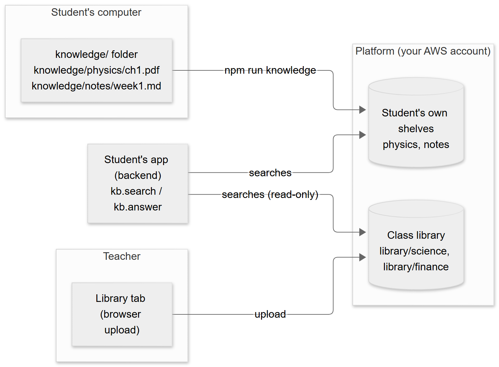
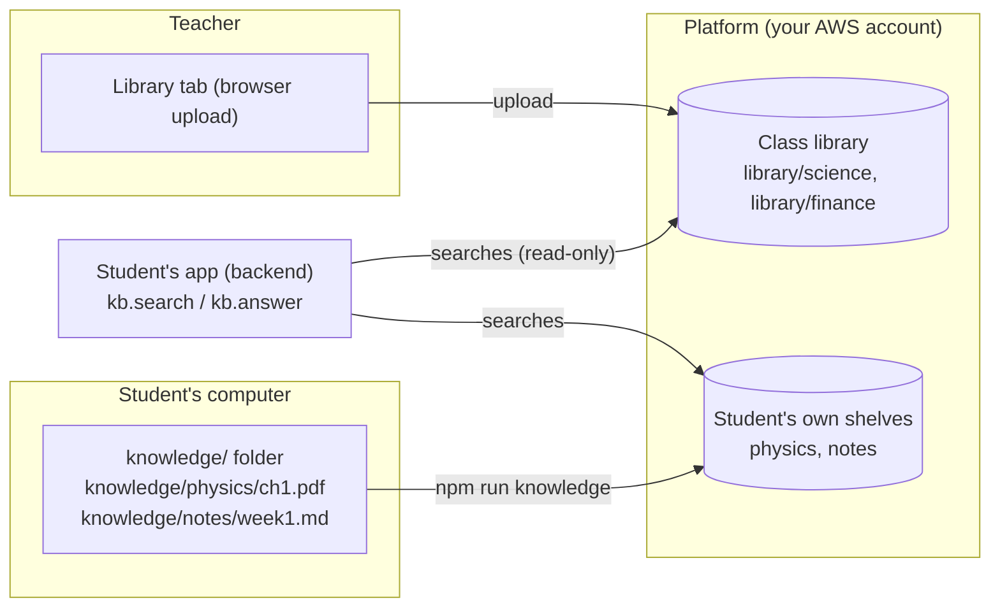
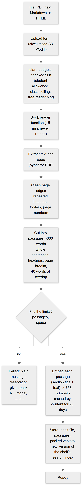
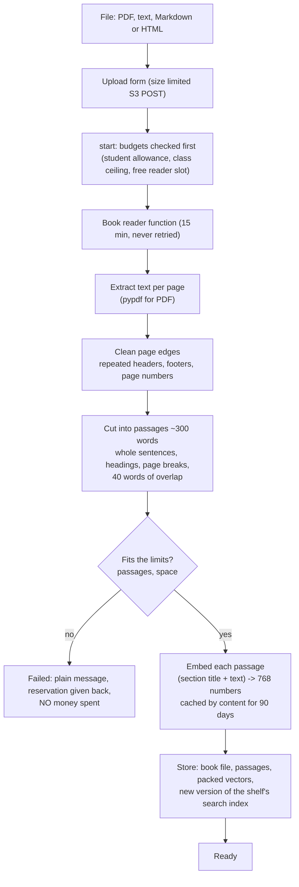
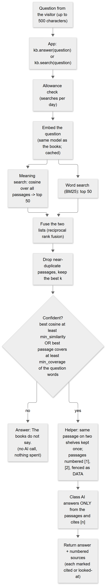
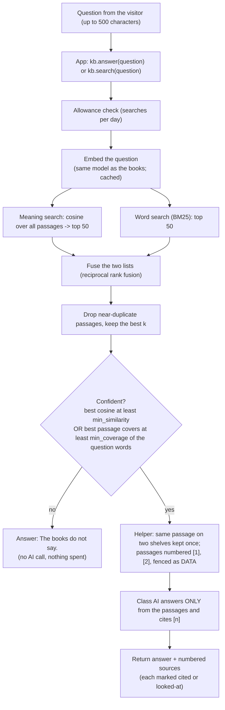
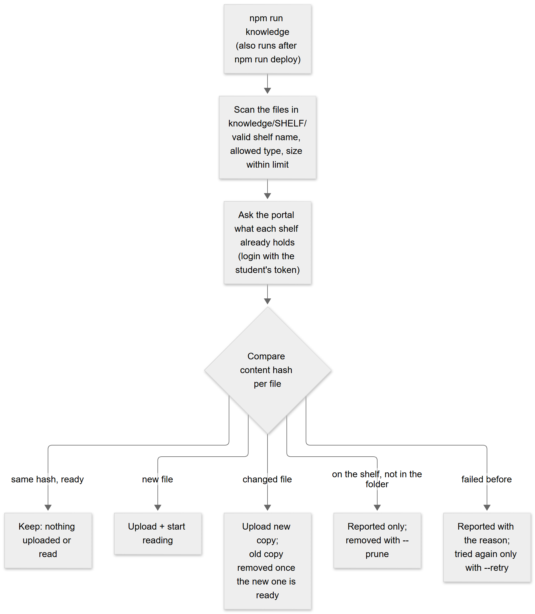
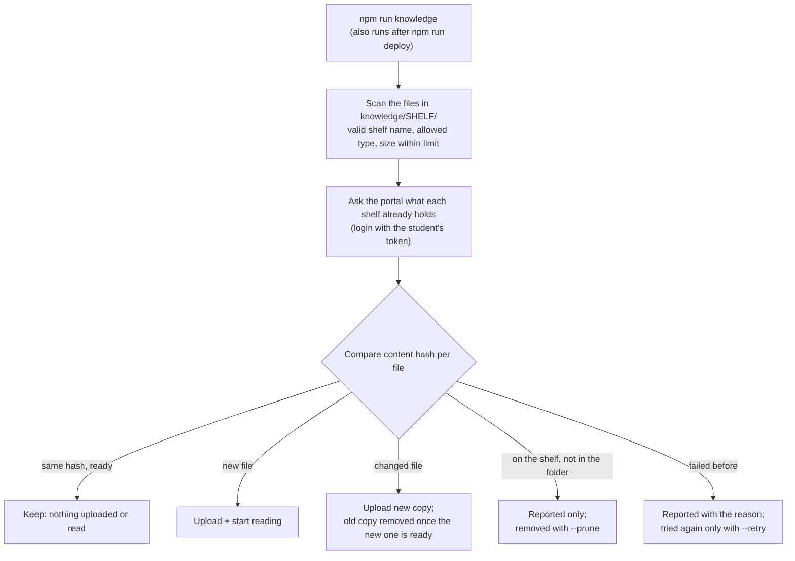

# RAG guide: how class knowledge works, how to tune it, and for which domains

> **Companion document** to [KNOWLEDGE_CONNECTOR.md](KNOWLEDGE_CONNECTOR.md) (limits, permissions, API) and `starter/template/PATTERNS.md` (how a student's app uses it). This guide explains the **whole pipeline in plain words**, what you can configure **today**, how to **tune quality for a domain** (school books, medical, finance, legal, manuals), and what is **not built yet**. Everything stated as a fact is checked by the tests named in KNOWLEDGE_CONNECTOR.md; sections marked *Proposal* are not built.

---

## 1. The three words you need: shelf, class library, `knowledge/` folder

| Word | What it is | Who owns it | Who can search it | How books get in |
|---|---|---|---|---|
| **Shelf** | A named group of books that are searched together (for example `physics`). The unit you search and tune. | Either the teacher (class library) or one student | see the next two rows | see the next two rows |
| **Class library** | The teacher's shelves, shared by the whole class. Searched as `library/<shelf>`. **Read-only for students.** | The teacher | **Every student** whose Class knowledge is switched on | The teacher's **Library tab** (upload in the browser) |
| **A student's own shelves** | A student's private shelves. | One student | **Only that student's app** (their backend) | The student's backend code, or the student's **`knowledge/` folder** |
| **`knowledge/` folder** | A folder in the student's **project, on the student's computer**. Not a shelf itself: each sub-folder becomes one of that student's own shelves when `npm run knowledge` runs. | One student | n/a (it is just files until synced) | The student puts files there; `npm run knowledge` uploads them |

So the two things you described are **not** two kinds of shelf. The difference is **who owns the shelf and who can search it**:

- **Shared with every application of the class** = the **class library** (teacher-owned, added in the Library tab).
- **Private to one student's application** = the student's **own shelves**, which a student fills either from code or from the **`knowledge/` folder**. The folder is only a convenient way to get files from the student's computer to that student's own shelves.

A student's app can search **both at once**: `kb.search(question)` with no list searches the student's own shelves and the class library; `kb.search(question, ["physics", "library/science"])` chooses (at most 4 shelves per question).

<!-- diagram:b5b7ba70 -->


<details><summary>Diagram source (Mermaid, editable; GitHub also draws it)</summary>



</details>
<!-- /diagram -->

Another student's app can **not** search your student's own shelves. Only the class library is shared.

---

## 2. Who does what

| Role | Does | Controls |
|---|---|---|
| **Teacher** | Installs the feature, switches it on per student, fills the class library | Limits per student (shelves, books, passages, space, file size, searches, monthly embedding allowance), the class-wide monthly spending ceiling |
| **Student** | Puts books in `knowledge/<shelf>/` (or uploads from code) and builds an app that searches them | Which shelves the app searches, how many passages it asks for, the prompt, the cache |
| **The app** | Calls `search` or `answer`, shows sources, says "The books do not say." when unsure | Nothing about storage or cost |
| **The platform** | Reads, cuts, embeds, stores, searches; enforces limits before spending money | Everything in section 6 (b) |

---

## 3. Workflow A: adding a book (reading and indexing)

<!-- diagram:90dd7206 -->


<details><summary>Diagram source (Mermaid, editable; GitHub also draws it)</summary>



</details>
<!-- /diagram -->

What matters for quality in this workflow:
- **Extraction** decides everything after it. A scanned PDF has no text: those pages are skipped and the book says so (no OCR yet). Tables and equations come out as plain text.
- **Cleaning** removes a header or footer only when it repeats across pages **at the page edges** (first and last two lines), and page numbers like `12`, `(iv)`, `- 7 -`. A line that is repeated in the middle of a page is kept.
- **Chunking** keeps whole sentences, starts a new passage at every heading, and ends a passage at a page break when the page ended with a finished sentence and the passage already has 100 words, so a citation points to one page.
- **Embedding** sees the section title in front of the passage text, which carries the topic that a mid-chapter paragraph does not repeat.

---

## 4. Workflow B: answering a question

<!-- diagram:560fa56f -->


<details><summary>Diagram source (Mermaid, editable; GitHub also draws it)</summary>



</details>
<!-- /diagram -->

Two important behaviours:
- **"Confident" is a gate, not a score.** It is true when the **best similarity anywhere in the shelf** is at least `min_similarity` **or** the **best passage contains at least `min_coverage` of the question's words**. When it is false, `answer()` replies "The books do not say." **without calling the AI**.
- **Passages are data, never instructions.** They are fenced and the AI is told to ignore any instruction written inside them.

---

## 5. Workflow C: the `knowledge/` folder sync

<!-- diagram:227141f4 -->


<details><summary>Diagram source (Mermaid, editable; GitHub also draws it)</summary>



</details>
<!-- /diagram -->

Commands: `npm run knowledge` (sync), `-- --dry-run` (plan only), `-- status`, `-- --wait`, `-- --prune`, `-- --retry`. The folder is git-ignored by the kit. Shelves that are not folders (for example one a backend creates) are never touched.

---

## 6. Configuration reference

**There is no single configuration file today.** Settings live in four places. This table says where, so you know what you can change now.

### (a) What you can change today

| Setting | Default | Where | Effect | Change when |
|---|---|---|---|---|
| Class knowledge on/off per student | off | Teacher page, student's card | The student's app can search and add books | Per student |
| Shelves, books, passages per student | 5, 20, 5,000 | Same card, "Edit limits…" | Hard caps, checked before any money is spent | A student has bigger or many books |
| Space per student | 50 MB | Same | Books + passages + vectors | Big PDFs |
| Largest file per student | 25 MB (max 50) | Same | Refuses larger uploads | Large scanned/illustrated PDFs |
| Searches per student | 500 per day | Same | Search allowance | A busy app |
| Adding-books allowance | 2,000,000 tokens a month | Same | Embedding tokens per month (a 400-page book is roughly 200,000) | Many books |
| Class-wide monthly ceiling | $3 | Stack parameter `KnowledgeMonthlyCapUsd` (`setup` / `plan`) | New books stop being read for the **whole class** when reached; searching continues | Your budget |
| Embedding model and vector size | `gemini-embedding-001`, 768 | Stack parameters `KnowledgeEmbeddingModel`, `KnowledgeEmbeddingDims` | Applied to **new** shelves; a shelf keeps the model it was created with | Switching provider (`google/gemini-embedding-001` through OpenRouter keeps vectors compatible) |
| Which shelves the app searches | all it can see | Student's code (`BOOKS` in `study.py`) | Scope of every search; **never take it from the visitor** | Per app |
| Passages asked for | 5 (`search`), 4 (`answer`) | Student's code (`k`, 1 to 10) | More context vs more noise and cost | Answers that miss a second fact |
| Prompt wording | helper default | Student's code (`system=`) | Tone, language, format of the answer | Per app |
| Answer cache lifetime | 7 days | Student's code (`days=`) | Repeat questions cost nothing | Content changes often |
| What goes in a shelf | the folder | Student's `knowledge/<shelf>/` | The books | Always |

### (b) Built-in values (change the platform code, then `plan` and `apply`)

| Value | Default | Where in the code | What it does | Change when |
|---|---|---|---|---|
| Passage length / overlap / minimum / page-break | 300 / 40 / 40 / 100 words | `knowledge_core.chunk_pages` | Size of the unit that is retrieved | Long legal clauses, short FAQ answers, dense tables (smaller or larger passages) |
| `min_similarity` | 0.55 | `knowledge_store.DEFAULT_THRESHOLDS` | The meaning-search confidence gate | **Per domain and per embedding model** (section 8) |
| `min_coverage` | 0.6 | same | The word-overlap confidence gate | Same |
| Candidate pool per search | 50 | `knowledge_core.hybrid_search` | How many passages each search method proposes before fusion | Very large shelves |
| Word-search settings (BM25 `k1`, `b`) | 1.5, 0.75 | `knowledge_core.bm25_scores` | Keyword weighting | Rarely |
| Fusion constant / weights | 60, equal | `reciprocal_rank_fusion` | How meaning and keyword rankings are mixed | If one method is clearly better for your domain |
| Near-duplicate rule | 90% word overlap | `_near_duplicate` | Removes repeated passages | Rarely |
| Stop words and stemming | English | `knowledge_core.STOPWORDS`, `stem` | What counts as a word | **Other languages, jargon** |
| Header/footer cleaning | page edges only | `clean_pages` | What is dropped as repeated furniture | Books with unusual layouts |
| Limits per file | 50 MB, 1,500 pages, 6,000 passages | `knowledge_ingest` | Refuses oversized files | Huge manuals (split them) |
| Class library caps | 20 shelves, 200 books, 60,000 passages, 1,000 MB, 50 MB per file | `knowledge.LIBRARY` | Teacher-side caps | A large library |
| Books read at once | 2 | environment value `KNOWLEDGE_WORKERS` (default in code) | Protects the account's few concurrent Lambda runs | Only with a raised Lambda concurrency |
| Question length / shelves per question | 500 characters / 4 | `knowledge.py` | Input limits | Rarely |

### (c) Not built yet (and why it matters to you)
- **A per-shelf settings file.** The platform *stores* `min_similarity` and `min_coverage` for each shelf, but **nothing sets them**: every shelf uses the defaults. Chunk size is not per shelf either. This is the first thing to build for non-school domains (see section 12).
- Domain **presets**, custom **stop words and synonyms** (for example "MI" = "myocardial infarction"), a **re-ranker**, **table-aware** extraction, **OCR** for scanned pages (a hook exists, not switched on), **metadata filters** (date, document type), **multilingual** word search, an in-product **evaluation screen**.

---

## 7. Cost model

| Step | Cost | Notes |
|---|---|---|
| Reading a book | about **$0.15 per million tokens** | A 400-page textbook is roughly 200,000 tokens, a few US cents, **once** (cached by content for 90 days, so re-adding costs about nothing) |
| A search | a fraction of a cent per thousand | Only the question is embedded (cached) |
| An `answer()` | one class-AI call | Skipped completely when the books do not say |
| Idle | about nothing | No server, no vector database |

Cost guards, in order: the shelf limits (before any spending) → the student's monthly allowance → the class-wide ceiling → at most 2 books read at once.

---

## 8. Tuning playbook (works for any domain)

### 8.1 Measure first, change second
1. Write **15 to 30 real questions** for the shelf, from the people who will use it, with the page (or a phrase) that answers each. Add **10 questions the books must NOT answer**, including near-misses ("What is the dose for adults?" when the book covers children only).
2. Run them: `quality.evaluate_retrieval(cases, collections=["your-shelf"], k=4)` (recall, MRR, refusal rate and which cases failed) and `npm run eval` for the full answer path.
3. Read three numbers: **recall** (is the right passage in the top k?), **MRR** (how high is it?), **refusal** (does it say "do not say" when it should?).
4. Change **one** thing, run again, keep a note of the numbers.

### 8.2 Symptom → cause → what to change

| Symptom | Likely cause | Change |
|---|---|---|
| Right book, answer says "The books do not say." | Threshold too strict, or the question's words differ from the book's | Lower `min_similarity`/`min_coverage` slightly; add synonyms (proposal); check the evaluation |
| Wrong or invented answers for unrelated questions | Threshold too loose, or the prompt allows guessing | Raise thresholds; keep "answer only from the passages"; check sources |
| Right page, but the answer misses a detail | Passage too short/long, or `k` too small | Raise `k` to 5 or 6; change passage length (built-in) |
| A heading or label is missing from the answer's evidence | The label is in `section`, not in `text` | Show `section` with each passage (the starter's agent tool does) |
| Several results are the same text | The same book on two shelves | Already de-duplicated by the helper; remove the duplicate shelf |
| Numbers, units, drug names not found | The word search treats them as ordinary tokens; abbreviations differ | Synonym/jargon lists (proposal); put both forms in the book's glossary |
| Table answers are wrong | Tables extract as flat text | Provide the table as text/Markdown; table-aware extraction is not built |
| Scanned book is empty | No text layer | Use a text version; OCR is not switched on |
| Answers are right but slow | Cold start of the search function, first AI call | Normal first call; repeat is cached |
| Whole class stopped adding books | Monthly ceiling reached | Raise `KnowledgeMonthlyCapUsd` or wait for next month |

### 8.3 Calibrating the confidence thresholds
Thresholds depend on the **embedding model and the domain**, so calibrate on your own questions.
1. Run all answerable and all unanswerable questions through `search` and note the top hit's `vector` (cosine) and `coverage`.
2. Choose `min_similarity` **between** the highest value of the unanswerable questions and the lowest value of the answerable ones.
3. In a first real test on a school textbook, answerable questions scored about **0.63 to 0.66** and unrelated ones about **0.49**; the default **0.55** sits between them. In another domain the two groups can sit at different values.
4. **Direction of the error matters.** For medical, financial or legal material, prefer **refusing too often** to answering wrongly: raise the thresholds, keep a human in the loop, and always show sources.

> Today the thresholds cannot be set per shelf (section 6 c). Until the settings file exists, calibrate on paper and keep the numbers: they are what the file will carry.

---

## 9. Domain notes

| Domain | What helps | What to watch |
|---|---|---|
| **School textbooks** | Default settings work; keep chapter headings; add a glossary shelf | Questions that need several chapters (raise `k`); scanned pages |
| **Medical** | Short, well-sectioned guidelines; abbreviations glossary; **always show sources and a "not medical advice" line**; stricter thresholds | Abbreviations (MI, BP), units and doses in tables, **conflicting versions/dates**, **never put patient data in a question or a book**: prompts go to the AI provider. A person must review anything that affects care |
| **Finance** | Dated documents with the date in the filename or heading; keep one version per shelf; stricter thresholds | Numbers in tables, rates that change, **no personal account data**; answers are **information, not advice** |
| **Legal / policy** | Clause-sized passages (shorter), exact quotations with page and section | Cross-references between clauses, versions; the answer must quote, not paraphrase |
| **Technical manuals / FAQ** | Short passages (FAQ), headings per procedure | Step lists split across pages; product versions |
| **Notes written by students** | Markdown with headings | Quality varies; use one shelf per subject |

General rules for any domain: **one topic per shelf**, **one version of a document per shelf**, headings in the source, files with real text (not scans), and an evaluation set kept next to the shelf.

---

## 10. Failure modes and what the app sees

| Message kind | Meaning | What to do |
|---|---|---|
| `not_enabled` | The teacher has not switched Class knowledge on | Ask the teacher |
| `allowance_used` | Searches or adding-books allowance used up | Resets by itself; or raise the limit |
| `class_budget` | The class reached the monthly ceiling | Wait, or raise the ceiling |
| `quota_exceeded` | Shelf is full (books, passages or space) | Remove a book |
| `too_large` / `unsupported` | File over the limit, or not PDF/text/Markdown/HTML | Split it, convert it |
| `busy` | Other books are being read | Retry in a few minutes |
| `failed` (with the reason) | The book could not be read (for example no text) | See the message; `--retry` after fixing |
| `confident: false` | The books do not seem to answer | Show "The books do not say."; do not guess |

---

## 11. Security and privacy
- A student's shelf key is **never** given to the browser or shown to the teacher; the student's function holds it. The folder sync uses the student's login with the portal instead.
- The platform builds every storage path itself from the login, so one student cannot name another's shelf. The class library is read-only for students.
- The teacher sees **counts and sizes**, never what a student stored.
- Books are stored in your AWS account only (`knowledge/` in the sites bucket, never served by CloudFront).
- **Book text and questions go to the AI provider** when an answer is generated, and passages to the embedding provider when a book is read. Do not add confidential or personal material.
- Copyright is the teacher's and the student's responsibility. The kit git-ignores `knowledge/` so books are not pushed to a public repository.

---

## 12. Proposal (not built): a shelf settings file
*The plan for all settings, including this one, is [CONFIGURATION_PLAN.md](CONFIGURATION_PLAN.md); this section keeps the draft contents.* One small file per shelf is proposed, kept with the books, kept with the books and read by the platform when the shelf is synced:

```
knowledge/physics/shelf.json        (a student's own shelf)
Library tab -> shelf settings       (the class library, set by the teacher)
```

Possible contents (names are a draft):
```
{
  "domain": "textbook",           // a preset: textbook | medical | finance | legal | faq | notes
  "passage_words": 300,           // overrides the preset
  "overlap_words": 40,
  "min_similarity": 0.55,         // the calibrated confidence gate
  "min_coverage": 0.6,
  "k": 4,                         // how many passages answer() uses
  "synonyms": { "MI": ["myocardial infarction", "heart attack"] },
  "notes": "Cardiology guidelines 2025; reviewed by Dr X"
}
```
Rules I would apply: a student can only move values **inside safe ranges** that the teacher allows; the class library's settings are the teacher's; changing chunk settings **re-reads the shelf** (it costs embeddings once, so it is shown first); thresholds apply at once (no re-reading). It would also give the **evaluation screen** a home: the teacher page shows recall, MRR and refusal for a shelf next to its settings.

---

## 13. Where the code is

| Part | File |
|---|---|
| Cleaning, chunking, BM25, vectors, fusion, confidence, evaluation | `lambda/knowledge_core.py` |
| Embedding client (Google, OpenRouter), cache, cost | `lambda/embeddings.py` |
| Storage layout, index versions, warm cache, search | `lambda/knowledge_store.py` |
| PDF and text reading (vendored `pypdf`) | `lambda/knowledge_ingest.py` |
| Switch, limits, key, API rules, student and library routes | `lambda/knowledge.py`, `knowledge_api.py`, `knowledge_worker.py` |
| Student helpers | `student/class_knowledge.py` / `.mjs`, `class_quality.py` / `.mjs` |
| Folder sync | `starter/template/tools/knowledge.mjs`, `student/portal-deploy.mjs` |
| Teacher page | `web/teacher.js` (Class knowledge card, Library tab) |

## 14. Glossary
- **Passage (chunk):** the piece of a book that is retrieved, about 300 words, with page and section.
- **Embedding:** a list of 768 numbers that captures a passage's meaning; two texts with similar meaning have similar numbers.
- **Cosine similarity:** how alike two embeddings are (1 = same meaning, near 0 = unrelated).
- **BM25:** a classic word-matching score (rare words that appear in a passage count more).
- **Hybrid search / fusion:** meaning search and word search run separately and their rankings are merged.
- **Confident:** the gate that decides whether the books seem to answer the question.
- **Recall@k / MRR:** is the right passage in the top k results / how high is it on average.
- **RAG:** retrieval-augmented generation: find the right passages first, then let the AI answer **only** from them.
