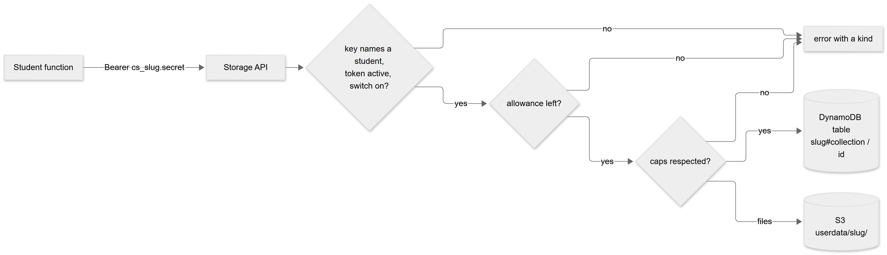
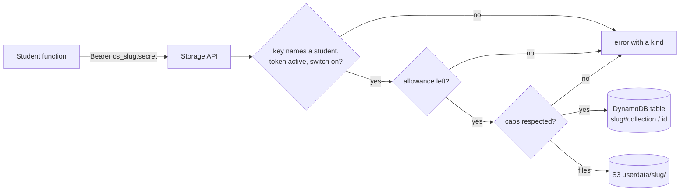

# Class storage connector: a small database and file area for student backends

> **Companion document.** The source of truth for this release is [TECHNICAL_SPECIFICATION.md](TECHNICAL_SPECIFICATION.md) (section 4.14); if the two disagree, the specification wins. Its numbers are checked against the code by `tests/test_spec.py`.

An optional feature. The teacher can give a student's **backend** a private, size-capped **database** (small JSON records) and **file area**, with no accounts, keys or setup on the student's side. It exists because apps need to remember things (scores, notes, a guestbook, uploaded pictures) and students otherwise end up inventing external services.

## 1. At a glance

| | |
|---|---|
| What | Per student: records in a collection (up to 64 KB each) and files (up to 5 MB each), reached through one helper, `class_storage` |
| Who controls it | The teacher, per student: on/off, database size, file space, operations allowance. **Off by default** |
| Isolation | The student's function holds an opaque key; the storage API works out the owner from it and builds every database key and S3 key itself. A student cannot name anyone else's data |
| Cost control | On-demand DynamoDB (idle costs nothing), hard caps on bytes, items, file space and file count, an operations allowance, a throttled API of its own |
| Not included | SQL, queries other than "list by id", per-visitor logins, backups of student data beyond S3 versioning (30 days for files) and DynamoDB point-in-time recovery is **not** enabled on the data table |
| Never built | RDS or any always-on database server (about 20 to 50 times the cost of everything else here, needs a private network, and one server would be shared) |
| Code | `lambda/storage.py` (rules), `lambda/storage_api.py` (the API), small hooks in `portal.py` and `backends.py`; helpers `student/class_storage.py`, `student/class_storage.mjs` |

## 2. How a request flows

<!-- diagram:1fb62429 -->


<details><summary>Diagram source (Mermaid, editable; GitHub also draws it)</summary>



</details>
<!-- /diagram -->

1. The student's function calls the helper; the helper calls the Storage API with the key the platform put in its environment.
2. The API checks the key (constant time), that the token is active and that the teacher's switch is on.
3. It takes one operation off the allowance (an atomic counter, so parallel callers cannot overshoot).
4. For a write it **reserves** the bytes and the item against the caps first, then writes, and gives the reservation back if the write fails.
5. For files it returns a one-time upload form (a presigned S3 POST limited to the declared size and content type) or a five-minute download link. The bytes never pass through a Lambda.

## 3. Limits (defaults; the teacher can change the first three per student)

| Limit | Default | Maximum |
|---|---|---|
| Database size | 5 MB | 100 MB |
| File space | 50 MB | 500 MB |
| Operations allowance | 10,000 per day | 1,000,000 per day, month or in total |
| One record | 64 KB | fixed |
| Records per student | 5,000 | fixed |
| One file | 5 MB | fixed |
| Files per student | 100 | fixed |
| A list answer | 100 records or about 400 KB | fixed (use `after` for the next page) |

Every read, write, list and file call is one operation. Names: collections are lowercase letters, digits, `-` and `_` (up to 40); ids are letters, digits, `.`, `-`, `_` (up to 128); file names have no folders (up to 100).

## 4. For the teacher

1. **Deploy once with the feature on** (see section 6). Nothing changes for anyone until you switch a student on.
2. On the teacher page each student row gets **Storage: off/on** and **Storage caps...**. Switching on creates the student's key, writes `CLASS_STORAGE_URL` and `CLASS_STORAGE_KEY` into their function (or into the function when it is first created) and shows their usage on the row. Switching off stops all access at once; the data is kept and is served again when you switch back on.
3. A revoked, expired or offline token pauses the student's storage automatically.
4. **Clear storage...** (in the student's details, or **Clear...** on the Storage tab) empties what the student stored: records, files or both. You type the student's name to confirm. The key, the switch and the caps stay. The **Storage** tab shows the whole class: how much is stored, who is near a cap, and students marked **Needs cleanup** (no longer using storage but still holding data, for example a revoked student). Nothing is deleted automatically.
5. **You never see what a student stored.** The portal shows sizes and counts only; no route returns a value, a file name or a key. This is deliberate: students can keep notes and uploads private from the teacher as well as from each other, and the teacher cannot leak what they cannot read.
4. The student sees the limits and their usage on their Backend card, with a code example in their language.

## 5. For the student (what the helper does)

```python
import class_storage as storage

storage.put("scores", "alice", {"points": 3})
storage.get("scores", "alice", default=None)
storage.items("scores")                          # newest ids last; pass after=<last id> for more
storage.delete("scores", "alice")

storage.files.put("photo.png", image_bytes, "image/png")
storage.files.url("photo.png")                   # a 5-minute link, good for 
```

Node: `import * as storage from './class_storage.mjs'` with `await storage.put(...)`, `get`, `items`, `del`, `files.put/list/url/delete/uploadUrl`. Errors are `StorageError` with a `.kind` (`not_enabled`, `allowance_used`, `quota_exceeded`, `too_large`, `token_inactive`, `bad_request`, `unavailable`, `bad_key`) and a friendly message: return it to the page as HTTP 503.

Honest limits to tell students: there is no SQL; two writers at the same moment overwrite each other (last write wins); every visitor of the site can call the student's routes, so validate input and never store secrets or other people's personal data; records are ordered by id, so choose ids that sort the way the app needs (for example a date prefix).

**On the student's computer** the helper keeps everything in the git-ignored `.class-storage/` folder with the same rules, so `npm run dev` works offline and costs nothing.

## 6. Turning it on (owner)

> **Status:** deployed to production on 2026-10-24 and verified live (`python tests/live_smoke.py`, section J: key isolation, data, quotas, a real presigned upload and download through S3 with its CORS headers, S3 refusing an oversized file, the off switch). The steps below are how it was done and how to repeat it on another stack.

```bash
sam build
sam deploy --parameter-overrides <your existing overrides> StorageEnabled="true"
```

This creates `StudentDataTable` (kept if the stack is deleted), `StorageApi`, `StorageFunction` and, when alerts are configured, the `storage-errors` alarm; it adds a CORS rule so a browser can POST an upload to, and GET a download from, the bucket with a presigned link; and it gives the portal function the storage address (`STORAGE_URL`). Then `node admin.mjs portal-publish` (the student kit now contains the helper) and, optionally, a live smoke test. **Do not set `StorageEnabled` back to `false` while students hold data**: the table is retained but nothing serves it.

## 7. Cost (rough, check the AWS price page for your region)

DynamoDB on-demand is billed per request and per GB-month; S3 per GB-month and per request; API Gateway and Lambda per request. With the default caps a student stores at most 5 MB of records and 50 MB of files, so even 100 active students stay well below a few dollars a month, and an idle class costs close to nothing. The risk is not normal use but a runaway loop: the per-student allowance (10,000 operations a day by default) and the API's own throttle (20 requests a second account-wide for this API) bound it, and an unhandled-error alarm watches the function. Review the AWS Budget you already have; no new budget is needed.

## 8. Security

| Concern | Control |
|---|---|
| One student reading another's data | Keys are built server-side from the caller's own key; the key cannot name another slug; tested with the same collection and id for two students |
| Key theft | The key is only in the student's function environment (like the AI key); it is never in any API view or log; it stops working when the token is not active or the teacher switches storage off |
| Reaching the tables directly | No student role has any DynamoDB or S3 permission; only `StorageFunction` does, and only for its two tables and `userdata/*` |
| Oversized or hostile input | Size limits on value, body, file and name patterns; the presigned POST carries the size and content type; listing counts bytes |
| Bucket exposure | Public access stays blocked; CloudFront never serves `userdata/`; downloads are short-lived signed links; the CORS rule allows POST and GET but access still needs a valid signature |
| Cost abuse | Caps, allowance, throttle, retained on-demand billing |
| Teacher access | The teacher can switch, resize and clear, never read. The portal's function can find and delete a student's items but not read or write one (verified by IAM simulation in the live test) |
| Residual | A student's own code can leak its own data to its own visitors; data is not encrypted per student (it is encrypted at rest by AWS defaults); there is no per-student backup of the database |

## 9. Testing

`tests/test_storage.py` (the teacher switch, isolation, quotas that cannot be overshot, rollback on a failed write, allowance, lifecycle, files, no key in any response), `tests/test_class_storage.py` and `.mjs` (both helpers against the real API over HTTP: every error kind, multipart upload with the file last, the local folder), `tests/test_kit_e2e.mjs` (a deployed backend saves and lists through the whole path, then the Node variant), and `tests/test_template_storage.py` (off by default, IAM scoping, retained table, private bucket).
