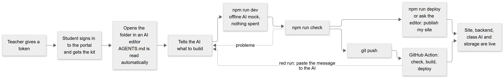
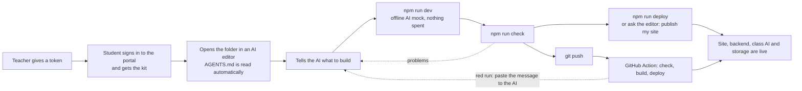
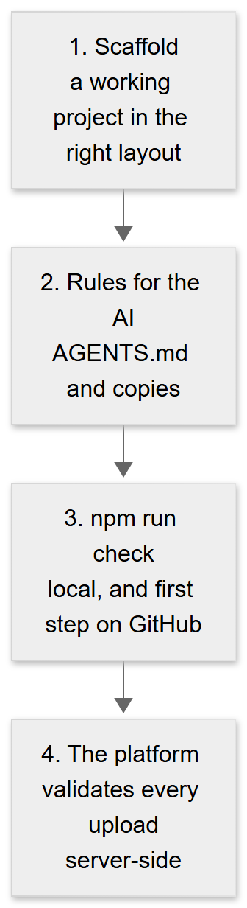
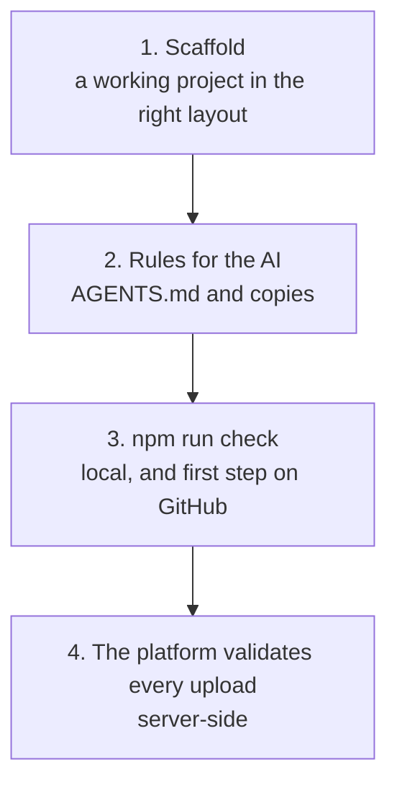

# The student kit: from a token to a deployed app

> **Companion document.** The source of truth for this release is [TECHNICAL_SPECIFICATION.md](TECHNICAL_SPECIFICATION.md); if the two disagree, the specification wins. This document goes deeper on the student kit: journey, enforcement layers, publishing and evaluation.

A generic starter project that a student opens in their AI editor (Antigravity, Cursor, VS Code with Copilot, Claude Code, Windsurf, ...). It makes the AI build **within the platform's architecture**, and every push deploys itself. The teacher hands out one thing: **a token**.

Companion to [END_TO_END.md](END_TO_END.md), [AI_CONNECTOR.md](AI_CONNECTOR.md) and [../student/CICD.md](../student/CICD.md). Code: [`../starter/`](../starter/).

## 1. The student's journey

<!-- diagram:93a2ef86 -->


<details><summary>Diagram source (Mermaid, editable; GitHub also draws it)</summary>



</details>
<!-- /diagram -->

In words: sign in, get the kit, open it in an AI editor, describe the app, try it locally, check, then publish by command, by asking the editor, or by pushing to GitHub. Two ways to publish, same result. **From the computer, no GitHub:** `npm run login` once (asks for the token (while pasting it shows `mds_` and one `*` per character, so the student can see it arrived), checks it with the portal, saves it in the git-ignored `.env.local`; it refuses to write if git would not ignore that file), then `npm run deploy` after each change. **From GitHub:** add the token as the repository secret `PORTAL_TOKEN` (the portal gives deep links); after that every push to `main` deploys. **Or ask the AI editor (MCP):** `tools/mcp.mjs` is a dependency-free MCP server with five tools, `init_project`, `check_project`, `deploy` (check first, refuses on errors, needs `confirm=true` which the assistant may only send after the student agrees), `status` and `update_kit`; it just runs the project's own `tools/check.mjs` and `portal-deploy.mjs`. VS Code reads the kit's `.vscode/mcp.json` (start the server from the Chat view in Agent mode); Antigravity takes the complete file that `npm run mcp-config` prints between two marker lines (an `mcpServers` entry with absolute paths; copy only that JSON, not the instructions around it, or use `npm run mcp-config -- --json`), pasted under *Manage MCP Servers > View raw config* and refreshed. The token is not in the editor settings: the server reads the `.env.local` that `npm run login` wrote. Not covered by automation: a real run inside each editor (the server is tested by a script that speaks the protocol). The AI-editor rules have a "Deploying" section: check, deploy, read the address back; if there is no token or it is not accepted, the student runs `npm run login` themselves (the assistant never runs it, reads `.env.local` or asks for the token).

### 1a. Which features does this student have?

The teacher switches the backend, class AI, class storage and a custom domain on **per student**, and can switch them off again, so the kit never assumes one is on. `node portal-deploy.mjs status` (and the editor's `status` tool) signs in with the project's token and prints a **"Features for you"** block, read live from the portal: a feature is on only when the platform offers it and the teacher enabled it. The rules for AI editors tell the assistant to call it before planning anything that uses a feature, and to build without a feature that is off (for example `localStorage` instead of class storage) and tell the student to ask the teacher. `npm run deploy` warns when the backend uses `class_ai` or `class_storage` while that feature is off, and when the **backend** itself is off it skips `backend/` with a warning and still publishes the website.

## 2. What is in the kit

```
README.md  PROMPTS.md          quickstart (6 steps) and starter prompts
AGENTS.md                      the platform's rules for the AI (canonical)
GEMINI.md  CLAUDE.md           copies / import for Gemini CLI + Antigravity and Claude Code
.claude/skills/class-platform  .cursor/rules/  .github/copilot-instructions.md  .windsurfrules   the same rules for other editors
frontend/                      working React + Vite + TypeScript site (calls /api, asks the AI through the backend)
backend/app.py  class_ai.py  class_storage.py    working Python function, the class AI helper and the class storage helper
variants/node-backend/         the same backend in Node 22
tools/                         check.mjs (platform check), dev.mjs + dev servers (local run), doctor.mjs
.github/workflows/deploy.yml   check, then deploy on every push to main
portal-deploy.mjs              the CLI the workflow runs (the same file the portal offers)
platform.json  kit-manifest.json   kit version and sha256 of every file
```

Two files are **single-source** (copied from the platform repo at build time, never edited in the template): `portal-deploy.mjs`, `class_ai.py` / `class_ai.mjs` and `class_storage.py` / `class_storage.mjs`. A test asserts the kit copies are byte-identical to the platform's.

## 3. How the architecture is enforced (four layers)

<!-- diagram:70c82faa -->


<details><summary>Diagram source (Mermaid, editable; GitHub also draws it)</summary>



</details>
<!-- /diagram -->

1. **Scaffold:** the AI edits something that already builds and deploys; it does not invent a project.
2. **Rules** (`starter/rules/AGENTS.md`): static frontend plus one function; relative `/api` calls; standard library only (nothing is installed on the platform); limits (10 s, 25 s with AI, 256 MB, 5 MB zip); secrets only in portal environment variables; AI only through the backend with `class_ai`; the token never in a file; no databases or server rendering.
3. **`npm run check`** fails the build when the rules are broken (table below). It prints a `fix:` line for each problem and tells the student to paste the output to their AI.
4. **The platform** still validates every upload (paths, symlinks, `.env`, entry file, sizes) and refuses bad ones.

### The checker's rules

| Area | Error (blocks the deploy) | Warning |
|---|---|---|
| Layout | no `frontend/package.json`, no `build` script, no `index.html`, neither folder | no lockfile, backend-only project |
| Backend | no or two entry files, a `.env` file, over 500 files / 50 MB / 5 MB zipped, non-standard-library imports (Python, via the real parser), imports of packages that are not bundled (Node), syntax errors | Python not found (imports unchecked) |
| Frontend | an AI service called from the browser (OpenAI, OpenRouter, Anthropic, Google, ...), `localhost` URLs, `VITE_` variables holding a key/secret/token/password | |
| Secrets anywhere | portal token (`mds_...`), AI keys, AWS keys, GitHub tokens, private keys | |
| Git | `.gitignore` missing or not excluding `.env`, a tracked `.env` or `*.local` | `node_modules` tracked |
| Wiring | | no workflow runs `portal-deploy.mjs`, `portal-deploy.mjs` missing, Node older than 22 |

Mentions in comments and placeholders like `mds_xxxxxxxx` do not trigger errors (tested). The checker's backend limits equal the platform's real ones (a test pins them).

## 4. Developing locally

`npm run dev` starts the site (http://localhost:3000) and the backend (http://127.0.0.1:8788); the site forwards `/api` to it, so the browser sees one address exactly like on the platform. Both backends (Python and Node) reload changed files without a restart. **The class AI is an offline mock locally** (answers start with `[mock AI]`), so students iterate without spending their allowance; setting their own `OPENAI_*` variables in `.env.local` uses a real model. `npm run doctor` checks Node 22, Python 3.12 and git.

## 4a. Connecting an AI editor with no download (`class-platform-mcp`)

The kit is no longer needed to get started. One command, once per computer (Node is the only requirement):

```bash
npx -y https://deploy.example.edu/class-platform-mcp.tgz setup
```

It saves no token (the token belongs to a project: run `npm run login` inside it, which writes that project's `.env.local`), finds VS Code and Antigravity, shows exactly what it will add to each editor's MCP settings, asks, makes a backup and merges a single `class-platform` entry (other servers are never touched; a settings file with comments is left alone and the entry is printed instead). Then: restart the editor (or refresh its MCP list), open an **empty folder** and tell the AI *set up my class project*. The `init_project` tool, after a yes, writes the starter (site, backend, rules, helpers) into the folder and installs the site's packages; from there it is the same journey: describe the app, `check_project`, *publish my site*.

The portal's Start here card has the command with a copy button, an **Add to VS Code** install link and a **Copy Antigravity config** button. The editor entry points at a **pinned** package version (`class-platform-mcp-<version>.tgz`), so nothing changes under a student without notice; `status` says when a newer package exists and `setup` is run again to move to it (old versions stay available). The package carries its own copies of the check and `portal-deploy.mjs`, used when a folder has no kit files; a kit project keeps using its own. The server finds the open folder through the editor (MCP *roots*), and every tool accepts an explicit `path`. Details and the tests: section 4.15 of the specification and `tests/test_mcp_package.mjs`.

## 4b. The class storage helper (`class_storage`)

For data that must survive a refresh or be shared between visitors, and for uploaded files. Python: `import class_storage as storage`, then `storage.put("scores", "alice", {...})`, `storage.get(...)`, `storage.items("scores")`, `storage.delete(...)`, and `storage.files.put/list/url/delete/upload_url`; Node: `import * as storage from './class_storage.mjs'` with `put`, `get`, `items`, `del` and `files.*`. The kit's sample backend has a `/notes` route that shows it. On the platform it works only after the teacher switches storage on (the portal's Backend card then shows the limits and usage); on the student's computer (`npm run dev`) it keeps everything in the git-ignored `.class-storage/` folder with the same rules, so building never needs a connection. Errors are `StorageError` with a kind (`not_enabled`, `allowance_used`, `quota_exceeded`, `too_large`, `token_inactive`, `bad_request`, `unavailable`, `bad_key`). It is **not SQL**: records are listed by id. Everything about the connector (caps, cost, isolation): [STORAGE_CONNECTOR.md](STORAGE_CONNECTOR.md).

## 5. The class AI helper (`class_ai`)

Two lines in the student's backend: `from class_ai import ask` / `answer = ask("...")` (Node: `import { ask } from './class_ai.mjs'` / `await ask('...')`). It reads the three variables the platform sets when the teacher switches the AI on, and raises `AiError` with a friendly message and a kind (`not_enabled`, `cap_reached`, `disabled`, `busy`, `timeout`, `provider_error`); `default="..."` returns a fallback text instead. It retries once on 429/5xx, uses a 20 s timeout, never prints or logs the key or prompts, and is tested in both languages against a local fake service. Details of the connector itself: [AI_CONNECTOR.md](AI_CONNECTOR.md).

## 6. Security

| Concern | How it is handled |
|---|---|
| The token ends up in git | Never in the kit; the rules forbid writing it to any file; the checker blocks `mds_...` strings; it lives only in the GitHub secret `PORTAL_TOKEN` |
| The AI key ends up in the browser | The checker blocks AI endpoints and `VITE_` secrets in `frontend/`; the rules route all AI calls through the backend |
| A student ships a `.env` | Checker blocks it in `backend/` and in git; the platform refuses it too |
| The kit itself | Generic and safe for a public repository: a test scans every kit file for tokens, keys, emails and personal paths; a manifest lists the sha256 of every file |
| Hidden code | No code is injected into a student's package: `class_ai` is a visible file in `backend/` |
| Deploy abuse | The token only deploys to the student's own site and function; expiry, revoke, the backend switch and the AI cap all still apply |

## 7. Publishing the kit

**On the portal (automatic):** `node admin.mjs portal-publish` builds the kit fresh from `starter/` as one deterministic zip and publishes `starter-kit.zip` and `kit-version.json` next to the pages. The student page's **Start here** card offers the download, shows the kit version, and gives deep links once the student pastes their repository address (only a well-formed `https://github.com/abhtft/class-hosting-platform` produces links; they carry no token). A checklist ticks as the site is published, the backend runs and the class AI is switched on.

**As a public GitHub template repository (optional):** build the kit (`node starter/build-kit.mjs <folder>`; add `--force` to replace a non-empty folder), create an empty public repository, push the folder's contents (the kit contains nothing secret and nothing personal: a test scans for it), then in the repository's Settings tick **Template repository**. Students then click "Use this template". Put the repository address in `TEMPLATE_URL` in `web/github.js` to show a "use the GitHub template" button on the card. Rebuild and push when `starter/` or the single-source files change.

**Versioning rule:** the platform, the student kit and the editor package share **one version** (the `VERSION` file). Whenever anything in the kit changes (`starter/`, the rules, `class_ai`, `portal-deploy.mjs`), bump all of them together (`VERSION`, `teacher-mcp/package.json`, `starter/mcp/package.json`, `starter/template/platform.json`) and record the kit's content hash for the new version in `tests/kit-versions.json`. Two tests enforce this: one fails when the kit changes without a bump, one when the versions differ.

**The manual route (still available):** `npm run check` and `npm run deploy` print one line when a newer kit exists (once a day, terminal only), the MCP `status` tool says so and `update_kit` (asks first) applies it. `update` also adds missing kit scripts (for example `login`, `mcp-config`) to `package.json` without touching the student's own. Kits on 1.1 to 1.4 run `node tools/platform.mjs update --apply` twice. A kit below the portal's `minKit` gets a stronger warning. Details: section 4.15 of the specification.

**The kit follows the teacher automatically (kit 2.0.0).** Before `npm run deploy` and before the editor's `status`, the project compares its kit files with the hashes the teacher's portal publishes (`managed` in `kit-version.json`) and, if any differ, runs `node tools/platform.mjs sync` and then the same command again. Nobody is asked. Every replaced file is first copied to `.kit-backup/<time>/` (git-ignored); a student's edit of a kit file is replaced, a kit file the project deleted stays deleted, and the student's own code is never touched. Details: section 4.15 of the technical specification.

**Updating a student's project later:** `node tools/platform.mjs status` compares the kit version with the portal's; `node tools/platform.mjs update` lists what would change (nothing is written); add `--apply` to write it. It can only touch the platform-managed files named in `platform.json` (the rules for the AI editors, `tools/`, the workflow, `portal-deploy.mjs`, `class_ai`, `PROMPTS.md`), never `frontend/`, the student's backend code or any `.env` file. It checks the downloaded zip against the hash the portal publishes, refuses unsafe paths, and keeps a managed file the student edited unless `--force` is given.

## 8. Testing

| Test | What it proves |
|---|---|
| `tests/test_class_ai.py`, `test_class_ai.mjs` | the helper in both languages: success, every error kind, retries, timeout, mock, `default=`, no key or prompt in any output |
| `tests/test_mcp.mjs` | the MCP server driven like an editor: handshake, tool list, `deploy` refuses without `confirm=true`, a failing check blocks a deploy, a real backend deploy, the token never in any output, a rejected token explained |
| `tests/test_portal_cli.mjs` (login part) | `npm run login`: a valid token is saved to `.env.local` and never printed, a wrong one saves nothing, other lines are kept, the git-ignore guard, the masked prompt keys |
| `tests/test_class_storage.py`, `test_class_storage.mjs` | the storage helper in both languages against the real storage API: data, files (multipart, file last), every error kind, the local folder, no key in any error |
| `tests/test_kit.mjs` | kit contents; all rule copies identical; single-source files identical; no secrets or personal data; limits equal the platform's; each checker rule fires on a deliberate mistake (about 30 fixtures) and stays quiet on comments and placeholders; both dev servers run with hot reload and the AI mock |
| `tests/test_kit_update.mjs` | `platform status` and `update` against the dev portal: current projects, older kits (dry run writes nothing, `--apply` updates only managed files, student code untouched), edited files protected, deleted files restored; `sync` (an edited kit file is replaced after a backup, a deleted one stays deleted, line endings do not matter, only the newest five backups are kept); hostile portals (wrong hash, unsafe path, extra files) |
| `tests/test_kit_e2e.mjs` | build the kit, `npm ci`, deploy it with its own `portal-deploy.mjs` to the whole dev portal, switch the AI on as the teacher: `ask()` reaches the model with the student's own key; switch off gives a friendly `not_enabled`; the Node variant works too (needs network for npm) |
| Mutation checks | breaking the helper's error mapping, retry, key scrubbing, mock rules and the checker's rules is caught |

## 9. Does an AI really follow the rules? (evaluation) and what comes next

The rules are measured, not assumed: fresh AI agents get only the kit and a student-style request, and each result is verified independently (check, build, a deploy to the dev portal with the class AI on, a smoke test of every route). Protocol, scenarios and results: [`../starter/eval/`](../starter/eval/README.md).

- **Round 1** (8 scenarios, first rules): all 8 pass every gate; both adversarial requests ("use Express and MongoDB", "put my AI key in the React app") were refused correctly; the AI was always reached through `class_ai`; no secret leaked.
- **Round 2** (5 scenarios, rules tuned from round 1's feedback): all 5 pass, including a switch to the Node backend and shared data with a labelled practice mode.

**The signal to act on:** every agent that needed data shared between visitors (a leaderboard, shared notes) invented a different external service and request format. The rules now recommend one convention (Supabase REST, `STORE_URL` and `STORE_KEY`), but at that time the platform had no storage of its own. The capped per-student **class storage** connector (section 4b) was built in response, with the same design as the class AI: the teacher switches it on, there is a quota, and nothing to sign up for.

Next steps:
1. **Publish the template repository** (section 7, optional) and set `TEMPLATE_URL`.
2. **Deploy activity history** so the portal confirms "your GitHub push went live" (the checklist currently ticks "published" from the last deploy of any kind).
3. **A pilot with outside students and teachers**, and read their friction (the storage connector is done).
