# Class Hosting Platform: Technical Specification (Release 1.0, MVP)

> **This is the main technical source of truth for Release 1.0.** If another document, a comment or a message disagrees with it, this document wins and the other one is wrong and must be fixed. The companion documents ([END_TO_END.md](END_TO_END.md), [API_REFERENCE.md](API_REFERENCE.md), [AI_CONNECTOR.md](AI_CONNECTOR.md), [STUDENT_KIT.md](STUDENT_KIT.md), [STORAGE_CONNECTOR.md](STORAGE_CONNECTOR.md), [MCP.md](MCP.md), [TEACHER_SETUP.md](TEACHER_SETUP.md), [AWS_LEARNINGS.md](AWS_LEARNINGS.md) (a learning guide, not an operating document), [../implement.md](../implement.md), [../learning.md](../learning.md)) go deeper on one area each. Numbers in section 14 are **machine-checked** against the code by `tests/test_spec.py` on every test run.

## 0. Document control

| | |
|---|---|
| Release | **1.0 (MVP)**, baseline date 2026-10-23 |
| Product | Class Hosting Platform: a controlled place where a teacher gives students expiring tokens, and students publish a website, a small backend and (optionally) an AI key, mostly by pushing to GitHub |
| Code base | this repository, branch `feature/custom-domains-and-portal-hosting` (the release baseline is the commit that adds this document; `git log -1` shows it) |
| Production | AWS account of the owner, region `us-east-1`, CloudFormation stack `student-hosting` (status `UPDATE_COMPLETE`), portal `https://deploy.example.edu`, student sites `https://<name>.example.edu` |
| Student kit | version `1.6.0` in the repository (`starter/template/platform.json`); the portal serves what `node admin.mjs portal-publish` last published (the kit zip and `kit-version.json`, the MCP package `class-platform-mcp-<version>.tgz`, the alias `class-platform-mcp.tgz` and `mcp-version.json`). MCP package version `1.0.0` (`starter/mcp/package.json`). **Until `portal-publish` is run the portal still serves kit 1.5.1 and no package** |
| Audience | the owner/operator, future maintainers, anyone reviewing the design or the security |
| Change rule | any change to behaviour, limits, resources or flows updates this document **in the same commit**; the machine-checked block (section 14) fails the test run if a number drifts |
| Changes since the baseline | **2026-10-24.** Documentation diagrams are PNG images with the Mermaid source collapsed beneath (section 7.1). Student kit **1.2.0** (`npm run login`), **1.3.0** (MCP server for AI editors, `npm run deploy` without GitHub described in section 4.15), **1.3.1** (masked token prompt), **1.4.0** (class storage helpers and sample). **Class storage connector** (section 4.14) **deployed to production** on 2026-10-24 (`StorageEnabled="true"`, change set reviewed first: seven resources added, the rest modified in place, nothing replaced) and verified by 27 live checks (section J of `tests/live_smoke.py`); it is off for every student until the teacher switches it on. Kit 1.4.0 and the updated portal pages are published. Local suite is now 36 steps. **Kit 1.6.0 and `class-platform-mcp` 1.0.0, published 2026-10-24:** an AI editor is connected with one `npx` command and no kit download (section 4.15); the token can be saved once for the whole computer; `init_project` creates the starter in an empty folder. **Kit 1.5.0** (student-side sync, section 4.15): a one-line update notice, the MCP `update_kit` tool, `update` adds missing `package.json` scripts, `minKit` in `kit-version.json`, and a written compatibility rule (section 4.11). **Kit 1.5.1** (found in the owner's first real Antigravity run: the printed instructions had been pasted into the JSON config file, and the entry was missing its `mcpServers` wrapper): `npm run mcp-config` now prints a complete file between two marker lines, and `-- --json` prints only the JSON. **Verified in real editors:** VS Code and Antigravity both connected to the MCP server (owner, 2026-10-24). **2026-10-24 (later):** the teacher dashboard was redesigned (summary tiles, student list, a detail panel that opens on click, a Storage tab) and the teacher can now **clear a student's storage** and see **storage across the class** (sizes and counts only; section 4.14), deployed and verified live (110 live checks, including the IAM scope of the portal function). Everything in this row is described in the sections named; the baseline row below is kept as the historical record. |
| Verification state at baseline | 28 local test steps pass (`node tests/run.mjs`, including the specification check), GitHub CI is green, the live smoke test (`python tests/live_smoke.py`) passes 74 checks against production, and the owner tested the full student journey end to end |

### How to read this document

Sections 1 to 3 explain what the system is and how it is built. Section 4 specifies each feature with its flow, rules and errors. Sections 5 to 8 cover APIs, data, limits and configuration. Sections 9 to 11 cover security, quality and operations. Section 12 records decisions and limits of the design, section 13 traces every requirement to code and tests, section 14 holds the machine-checked facts, and the appendices are catalogues.

---

## 1. Product definition

### 1.1 Problem

A teacher wants many students to publish real web projects (a site, a backend, AI features) without each student needing an AWS account, a credit card or deep cloud knowledge, and without the teacher losing control of access, cost and the shared AWS account. Hosted platforms (Vercel, Railway) do not offer per-student expiry, hard usage caps or a teacher-owned off switch.

### 1.2 Goals (MVP)

| # | Goal |
|---|---|
| G1 | A teacher issues **expiring tokens** (1 to 365 days) and can extend, revoke, take a site offline, and approve or deny regeneration requests |
| G2 | A student with a token publishes a **static website** to `https://<name>.example.edu` without any cloud account |
| G3 | A student can have one **custom domain**, only when the teacher allows it |
| G4 | A student can run **one backend function** (Python 3.12 or Node 22) reached at `/api/...` on their own address, with a teacher on/off switch and a **run allowance** |
| G5 | The teacher can give a student's backend an **AI key** with a dollar cap, switched on per student |
| G6 | A student can **push to GitHub and have everything deploy automatically**, using the same token |
| G7 | A **student kit** makes an AI code editor build inside the platform's architecture, checked by tooling before every deploy |
| G8 | The shared AWS account stays safe: protections against runaway use, alarms to the owner, recoverable files, hashed secrets |

### 1.3 Non-goals (not in Release 1.0)

SQL or server databases for students (RDS), server-side rendering, long-running processes, websockets, several teacher accounts, student self-registration, billing, a hard model allow-list for AI, AI streaming, a deploy-activity history, key rotation by button, infrastructure for custom domains inside CloudFormation. Section 12.3 lists them with their status.

### 1.4 Roles

| Role | How they sign in | Can |
|---|---|---|
| **Teacher** | username and password (one account, stored as a salted scrypt hash in SSM) | everything in section 4 on the admin side: tokens, switches, caps, requests |
| **Student** | the token itself | publish, manage their own backend, custom domain, request regeneration, read their AI usage |
| **Visitor** | none | open student sites and call `/api/...` on them |
| **Operator** (the owner) | AWS credentials | deploy the stack, publish the pages, read alarms and logs |
| **GitHub Action** | the student's token stored as the repository secret `PORTAL_TOKEN` | act as that student for deploys only |

### 1.5 Release scope: features and their state

| ID | Feature | State at baseline | Verified by |
|---|---|---|---|
| F1 | Teacher and student sign-in, signed sessions | live | `test_portal.py`, live smoke |
| F2 | Token lifecycle (create, extend, revoke, offline, regenerate, daily sweeper) | live | `test_portal.py`, `test_portal_deploy.py` |
| F3 | Frontend publishing (portal upload and legacy CLI) | live | `test_lambda.py`, e2e steps, live smoke |
| F4 | Static hosting and routing (CloudFront, SPA fallback, wildcard host) | live | router function tests, e2e |
| F5 | Custom domains (CloudFront multi-tenant) | live | `test_domains.py`, `test_tenant_config.py`, live test with a real domain |
| F6 | Student backends (deploy, environment variables, logs, removal) | live | `test_backend.py`, live smoke |
| F7 | Backend gateway (nine checks, response shaping) | live | `test_backend.py`, live smoke |
| F8 | Run allowance and in-flight limiter | live | `test_backend.py` (60 parallel callers), live smoke |
| F9 | Class AI connector (capped per-student keys) | live | `test_ai.py`, `test_template_ai.py`, live smoke section H |
| F10 | GitHub deploy (`portal-deploy.mjs`, workflow templates) | live | `test_portal_cli.mjs`, owner's end-to-end test |
| F11 | Student kit, checker, local dev tools, update command, AI helper | live | `test_kit*.mjs`, `test_class_ai.*`, live smoke section I, AI evaluation |
| F12 | Operations: alarms, versioning, backups | live | `test_template_ops.py`, live alarm test |
| F13 | Portal user interface (teacher and student pages) | live | `test_web.mjs`, browser checks |
| F15 | Student deploy from the computer without GitHub: `npm run login`, `npm run deploy`, an MCP server for AI editors, and the `class-platform-mcp` package (one `npx` command, no kit download) | **live** in kit 1.3.1 and later; the MCP server is tested by a protocol script, **not yet run inside VS Code or Antigravity by the owner** | `test_portal_cli.mjs`, `test_mcp.mjs`, `test_mcp_package.mjs`, `test_kit.mjs` |
| F14 | Class storage connector (capped per-student data and files) | **live** (deployed 2026-10-24; off per student until the teacher switches it on) | `test_storage.py`, `test_class_storage.*`, `test_kit_e2e.mjs`, `test_template_ops.py` |

---

## 2. System architecture

### 2.1 Context

<!-- diagram:1725a57b -->
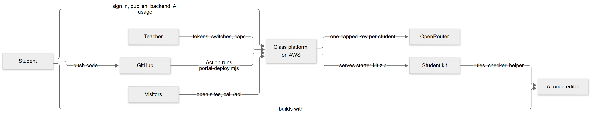

<details><summary>Diagram source (Mermaid, editable; GitHub also draws it)</summary>

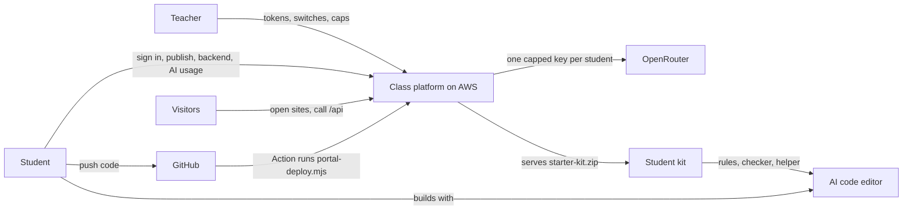

</details>
<!-- /diagram -->

### 2.2 Topology (what runs where)

<!-- diagram:86b4fb82 -->
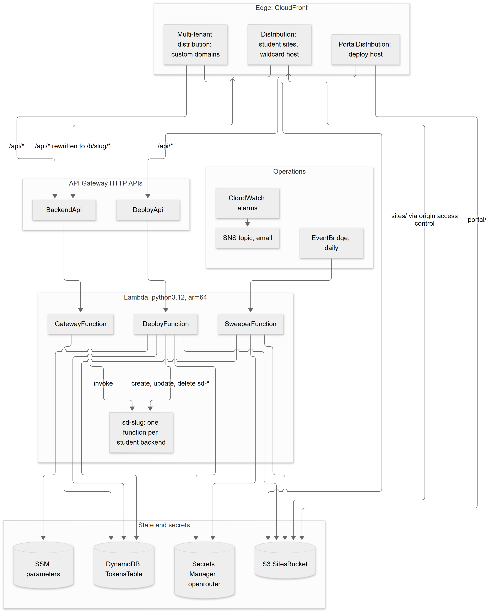

<details><summary>Diagram source (Mermaid, editable; GitHub also draws it)</summary>

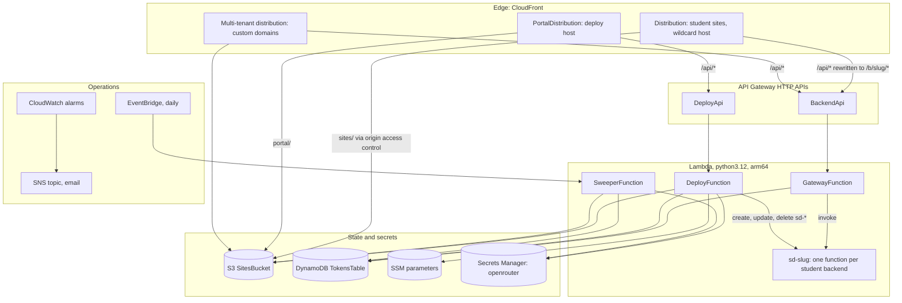

</details>
<!-- /diagram -->

### 2.3 Components (all defined in `template.yaml` unless noted)

| Component | Logical name | Responsibility |
|---|---|---|
| Student-site CDN | `Distribution` + `RouterFunction` | serves `sites/<slug>/` for `<slug>.<RootDomain>`; SPA fallback; `/api/*` to the backend with `BackendRouteFunction` (host to `/b/<slug>/...`, real viewer IP) |
| Portal CDN | `PortalDistribution` + `PortalFunction` | serves `portal/` (pages and downloads) at `deploy.<RootDomain>`; `/api/*` to `DeployApi`; clean URLs (`/teacher` to `teacher.html`) |
| Custom-domain CDN | created by hand: multi-tenant distribution `<TENANT_DISTRIBUTION_ID>`, functions `student-hosting-spa-fallback` and `student-hosting-tenant-api`, origin access control, connection group (see [END_TO_END.md section 4.4](END_TO_END.md)) | one *distribution tenant* per student domain; **not in CloudFormation** (known gap) |
| Storage | `SitesBucket` (+ policy, origin access control `SitesOAC`) | `sites/`, `uploads/`, `archive/`, `portal/`; versioning on; lifecycle rules |
| Token store | `TokensTable` | the single DynamoDB table (key `pk`), on demand, point-in-time recovery on |
| Portal and CLI API | `DeployApi` + `DeployFunction` (`lambda/app.py`, 1024 MB, 29 s) | all `/api/...` portal routes, the legacy CLI routes, frontend publishing, backends control plane, AI control plane |
| Backend API | `BackendApi` + `GatewayFunction` (`lambda/gateway.py`, 256 MB, 29 s) | the only door to student functions: `ANY /b/{slug}/{proxy+}` |
| Student functions | `sd-<slug>` (created at runtime) | the student's code; role `StudentSandboxRole` (logs only), 256 MB, 10 s (25 s with AI) |
| Daily job | `SweeperFunction` (`app.sweep`, 512 MB, 300 s) + `SweeperFunctionDaily` (cron 03:00 UTC) | archive expired sites, finish domain removals, sync AI keys |
| Configuration | SSM parameters `StudentKeys`, `TeacherAccount`, `/student-deploy/alert-email` | legacy keys map, teacher account, alert address |
| Secret | Secrets Manager `openrouter` (outside the stack) | the OpenRouter management key (JSON, `OPENROUTER_MANAGEMENT_KEY`) |
| Class storage | `StorageApi` + `StorageFunction` (`lambda/storage_api.py`, 256 MB, 10 s), `StudentDataTable` (all only with `StorageEnabled=true`) | the capped data and file connector (section 4.14) |
| Alerts | `AlertsTopic`, `AlertsEmail`, six alarms (seven with storage) | see section 11.2 |

### 2.4 Code layout

| Path | Contents |
|---|---|
| `template.yaml`, `samconfig.toml` | all AWS resources managed by CloudFormation; the deployed parameter values |
| `lambda/` | `app.py` (entry, legacy CLI, publish, archive/restore, sweeper), `portal.py` (tokens, sessions, routing for `/api/...`), `backends.py` (student functions), `gateway.py`, `domains.py`, `ai.py`, `openrouter.py` Class storage: `storage.py` (rules and the API's logic) and `storage_api.py` (its Lambda handler). |
| `web/` | portal pages (`index`, `teacher`, `student`) and modules (`teacher.js`, `student.js`, `backend.js`, `github.js`, `common.js`, `check.js`, `backend-check.js`, `zip.js`), `shared.css` |
| `student/` | files students and the kit use: `portal-deploy.mjs`, `class_ai.py/.mjs`, workflow templates, guides, starter backend templates, legacy `deploy.mjs`; `class_storage.py/.mjs` (the storage helpers) |
| `starter/` | the student kit: `template/`, `rules/AGENTS.md`, `build-kit.mjs`, `zip.mjs`, `eval/` (AI evaluation); the MCP package: `mcp/` (server, setup, jsonc reader, package.json), `build-mcp-package.mjs` (deterministic tarball), `publish-files.mjs` (everything `portal-publish` uploads and the dev portal serves) |
| `admin.mjs` | operator CLI: legacy students, `teacher-setup`, `portal-publish` |
| `custom-domain/` | the hand-made CloudFront pieces: scripts and reference files |
| `tests/` | all tests, fakes, the local portal `dev_server.py`, `live_smoke.py` |
| `docs/` | this specification and the companion documents |

---

## 3. Data and state

### 3.1 DynamoDB (one table, string key `pk`)

<!-- diagram:ed36d52e -->
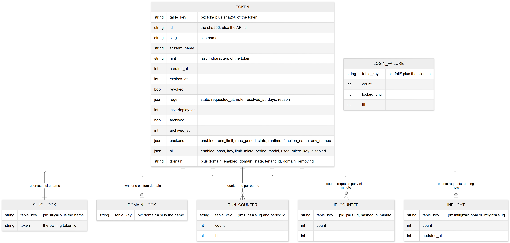

<details><summary>Diagram source (Mermaid, editable; GitHub also draws it)</summary>

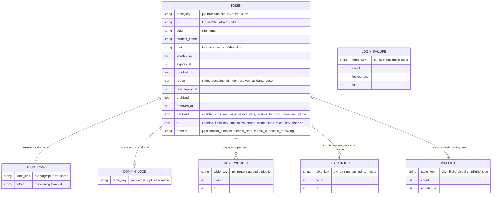

</details>
<!-- /diagram -->

Rules: counters change only through atomic conditional updates (`counter_add` / `counter_sub`), so a limit is exact even with parallel callers. Counter items carry a DynamoDB TTL where they are temporary. Money is stored as whole micro-dollars because DynamoDB has no floats. The plain token is **never** stored: only its SHA-256, and it is shown once at creation.

### 3.2 S3 (`SitesBucket`, private, versioned)

| Prefix | Content | Lifecycle |
|---|---|---|
| `sites/<slug>/` | the student's published site | old versions expire after 30 days |
| `uploads/` | temporary zips (`<slug>.zip`, `<slug>-backend.zip`) | deleted after 1 day, with their old versions |
| `archive/<slug>/` | sites taken offline (moved, never deleted automatically) | kept; restorable |
| `portal/` | the portal pages and downloads (written by `admin.mjs portal-publish`) | replaced on publish |
| `userdata/<slug>/` | a student's files (class storage only; never served by CloudFront) | kept; old versions expire after 30 days; the bucket allows browser POST and GET only through presigned links |

Versioning makes an overwritten or deleted file recoverable for 30 days (runbook in [END_TO_END.md section 4.5b](END_TO_END.md)). CloudFront reads only `sites/*` (and `portal/*` for the portal) through origin access control; the bucket blocks all public access.

### 3.3 State machines

**Token status is derived from time and two flags; it is never stored** (so nothing can get out of sync):

<!-- diagram:7e152d05 -->
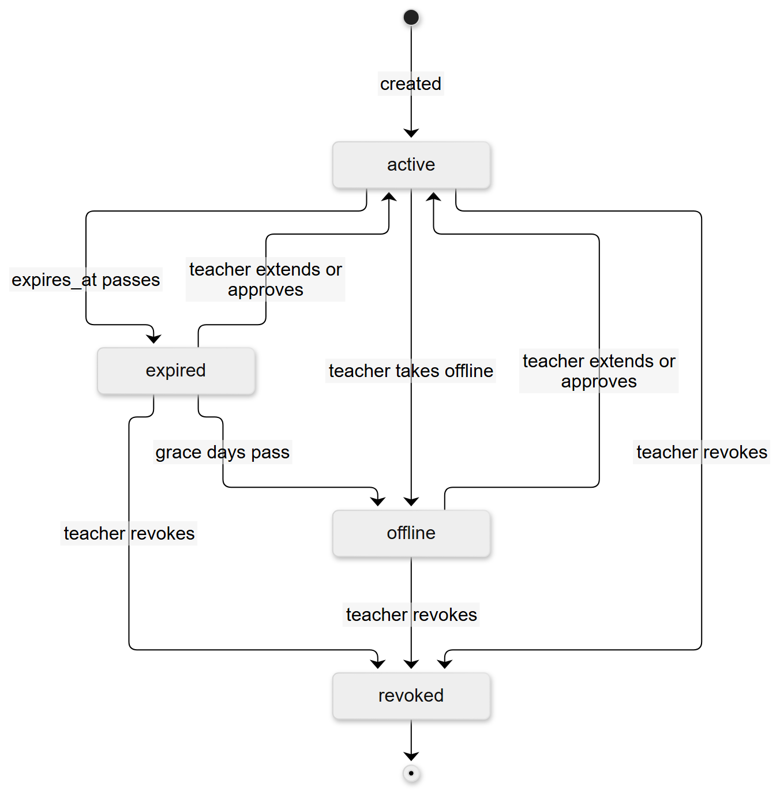

<details><summary>Diagram source (Mermaid, editable; GitHub also draws it)</summary>

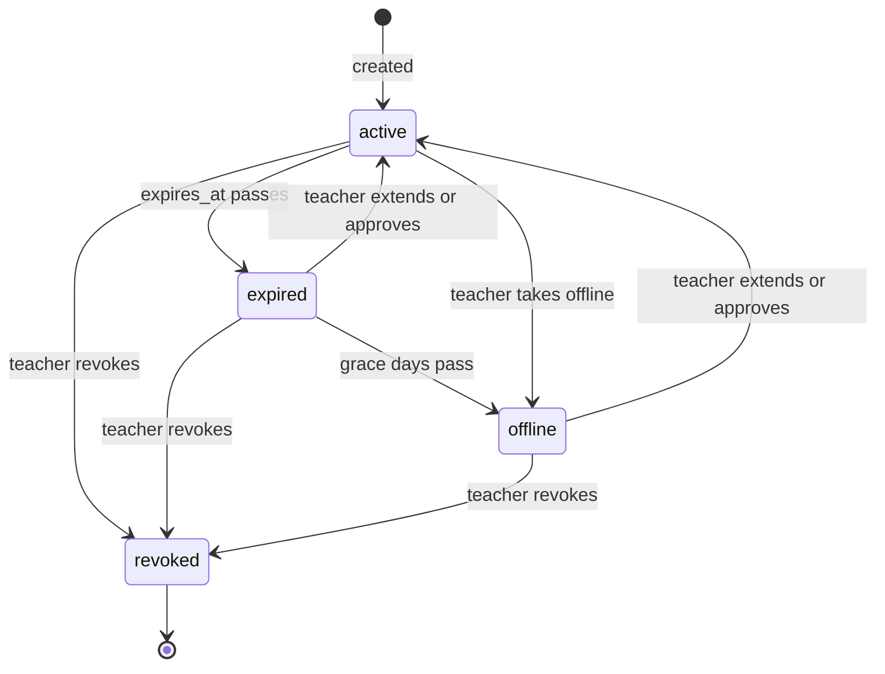

</details>
<!-- /diagram -->

Precedence in `status_of`: `revoked`, then `offline` (archived flag), then `active` (now before `expires_at`), then `expired` (within `OFFLINE_GRACE_DAYS`, default 3), otherwise `offline`. `expired` is read-only for the student; `offline` means the site is archived by the sweeper or by the teacher.

**Regeneration request:** `none` to `pending` (allowed only in the last 3 days before expiry or after it, one at a time) to `approved` (new duration counted from now, brings an archived site back) or `denied` (with a reason).

**Backend:** `none` to `creating` (after publish) to `ready` or `failed`, advanced one step per student poll (`GET /api/student/backend`). The teacher's `enabled` flag is independent of this state. Removal returns the state to `none` and keeps the teacher's settings.

**Custom domain:** `none`, `waiting_dns`, `issuing_certificate`, `finishing`, `live`, and `removing`; advanced one step per poll (`GET /api/student/domain/status`).

<!-- diagram:91126943 -->
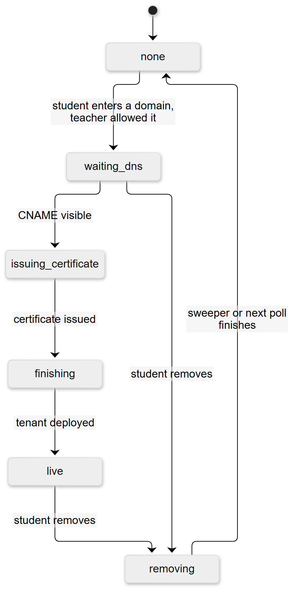

<details><summary>Diagram source (Mermaid, editable; GitHub also draws it)</summary>

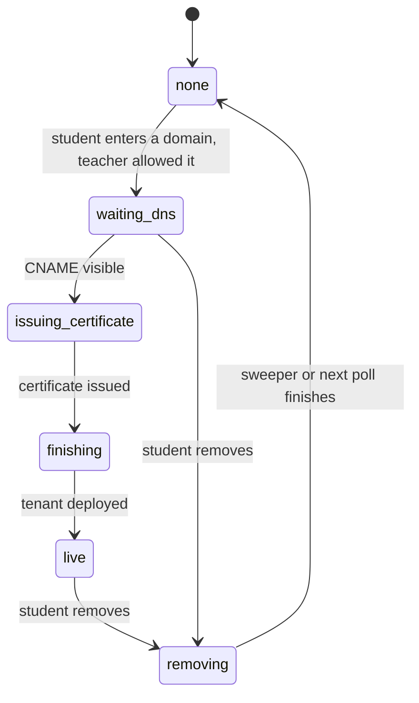

</details>
<!-- /diagram -->

**AI key:** works only while the teacher's `enabled` is on **and** the token is `active`.

<!-- diagram:8715e790 -->
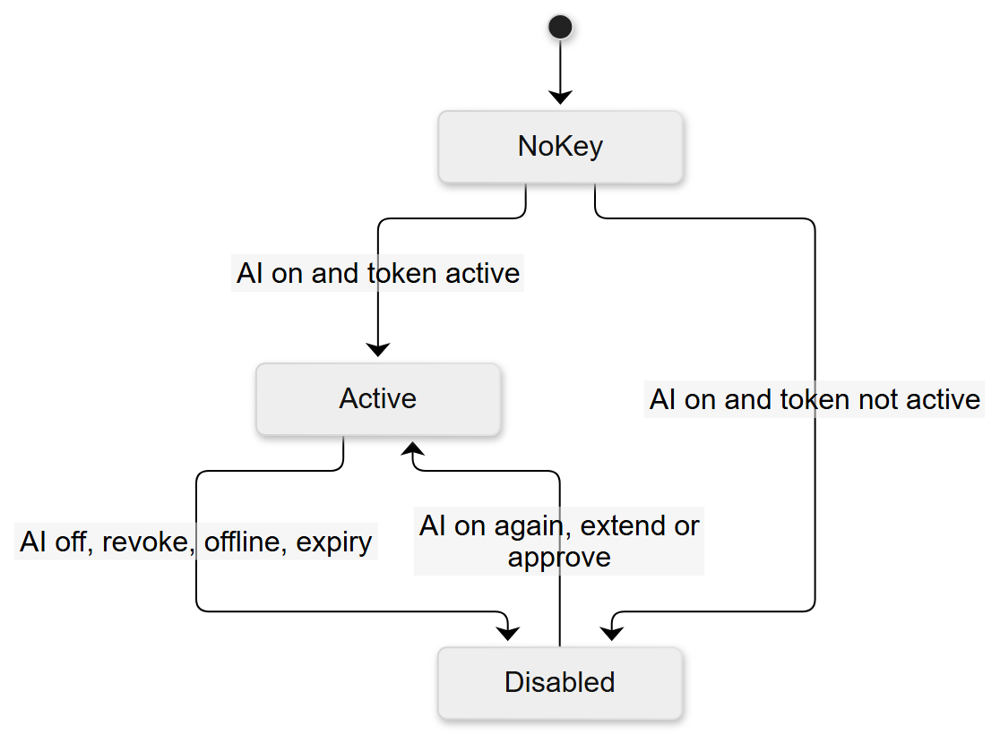

<details><summary>Diagram source (Mermaid, editable; GitHub also draws it)</summary>

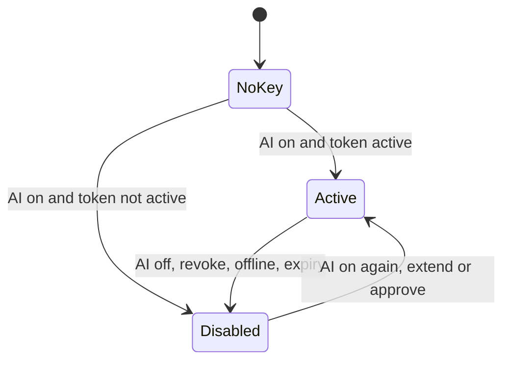

</details>
<!-- /diagram -->

---

## 4. Functional specification

Each feature lists its purpose, the main flow, the rules, the failure behaviour and the tests that prove it.

### 4.1 Authentication and sessions (F1)

- **Teacher login** `POST /api/teacher/login {username, password}`: the password is checked with scrypt (N=16384, r=8, p=1, 32 bytes) against the account in the SSM parameter (`TEACHER_PARAM`, JSON with `username`, `salt`, `hash`, `secret`). The hash is computed even for a wrong username (no timing leak). **Five** failures from one address lock it for **15 minutes** (`fail#<ip>` items with a TTL).
- **Student login** `POST /api/student/login {token}`: hashes the token and looks up `tok#<sha256>`; a revoked or unknown token is refused (`401`). A token in its read-only or offline period still signs in so the student can request regeneration.
- **Sessions** are HMAC-signed payloads `{r: role, s: subject, e: expiry}`: **8 hours** for teachers, **12 hours** for students, signed with **different keys** derived from the account secret (`teacher-session` and `student-session`), so a student session can never pass a teacher check and vice versa. The browser keeps the session in `sessionStorage`.
- **Real client address** behind CloudFront: the CloudFront function sets `x-viewer-ip`, and the API trusts it only together with the secret `x-origin-secret` header (derived from the stack id); direct calls to the API URL cannot forge it.

### 4.2 Token lifecycle (F2)

<!-- diagram:50e1c22c -->
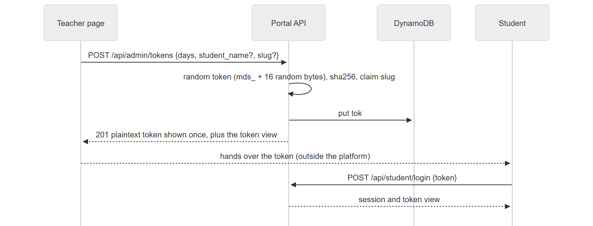

<details><summary>Diagram source (Mermaid, editable; GitHub also draws it)</summary>

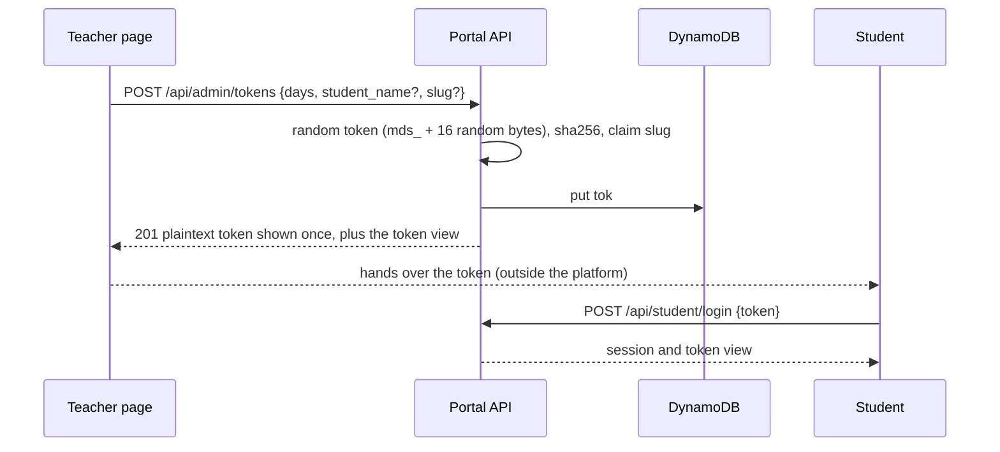

</details>
<!-- /diagram -->

- **Slug** (site name): teacher-set, else derived from the student name, else random (`s-` plus 6 hex); 1 to 30 characters of `a-z0-9-`, not reserved (`sites uploads archive deploy www api admin mail ftp app apps static assets bs lenden`), not used by a legacy CLI student, unique through the `slug#` lock.
- **Teacher actions** (`POST /api/admin/tokens/{id}/...`): `revoke` (student cannot sign in or deploy; the live site is unchanged), `extend {days}` (adds to the current expiry, or counts from now if lapsed, and restores an archived site; refused if revoked), `offline` (archives the site now), `approve {days}` and `deny {reason}` for regeneration requests, plus the switches in 4.5 to 4.8. Revoke, extend, approve and offline also **sync the student's AI key** (4.9).
- **Daily sweeper** (`cron(0 3 * * ? *)` UTC): archives the site of every token past expiry plus grace (moves `sites/<slug>/` to `archive/<slug>/`, never deletes), finishes pending custom-domain removals, and corrects any AI key whose state does not match the token (`ai_keys_changed`). One bad record never stops the rest; a failure raises an error that trips the sweeper alarm, and everything is retried the next day.

### 4.3 Frontend publishing (F3, F4)

<!-- diagram:451b556c -->
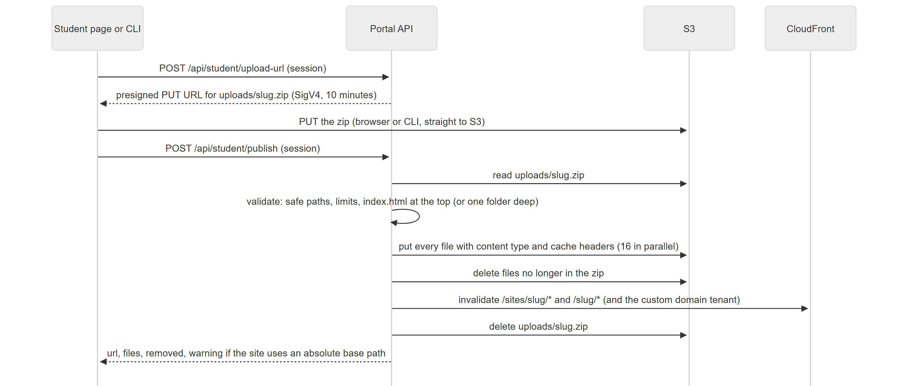

<details><summary>Diagram source (Mermaid, editable; GitHub also draws it)</summary>

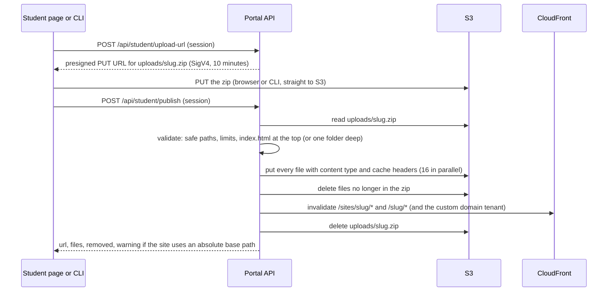

</details>
<!-- /diagram -->

- **Limits:** zip at most 50 MB, unzipped at most 200 MB, at most 2,000 files; names with `__MACOSX/`, `.DS_Store`, `Thumbs.db` are ignored; absolute or `..` paths are refused; `index.html` must be at the top of the zip (a zip of the build folder itself is accepted: one top folder is stripped).
- **Headers:** HTML gets `public, max-age=0, must-revalidate, s-maxage=31536000`; other files `public, max-age=300, s-maxage=31536000`. CloudFront keeps everything until the next publish invalidates it.
- **Requires an active token** (`403` otherwise); success records `last_deploy_at`.
- **Presigned URLs** must use a SigV4 client (virtual addressing); a legacy signature fails with `SignatureDoesNotMatch` as soon as the browser adds a `Content-Type` (found in testing, pinned by a test).
- **Legacy CLI** (`x-deploy-key: <name>.<secret>`, keys in the SSM map managed with `admin.mjs add|remove|list`): routes `POST /upload-url` and `POST /publish` on `DeployApi`, same publish code.
- **Serving** (`RouterFunction`): the host `<slug>.<RootDomain>` selects `sites/<slug>/`; a last path segment without a dot is a client-side route and becomes `/index.html` (SPA fallback); names failing the slug pattern get 404. Without a `RootDomain` the path form `/<slug>/...` is used.

### 4.4 Custom domains (F5)

<!-- diagram:4b390b9e -->
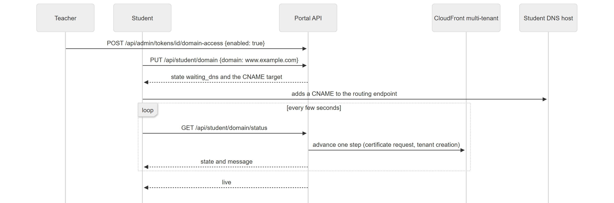

<details><summary>Diagram source (Mermaid, editable; GitHub also draws it)</summary>

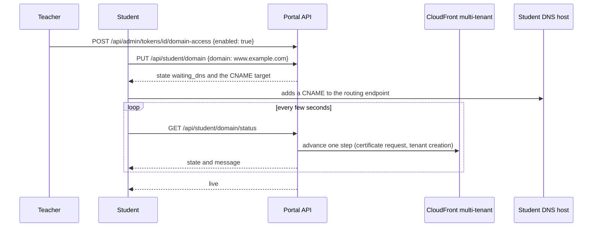

</details>
<!-- /diagram -->

Rules: needs `domain_enabled` set by the teacher, an active token and no existing domain; one domain per student; subdomains only; refused names: the platform's own, AWS addresses, bare apex domains; unique through `domain#<name>` locks. CloudFront refuses to create the tenant until the CNAME is visible, so the first step simply retries. Removal (`DELETE /api/student/domain`) starts `removing`; the next poll or the daily sweeper completes it. Teacher switch off stops *adding*; a live domain keeps working. The multi-tenant distribution is not in CloudFormation: see section 12.3.

### 4.5 Student backends (F6)

<!-- diagram:59dc968c -->
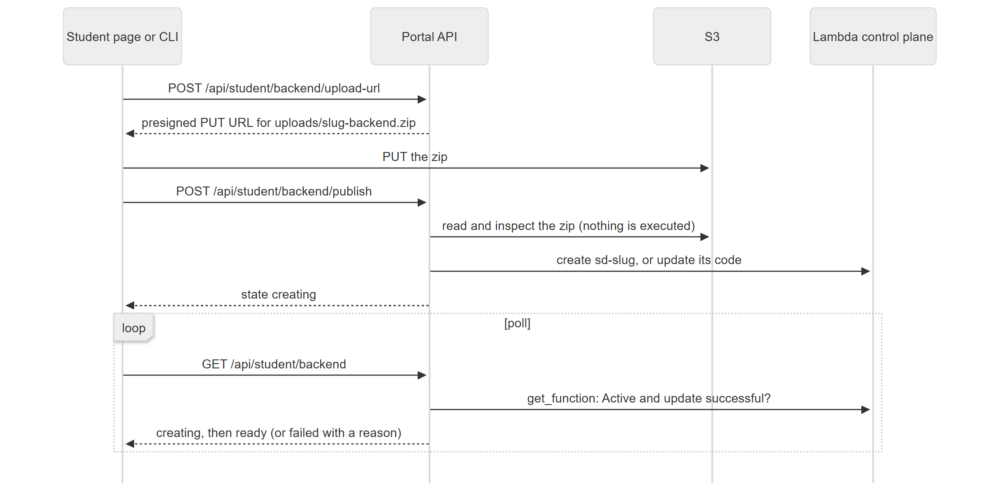

<details><summary>Diagram source (Mermaid, editable; GitHub also draws it)</summary>

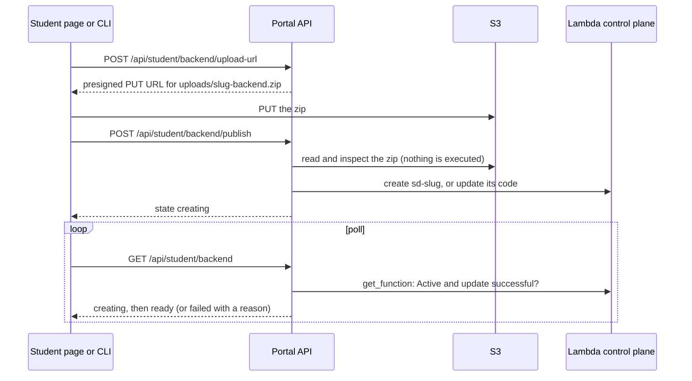

</details>
<!-- /diagram -->

- **Preconditions:** the teacher turned **Backend on**, the token is active (`403 Owner not enabled for you. Please contact site owner.` otherwise).
- **Package rules:** zip at most 5 MB, 50 MB unzipped, 500 files; exactly one entry file at the top: `index.mjs` or `index.js` (Node 22, handler `index.handler`) or `app.py` (Python 3.12, handler `app.handler`); no `.env*` file, no symlink, no unsafe path; a runtime switch requires removing the backend first.
- **Function:** name `sd-<slug>`, role `StudentSandboxRole` (may only write its own logs, bounded by `StudentSandboxBoundary`), 256 MB, **10 s** (25 s while AI is on), log group with **7-day** retention, tags `managed-by` and `slug`. Never deleted automatically.
- **Environment variables:** `PUT /api/student/backend/env {name, value}` and `DELETE .../env/<NAME>`; at most 20 variables and 4,096 bytes; name pattern `^[A-Za-z][A-Za-z0-9_]{0,63}$`, not starting with `AWS_`, `LAMBDA_` or `_`, not `TZ`; value at most 1,024 characters. **Values are write-only**: stored only inside the function's configuration, never in DynamoDB and never returned by any API (the view lists names). While the class AI is on, `OPENAI_API_KEY`, `OPENAI_BASE_URL` and `AI_MODEL` are reserved.
- **Logs:** `GET /api/student/backend/logs` returns up to 50 lines of the last hour from the function's log group.
- **Removal:** `DELETE /api/student/backend` deletes the function and its log group and keeps the teacher's settings.
- **Teacher switch** `POST /api/admin/tokens/{id}/backend {enabled?, runs_limit?, runs_period?}`: OFF makes the gateway answer `503 backend_off` within about 10 seconds and, as a second safeguard, sets the function's reserved concurrency to 0 (best effort); the first time ON sets the allowance to 5,000 per month.

### 4.6 Backend gateway (F7)

Every call to a student backend passes through the gateway:

<!-- diagram:f29f3dec -->
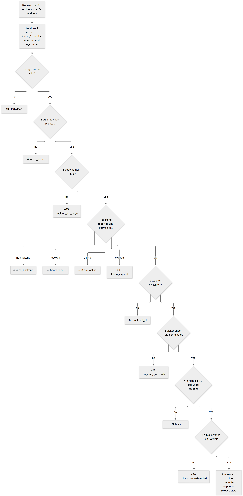

<details><summary>Diagram source (Mermaid, editable; GitHub also draws it)</summary>

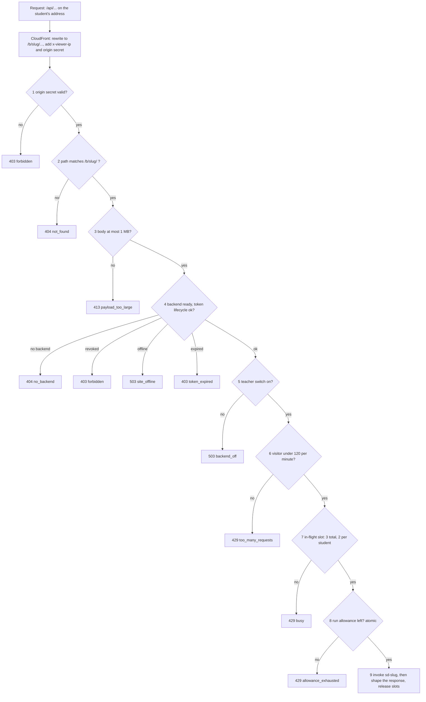

</details>
<!-- /diagram -->

- A **run is counted only at step 8**; slots are released in a `finally` block. A slot counter stuck above zero for 60 seconds (a crash between increment and decrement) heals itself.
- **Settings cache:** a site with a ready backend is cached for 10 s (teacher changes take effect within about 10 s); a site without one for 2 s (a fresh deploy is served within about 2 s).
- **Request to the function:** an API Gateway HTTP API payload v2 event, with `x-origin-secret` and `x-viewer-ip` removed from the headers.
- **Response shaping:** the function's return value becomes an HTTP response as API Gateway would: a dict with `statusCode` (100 to 599), string headers, string `body` (a non-string body is serialized as JSON), optional `isBase64Encoded` and `cookies`; a plain value becomes `200`. Hop-by-hop headers are dropped; `x-content-type-options: nosniff` and `cache-control: no-store` are added if missing; a response over 1 MB is refused (`502 response_too_large`).
- **Function failures:** a timeout is `504 function_timeout`; a crash is `502 function_error` (the details stay in the student's own logs, never in the response or platform logs); an unreadable reply is `502 bad_response`; AWS throttling is `429 busy`; any other invoke failure is `502 backend_unavailable`.
- **Same-origin `/api`:** CloudFront routes `<slug>.<RootDomain>/api/*` (and custom domains through a tenant function) to the gateway, so the browser sees one origin: no CORS.

### 4.7 Run allowance and in-flight limiter (F8)

- **Allowance:** `runs_limit` (0 to 1,000,000) per `runs_period` (`day`, `month`, `total`; UTC), counted in `runs#<slug>#<period id>` with a TTL a week after the period ends. Exact under parallel load (tested with 60 callers). The student page shows a meter; the teacher edits the number or adds 1,000.
- **In-flight limiter:** 3 requests in flight for all students together, 2 per student, so one student cannot consume the account's Lambda concurrency. **These two numbers were chosen for the original account limit of 10 concurrent executions; the limit is now 1,000 and the numbers are unchanged (see 12.3).**
- **Per-visitor limit:** 120 requests per minute per visitor address and student.
- API throttles: `BackendApi` 10 requests per second (burst 20), `DeployApi` 20 per second (burst 50).

### 4.8 Teacher controls summary

| Control | Route | Effect |
|---|---|---|
| Create token | `POST /api/admin/tokens` | section 4.2 |
| Revoke, extend, offline | `POST .../revoke`, `.../extend`, `.../offline` | section 4.2 |
| Approve, deny regeneration | `POST .../approve`, `.../deny`, `GET /api/admin/requests` | section 4.2 |
| Domain on/off | `POST .../domain-access` | section 4.4 |
| Backend on/off, allowance | `POST .../backend` | sections 4.5 and 4.7 |
| AI on/off, cap, period, model | `POST .../ai` | section 4.9 |

### 4.9 Class AI connector (F9)

Full detail, diagrams and the threat model are in [AI_CONNECTOR.md](AI_CONNECTOR.md); the binding rules are:

<!-- diagram:bf3fcc23 -->
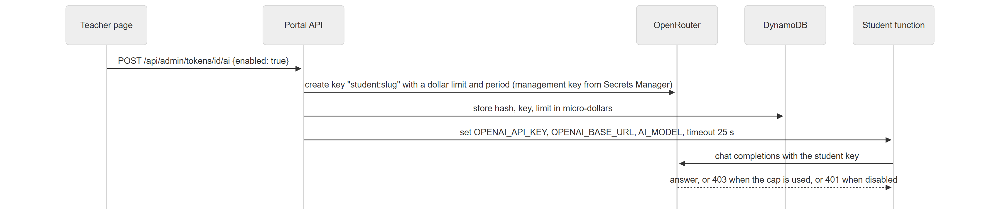

<details><summary>Diagram source (Mermaid, editable; GitHub also draws it)</summary>

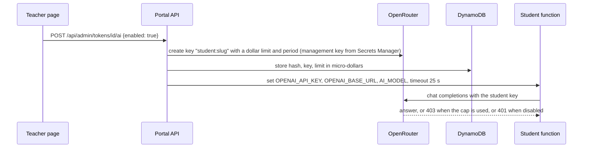

</details>
<!-- /diagram -->

- **One management key** in Secrets Manager (`openrouter`, JSON key `OPENROUTER_MANAGEMENT_KEY`), readable only by `DeployFunction` and `SweeperFunction` (one named-secret IAM statement, pinned by a test). It can create and disable keys but cannot make model calls. It is never returned, logged or given to a student's function.
- **Per student:** their own OpenRouter key with a dollar `limit` (0.01 to 20, default 0.25) and `limit_reset` (`day`, `month`, or none for `total`); the provider enforces the cap. Default model `anthropic/claude-haiku-5.5` (parameter `AiDefaultModel`, per-student override by the teacher).
- **Order of operations:** switch-off disables the key *before* anything else; switch-on stores the key *before* updating the function; a failure between steps is retried with the same key (no second key). A function that is mid-update answers `409` and the same request is repeated.
- **Lifecycle:** the key is enabled only while AI is on **and** the token is active; revoke, offline, extend and approve sync it immediately; the daily sweeper catches silent expiry; a provider outage never blocks the teacher's own action.
- **Usage:** read from OpenRouter by `GET /api/student/ai` (cached 20 s; the student page asks once a minute). The provider counts usage **late** (seconds to about half a minute), so a cap can be overshot slightly and meters lag.
- **Known measured behaviour:** a capped-out key answers HTTP 403 "Key limit exceeded"; a disabled key 401; the free `:free` models returned 429 in every test, so the paid model is the default; the key can call **any** OpenRouter model (the cap, not a model list, is the control).

### 4.10 GitHub deploy (F10)

<!-- diagram:c276a5ae -->
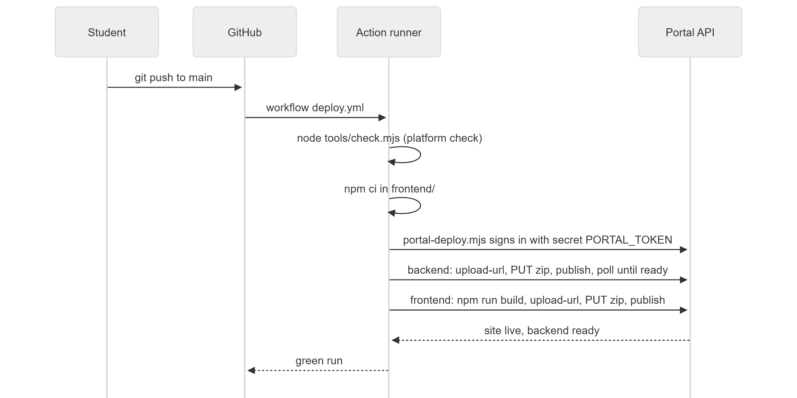

<details><summary>Diagram source (Mermaid, editable; GitHub also draws it)</summary>

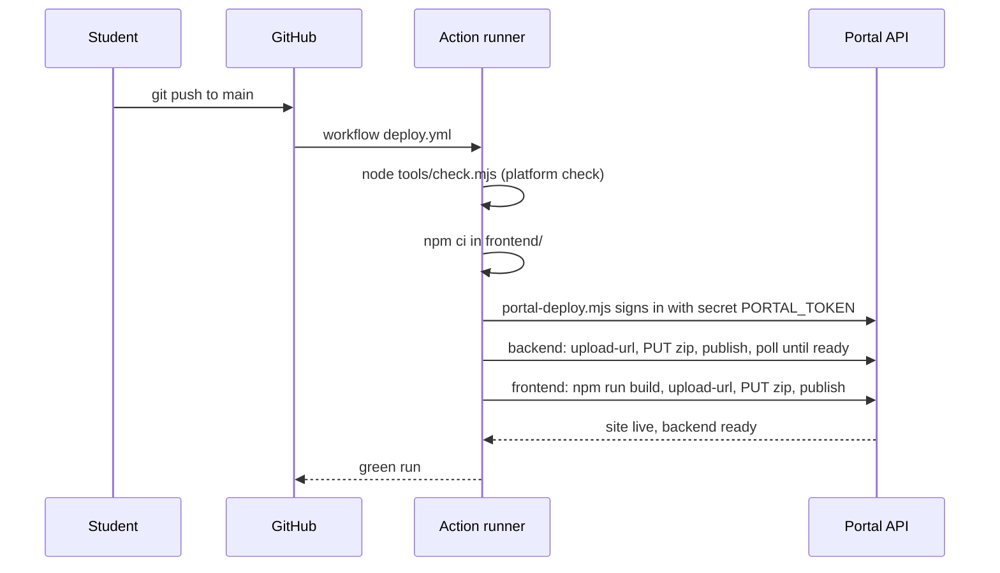

</details>
<!-- /diagram -->

`student/portal-deploy.mjs` (single dependency-free file) does exactly the portal's flow with the token: sign in, refuse a token that cannot deploy (with the status), deploy `backend/` first (waits until `ready`, up to 120 s), then `frontend/` (runs `npm run build`, finds `dist/`, `build/` or `out/`). Layout options: `--frontend <dir>` (use `.` for an app at the repo root), `--backend <dir>`, `--only`, `--skip-build`. Safety: the repo root is never published as-is, `.env*` and `node_modules` are never included in the frontend zip, `.env*` in the backend is refused before any upload. The token comes from `PORTAL_TOKEN` (environment, `.env.local` or `.env`). `node portal-deploy.mjs login` (kit: `npm run login`) asks for it with masked input (raw keys: the first 4 characters, `mds_`, then one `*` per character; Backspace, Enter and Ctrl+C work; piped input is read as one line), checks it with the portal, and writes only the `PORTAL_TOKEN` line of `.env.local`, keeping other lines; it refuses when `git check-ignore` says `.env.local` is not ignored, never prints the token, and `deploy` offers the same prompt when no token is found in a terminal. A token the portal rejects (401/403/404) gets one message: run `npm run login` with the current token. The kit checker skips `.env.local` in its secret scan and still errors if git tracks it. `portal-deploy.mjs status` signs in and reports the token's validity without deploying. **MCP server** (`tools/mcp.mjs`, kit 1.3.0): newline-delimited JSON-RPC over stdio, tools `check_project`, `deploy` (`confirm` must be `true`; runs the check first and stops on errors; optional `only`) and `status`, each running the project's own scripts with stdin closed and a timeout; output has ANSI codes removed and any `mds_` token masked, and is capped at 8,000 characters. `.vscode/mcp.json` ships in the kit; for Antigravity `--print-config` prints the entry with absolute paths. No token is stored in editor settings. It exits by itself (no `process.exit` after network use). Workflow templates: `student/portal-deploy.yml` (app in `frontend/`) and `student/portal-deploy-root.yml` (app at the repo root).

### 4.11 Student kit (F11)

The kit makes the student's AI editor build inside the architecture ([STUDENT_KIT.md](STUDENT_KIT.md) has the full text):

<!-- diagram:dceca84d -->
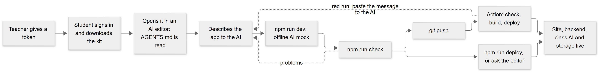

<details><summary>Diagram source (Mermaid, editable; GitHub also draws it)</summary>

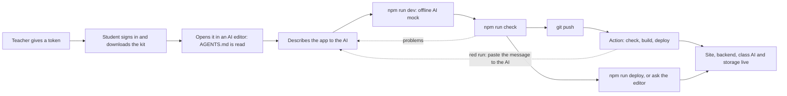

</details>
<!-- /diagram -->

Enforcement, in four layers: (1) a **working scaffold** in the right layout; (2) **rules** in `AGENTS.md` and identical copies for each editor (`GEMINI.md`, `CLAUDE.md` importing it, a Claude skill, Cursor rules, Copilot instructions, `.windsurfrules`); (3) `npm run check`, about 30 rules that fail the build (layout, backend limits equal to the platform's, non-standard-library imports, syntax errors, AI called from the browser, `localhost` URLs, `VITE_` secrets, tokens and keys in any file, tracked `.env`, missing `.gitignore`); (4) the platform validating every upload server-side.

- **`class_ai`** (Python and Node, single source in `student/`): `ask(prompt, ...)`, `chat(messages, ...)`, `available()`; friendly `AiError` kinds `not_enabled`, `cap_reached` (402 and 403), `disabled` (401), `busy` (429 and 5xx, one retry), `timeout` (20 s default), `provider_error`; `default=` returns a fallback text instead of raising; `mock=` sets the offline mock's reply; offline mock when no key and not on Lambda (`AWS_LAMBDA_FUNCTION_NAME` unset); the key, prompts and answers are never printed or put in errors.
- **`class_storage`** (Python and Node, single source in `student/`): `put/get/items/delete` and `files.*`; on the platform it uses `CLASS_STORAGE_URL` and `CLASS_STORAGE_KEY`, on the student's computer a git-ignored `.class-storage/` folder; see section 4.14. The sample backend has a `/notes` route that uses it.
- **Deploying from the computer:** `npm run login` (once) and `npm run deploy`, and the optional MCP server; see section 4.15.
- **Kit versions:** 1.1.0 (baseline), 1.2.0 `npm run login` and the "Deploying" rules, 1.3.0 MCP server and `.vscode/mcp.json`, 1.3.1 masked token prompt, 1.4.0 class storage, 1.5.0 kit sync (update notice, `update_kit`, scripts added by `update`, `minKit`), 1.5.1 `mcp-config` prints a complete, clearly delimited file, 1.6.0 the computer-wide token (`login --global`) and the single MCP server source shared with the new package.
- **Local development:** `npm run dev` (site on 3000, backend on 8788; the site forwards `/api`), hot reload for both backends, `npm run doctor`.
- **Kit delivery:** `node admin.mjs portal-publish` builds `starter-kit.zip` deterministically from `starter/` and publishes it with `kit-version.json`; the student page's **Start here** card offers it with repository deep links and a checklist. An optional public GitHub template repository is pending (12.3).
- **Update:** `node tools/platform.mjs status|update [--apply] [--force]` touches only the platform-managed files listed in `platform.json`, verifies the zip against the published hash, refuses unsafe paths, protects files the student edited.
- **Compatibility rule:** the server only ever *adds* routes, fields and error codes (an old kit keeps working, and the server enforces every limit itself); a change that would break old kits instead raises `minKit` in `starter/template/platform.json`, which `portal-publish` copies into `kit-version.json`, so those kits are told to update. What reaches students: server changes at once (teacher switches, caps, the storage API, injected variables); kit files only when the student updates (section 4.15); a deployed backend keeps the helper it was uploaded with until it is redeployed.
- **Versioning rule:** bump `kitVersion` in `starter/template/platform.json` whenever anything in the kit changes.
- **Evaluation:** 13 fresh AI agent runs on 8 scenarios (including two adversarial) all passed the platform's gates; see `starter/eval/README.md`.

### 4.12 Operations features (F12)

Six CloudWatch alarms notify one SNS topic by email (address read from SSM at deploy time, never in the repository); S3 versioning and lifecycle give 30-day file recovery; the tokens table has point-in-time recovery; see section 11.

### 4.13 Portal user interface (F13)

Static pages from `web/`, built with a tiny DOM helper that never parses text as HTML; no build step.

- **Teacher page** (`/teacher`): sign-in; four summary tiles (students and how many are active, expiring soon, pending requests, class storage in use); tabs **Students**, **Requests** (with a badge) and **Storage**; token creation (days, name, slug). The **Students** tab is a searchable list: each row shows an avatar, the name and site, small chips for the features that are on, the status and the time left. **Clicking a student opens a detail panel** (a side panel that becomes full-screen on a phone) with the token facts and the lifecycle actions (Extend, Take offline, Revoke) and one card per feature with an on/off switch and its meters and buttons: Custom domain, Backend (runs meter, Edit allowance, +1,000), Class AI (spend meter, Edit cap), Class storage (records, files and operations meters, Edit caps, **Clear storage**). Nothing but the list is on the main page. The **Storage** tab shows the class totals and a row per student with meters, a state (On, Off, Needs cleanup) and a quick Clear; it shows sizes and counts only. **Requests** keeps Approve and Deny.
- **Student page** (`/student`): sign-in with the token; status card (expiry bar, last upload, 3-day warning banner, regeneration request); **Upload your site** (drop a build folder or a zip, pre-upload checks, progress); **Custom domain** card (steps and polling); **Backend** card (upload, state, usage meter, environment variables, logs, **Class AI** and **Class storage** sections); **Start here** card (kit download, repository links, checklist, older downloads); upload guidelines.
- **Shared:** dialogs for confirmations and number input (decimals supported), toasts, dark and light themes, layouts that work at phone width.

### 4.14 Class storage connector (F14)

Teacher-controlled **data and file storage** for a student's backend, capped and metered. Full description for teachers and students: [STORAGE_CONNECTOR.md](STORAGE_CONNECTOR.md). Added after the baseline of sections 11 and 12; it is **off unless `StorageEnabled=true`**, which production has had since 2026-10-24 (section 12.3, item 12). Each student stays off until the teacher switches storage on.

**Design decisions.** (1) *Isolation by construction, not by IAM:* all student functions share one sandbox role, and per-student IAM roles would give the portal's function the power to create roles and add a propagation delay to every deploy. Instead the student's function holds an **opaque key** (`cs_<slug>.<secret>`); the storage API works out the owner from the key and builds every DynamoDB key and S3 key itself, so a student cannot name another student's data. (2) *Own API and function* (`StorageApi` + `StorageFunction`, throttled separately) so a busy loop cannot slow the portal. (3) *Hard caps everywhere* so cost cannot run away: bytes, items, file space, file count, value size, and an operations allowance. (4) *Not SQL*: a collection is a list ordered by id; **no RDS** (always-on cost, private network, shared server).

| Part | Specification |
|---|---|
| Switch | `StorageEnabled` template parameter (default `false`, needs `BackendEnabled=true`); per student `POST /api/admin/tokens/{id}/storage {enabled?, data_mb?, files_mb?, ops_limit?, ops_period?}`. Off is immediate (checked on every call); data is kept. |
| Key | made on first switch-on, kept while the student exists, stored on the token item (`storage.key`), never part of any API view; compared in constant time. |
| Student function receives | `CLASS_STORAGE_URL`, `CLASS_STORAGE_KEY` (set on publish and on every switch; the names are reserved while on, like the AI names). |
| Data | table `StudentDataTable` (partition `s` = `<slug>#<collection>`, sort `id`, on demand, retained on stack deletion); value is a JSON string up to **64 KB**; collection `[a-z0-9_-]{1,40}`, id `[A-Za-z0-9._-]{1,128}`. Operations: put, get, delete, list (ordered by id, 100 per page and at most 400 KB per answer, `after` for the next page). |
| Quotas (atomic counters in the tokens table) | bytes `sbytes#<slug>` (cap `data_mb`, default **5**, max 100), items `sitems#<slug>` (cap **5,000**); both reserved with a conditional update **before** the write and returned if the write fails, so a cap cannot be overshot by parallel callers. |
| Files | S3 `userdata/<slug>/<name>` (flat names, up to **5 MB** each, **100** files, total cap `files_mb` default **50**, max 500). The API returns a **presigned POST** limited to the declared size and the declared content type (the browser or the function sends the bytes straight to S3, so the 1 MB request limit does not apply); downloads are 5-minute presigned links. Usage is counted by listing the folder, so it cannot drift. |
| Allowance | every API call counts one operation (`sops#<slug>#<period>`, atomic, default **10,000 per day**, `ops_limit` up to 1,000,000, period day, month or total); `429 allowance_used` when spent. |
| Lifecycle | the token must be active (not expired, revoked or offline) and the switch on, on every call. |
| Errors | JSON `{"error": code, "message"}`: `bad_key` 401, `token_inactive` and `not_enabled` 403, `allowance_used` 429, `quota_exceeded` and `too_large` 413, `bad_request` 400, `not_found` 404. |
| Student helper | `class_storage.py` / `class_storage.mjs` (single-source files copied into the kit): `put/get/items/delete`, `files.put/list/url/delete/upload_url`; retries once on 5xx or a network error, 8 s timeout, raises `StorageError(kind)`; on a student's computer it keeps everything in `.class-storage/` with the same rules; on the platform without the variables it raises `not_enabled` instead of pretending. |
| IAM | `StorageFunction`: `GetItem`/`UpdateItem` on the tokens table, plus `PutItem`/`DeleteItem` there **only for keys starting `scoll#`** (an IAM condition on `dynamodb:LeadingKeys`), `GetItem`/`PutItem`/`DeleteItem`/`Query` on `StudentDataTable`, `GetObject`/`PutObject`/`DeleteObject` on `userdata/*`, `ListBucket` limited to the `userdata/` prefix. The portal's function (`DeployFunction`) gains only `Query`, `BatchWriteItem` and `DeleteItem` on `StudentDataTable` (to find and delete a student's items for "clear"): it still cannot read, write or scan a value; the live test asks IAM itself to confirm this. |
| Teacher tools | `GET /api/admin/storage` (per student: switch, caps, bytes, items, operations, **file count and bytes from one listing of `userdata/`**; totals; a flag `inactive` for a student who is revoked, offline or switched off but still holds data) and `POST /api/admin/tokens/{id}/storage/clear {scope: data \| files \| all}`. **The teacher never sees what a student stored**: no route returns a value, a file name or a key (a deliberate privacy decision). Clearing deletes every record of every collection the student ever used (found through the remembered list below), resets the byte and item counters to zero, and deletes the files; the key, the switch and the caps stay. Files are in a versioned bucket, so the owner can still restore a deleted file for 30 days. The portal asks the teacher to type the student's name before it clears. Nothing is deleted automatically: students who no longer use storage but still hold data appear as **Needs cleanup** for the teacher to clear. |
| Remembered collections | one item `scoll#<slug>#<collection>` in the tokens table per collection name a student has used (at most **50** names), created once with a conditional put and counted in `scollcount#<slug>`; it exists so "clear" can find every partition without scanning the data table. A container trusts its own memory for 60 seconds, so a deleted list is rebuilt by the next write. |
| Cost | on-demand billing: an idle app costs nothing; the caps bound the data (about 5 MB per student) and the allowance bounds the requests. Alarm `storage-errors` on the function. |

<!-- diagram:952c97df -->
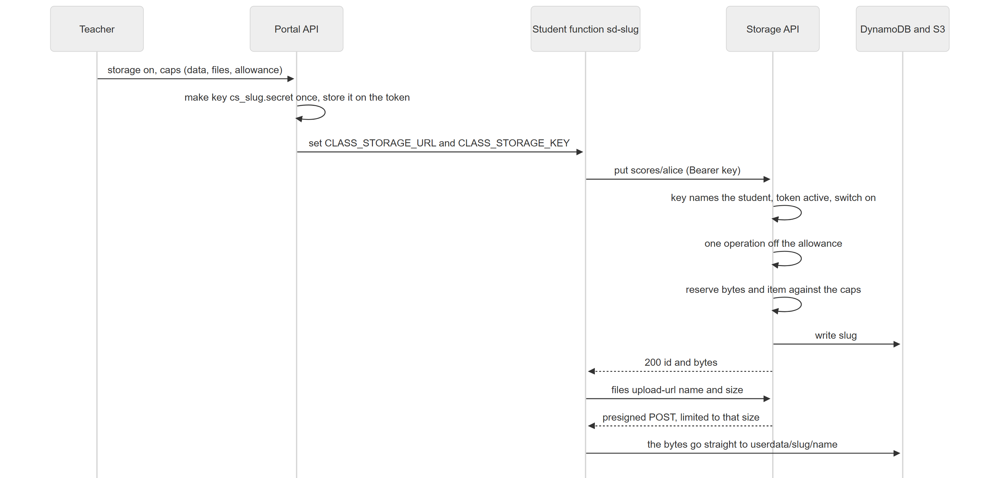

<details><summary>Diagram source (Mermaid, editable; GitHub also draws it)</summary>

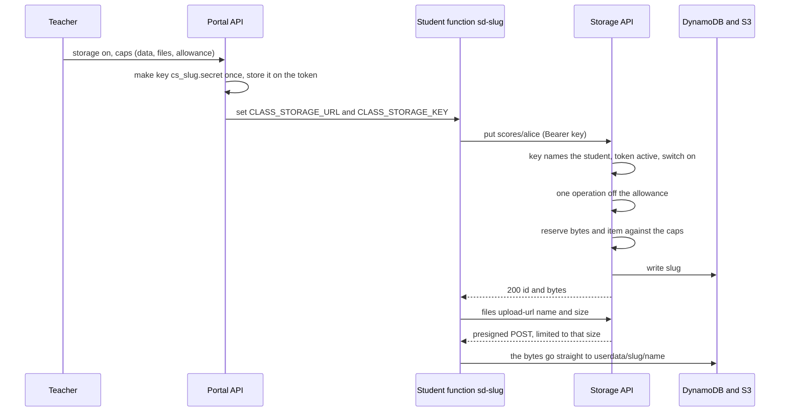

</details>
<!-- /diagram -->

### 4.15 Deploying from the student's computer: login, deploy and the MCP server (F15)

The GitHub route (section 4.10) is not required. A student can publish from their computer with the same `portal-deploy.mjs`, using the same token, and an AI editor can do it for them.

| Part | Specification |
|---|---|
| `npm run login` (`node portal-deploy.mjs login`) | asks for the token with **masked input** (raw keys: the first four characters, `mds_`, then one `*` per character, so the student can see the paste arrived; Backspace, Enter and Ctrl+C work, arrow keys are ignored); piped input is read as one line; checks it with `POST /api/student/login`; writes **only** the `PORTAL_TOKEN` line of `.env.local` and keeps every other line; refuses when `git check-ignore` says `.env.local` is not ignored; never prints the token |
| `npm run deploy` (`node portal-deploy.mjs`) | the flow of section 4.10; the token comes from `PORTAL_TOKEN`, `.env.local` or `.env`; with no token and a terminal it offers the login prompt, without a terminal it says to run `npm run login` |
| `node portal-deploy.mjs status` | signs in and reports the token's validity and days left; deploys nothing |
| A rejected token | 401, 403 or 404 on sign-in gives one message: run `npm run login` with the current token (a regenerated token replaces the old one) |
| The checker | skips `.env.local` in its secret scan (that is where the token lives) but still errors when git tracks it (`env-committed`) |
| MCP server (`tools/mcp.mjs`) | newline-delimited JSON-RPC over stdio, dependency-free. Tools: `check_project`, `deploy` (argument `confirm` must be `true`, optional `only`; runs the check first and stops on errors) and `status`. Each runs the project's own scripts with stdin closed and a timeout (check 120 s, deploy 300 s, status 60 s), one deploy at a time; output has ANSI codes removed, `mds_` tokens masked and is capped at 8,000 characters. The token is read from `.env.local`; it is never in the editor's settings |
| Editor setup | VS Code: the kit ships `.vscode/mcp.json` (newer VS Code versions offer to migrate it to `.mcp.json`; the owner's test showed that prompt). Antigravity: `npm run mcp-config` prints the entry with absolute paths to paste under *Manage MCP Servers, View raw config* |
| The MCP package (`class-platform-mcp`, no kit download) | Source `starter/mcp/` (`bin.mjs`, `server.mjs`, `setup.mjs`, `jsonc.mjs`, `package.json`); `starter/build-mcp-package.mjs` makes one **deterministic tarball** (`package/` root: those files plus `portal-deploy.mjs`, `check.mjs`, `update-notice.mjs`, `zip.mjs` and `kit.zip`, the starter inside). `starter/publish-files.mjs` builds everything `portal-publish` uploads and the dev portal serves, so the two cannot differ: `class-platform-mcp-<version>.tgz` (one per version; **older ones are never deleted**, editor settings point at them), `class-platform-mcp.tgz` (always the newest; used only for the one-time command) and `mcp-version.json` (`version`, `url`, `alias`, `sha256`). `server.mjs` is **one source with two homes**: the package's server and the kit's `tools/mcp.mjs`. |
| Connecting an editor | One command per computer: `npx -y <portal>/class-platform-mcp.tgz setup` (npm fetches the tarball over HTTPS: no git, no zip). **Token:** a masked prompt (as `npm run login`), checked with the portal, saved in `~/.class-platform/token` (`CLASS_PLATFORM_HOME` overrides; mode 0600) which every project uses and no project contains; `portal-deploy.mjs` reads it last, after `PORTAL_TOKEN`, `.env.local` and `.env`. **Editors:** VS Code (`servers` with `type: stdio`, in the user's `Code/User/mcp.json`) and Antigravity (`mcpServers`, in `~/.gemini/config/mcp_config.json` or `~/.gemini/antigravity/`); for each it shows the exact entry, asks (`--yes` skips, no terminal means no write), makes a timestamped backup and **merges** one `class-platform` entry; other servers are never touched, an up-to-date entry is left alone, an outdated one is replaced; a file with comments or invalid JSON is **never rewritten** (the entry is printed instead). The entry points at the **pinned** URL of the version `mcp-version.json` names (Windows editors get `cmd /c npx`); `--dry-run`, `--no-token` and `--editors none|vscode|antigravity` are available. The portal's Start here card shows the command with a copy button, an *Add to VS Code* install link and a *Copy Antigravity config* button. |
| Which folder is the project | In order: the `path` argument of a tool, the folder the editor has open (the MCP **roots** feature: the server asks `roots/list` after `initialized`), `--root`, the kit project the file lives in, the working directory. `check_project` and `deploy` use the project's own `tools/check.mjs` / `portal-deploy.mjs` when it has them (a kit project) and the copies bundled in the package otherwise. |
| `init_project` | writes the starter from the bundled `kit.zip` into an **empty** folder (only `.git`, `.vscode`, `.idea`, `.DS_Store`, `.mcp.json`, `.claude`, `.cursor`, `.gemini` may exist; a file that already exists is left alone), needs `confirm=true`, then runs `npm ci` in `frontend/` unless `install=false`. Refuses a folder with other files. The zip reader refuses any path that would leave the folder. |
| Updating the package | Pinned URLs never change under a student. `status` compares with `mcp-version.json` (2 s, fresh) and says to re-run `setup`, which writes the new pinned URL; the old tarball keeps working. |
| Staying current (kit 1.5.0) | `tools/update-notice.mjs`: `npm run check` and `npm run deploy` print **one line to stderr** when the portal's `kit-version.json` has a newer `kitVersion`, when this kit is older than the portal's `minKit` (stronger wording), or when `package.json` lacks scripts the kit owns. It asks at most **once a day** (answer kept in `.platform-notice.json`, git-ignored), waits at most 2 s, says nothing offline or on a bad answer, and prints only to a terminal (never in CI, never when output is piped, never with `--json`; `PLATFORM_NOTICE=off` silences it). The MCP `status` tool reports the same (asking fresh) and the `update_kit` tool runs `platform.mjs update --apply` only with `confirm=true`, then asks for a restart of the tool server. `node tools/platform.mjs update --apply` also **adds the kit scripts `package.json` lacks** (`managedScripts` in `platform.json`, commands taken from `kit-version.json`): never changes or removes a script the student has, keeps the file's indentation, and accepts only plain `node tools/...` / `node portal-deploy.mjs ...` commands with plain names. A project on kit 1.1 to 1.4 runs `update --apply` twice: the first run replaces the old `platform.mjs`, the second can add the scripts |
| Assistant rules | the kit's "Deploying" section: run the check, ask the student "publish now?", deploy with `confirm=true` only after a yes, read the address back; if the token is missing the student runs `npm run login` themselves; the assistant never reads `.env.local` or asks for the token |

<!-- diagram:f638c537 -->
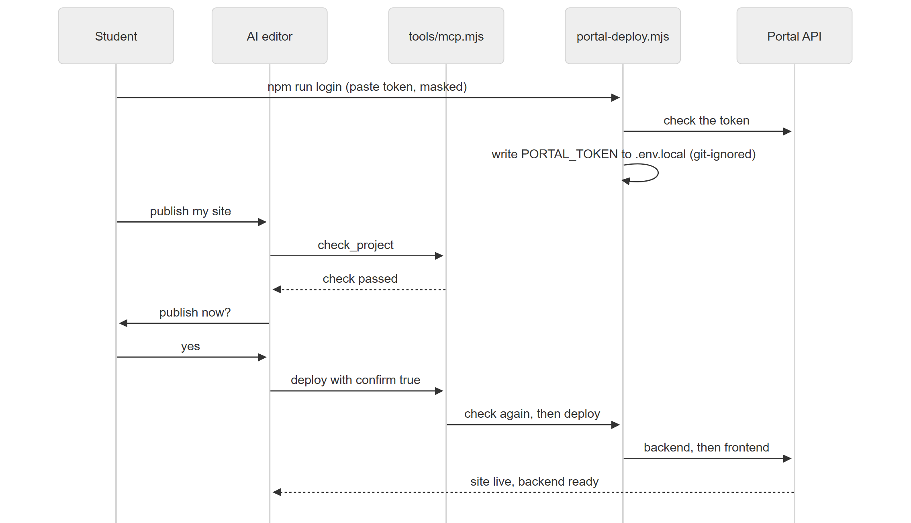

<details><summary>Diagram source (Mermaid, editable; GitHub also draws it)</summary>

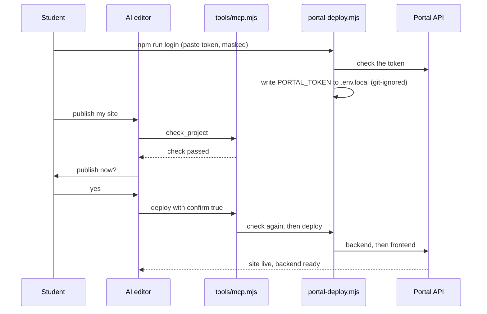

</details>
<!-- /diagram -->

---

## 5. API summary

Complete request and response shapes: [API_REFERENCE.md](API_REFERENCE.md). Routes at baseline (all `/api/...` portal routes need `Authorization: Bearer <session>` except the two logins):

| Group | Routes |
|---|---|
| Logins | `POST /api/teacher/login`, `POST /api/student/login` |
| Teacher | `GET/POST /api/admin/tokens`, `POST /api/admin/tokens/{id}/revoke\|extend\|offline\|approve\|deny\|domain-access\|backend\|ai\|storage\|storage/clear`, `GET /api/admin/requests`, `GET /api/admin/storage` |
| Student | `GET /api/student/me`, `POST /api/student/regen-request`, `POST /api/student/upload-url`, `POST /api/student/publish`, `GET /api/student/ai`, `GET /api/student/storage` |
| Domain | `PUT/DELETE /api/student/domain`, `GET /api/student/domain/status` |
| Backend | `GET/DELETE /api/student/backend`, `POST .../backend/upload-url`, `POST .../backend/publish`, `PUT .../backend/env`, `DELETE .../backend/env/{NAME}`, `GET .../backend/logs` |
| Legacy CLI | `POST /upload-url`, `POST /publish` with `x-deploy-key` |
| Student backend (public) | `ANY /api/...` on a student's address, handled by the gateway |
| Storage API (called by student functions only) | `PUT/GET/DELETE /v1/data/{collection}/{id}`, `GET /v1/data/{collection}`, `POST /v1/files/upload-url`, `GET /v1/files`, `GET/DELETE /v1/files/{name}`, with `Authorization: Bearer cs_<slug>.<secret>` |
| Static downloads | `portal-deploy.mjs`, `deploy-frontend-folder.yml`, `deploy-root-app.yml`, `github-deploy-guide.md`, `starter-kit.zip`, `kit-version.json`, `class-platform-mcp-<version>.tgz` (one per version, never deleted), `class-platform-mcp.tgz` (the newest), `mcp-version.json` |

Error shape: JSON `{"error": "<code or message>"}` (gateway errors: `{"error": "<code>", "message": "..."}`). Gateway error codes are catalogued in appendix A.

---

## 6. Configuration

### 6.1 CloudFormation parameters (`template.yaml`) and deployed values

| Parameter | Default | Deployed | Meaning |
|---|---|---|---|
| `RootDomain` | none | `example.edu` | student sites are `<slug>.<RootDomain>`, portal is `deploy.<RootDomain>` |
| `CertificateArn` | none | (an ACM wildcard certificate in us-east-1) | TLS for the two distributions |
| `PortalAlias` | `false` | `true` | attach the portal host name to `PortalDistribution` (two-phase DNS cutover) |
| `TenantDistributionId` | empty | `<TENANT_DISTRIBUTION_ID>` | the hand-made multi-tenant distribution; empty switches custom domains off |
| `RoutingEndpoint` | empty | `<id>.cloudfront.net` | the CNAME target students use |
| `BackendEnabled` | `false` | `true` | student backends (Backend API, gateway, `/api/*` route) |
| `OfflineGraceDays` | `3` | `3` | read-only period after expiry |
| `KeysParameterName`, `TeacherParameterName` | `/student-deploy/keys`, `/student-deploy/teacher` | same | legacy keys map; teacher account |
| `AlertEmailParameter` | empty | `/student-deploy/alert-email` | SSM parameter holding the alert address (the address itself is never committed) |
| `ConcurrencyAlarmThreshold` | `8` | `8` | alarm level for account-wide Lambda concurrency |
| `AiEnabled` | `false` | `true` | class AI connector |
| `AiSecretName` | `openrouter` | `openrouter` | Secrets Manager secret with the management key |
| `AiDefaultModel` | `anthropic/claude-haiku-5.5` | same | default model id |
| `AiDefaultLimitUsd` | `0.25` | `0.25` | default per-student cap |
| `StorageEnabled` | `false` | `true` | class storage connector: creates `StudentDataTable`, `StorageApi`, `StorageFunction` and the `storage-errors` alarm (needs `BackendEnabled`) |

### 6.2 Lambda environment (set for every function through `Globals`)

`BUCKET`, `DISTRIBUTION_ID`, `DISTRIBUTION_DOMAIN`, `ROOT_DOMAIN`, `KEYS_PARAM`, `TOKENS_TABLE`, `TEACHER_PARAM`, `OFFLINE_GRACE_DAYS`, `TENANT_DISTRIBUTION_ID`, `ROUTING_ENDPOINT`, `BACKEND_ENABLED`, `SANDBOX_ROLE_ARN`, `BACKEND_RESERVED_CONCURRENCY` (`0`), `INFLIGHT_GLOBAL` (`3`), `INFLIGHT_STUDENT` (`2`), `PER_IP_PER_MINUTE` (`120`), `ORIGIN_SECRET` (derived from the stack id), `AI_ENABLED`, `AI_SECRET_NAME`, `AI_DEFAULT_MODEL`, `AI_DEFAULT_LIMIT_USD`, `AI_STUDENT_TIMEOUT` (`25`). `GatewayFunction` overrides `DISTRIBUTION_ID` and `DISTRIBUTION_DOMAIN` with empty values (it needs neither; this removes a circular dependency that CloudFormation refuses).

### 6.3 Secrets and where they live

| Secret | Location | Readable by |
|---|---|---|
| Teacher password hash and session secret | SSM `/student-deploy/teacher` | `DeployFunction` |
| Legacy student keys | SSM `/student-deploy/keys` | `DeployFunction` |
| Alert email address | SSM `/student-deploy/alert-email` (read at deploy time) | CloudFormation |
| OpenRouter management key | Secrets Manager `openrouter` | `DeployFunction`, `SweeperFunction` |
| Student tokens | only as SHA-256 in DynamoDB | nobody can recover them |
| Student AI keys | DynamoDB item `ai.key` and the student's function configuration | platform roles with table access (low value: capped and revocable) |
| Origin secret | derived from the stack id; CloudFront custom origin header | gateway and portal API check it |
| Teacher login file `teacher-login.local` | the operator's computer only (git-ignored) | the operator |

---

## 7. Build, test and release

> **About the diagrams.** Each diagram is shown as a PNG (works in every viewer) with its Mermaid source collapsed underneath. Edit the Mermaid, then run `node docs/diagrams/render.mjs` (needs Chrome; renders only what changed). `tests/test_diagrams.mjs` fails if a diagram changed without a fresh image.

### 7.1 Tests (all run by `node tests/run.mjs`, no AWS needed)

| Group | Steps | Scope |
|---|---|---|
| Core | `lambda`, `portal`, `portal deploy` | zip validation and headers; tokens, logins, sessions, lifecycle; session-bound publish, expiry, revoke |
| Domains | `custom domains`, tenant config | switch, setup states, removal, cache invalidation, sweeper; the tenant distribution routes `/api/*` and holds no secrets |
| Backends | `backends` (two steps) | allowance, limiter, gateway, deploy flow, Python and Node handlers actually executed; template IAM scoping and switches |
| Operations | `operations` | versioning, alarms, no email in the repository |
| Class AI | two steps | template keeps it off by default and the management key out of reach; capped keys, function environment, lifecycle, failures, nothing exposed |
| Web | `web` | folder checks and zip builder (the zip is validated by the Lambda's own validator), dollar formatting, repository-link parsing |
| AI helper | Python and Node | errors, retries, mock, key never printed |
| Student kit | three steps | contents and rule copies, checker rules (about 30 fixtures), local dev servers; `platform update`; end to end deploy of the kit to the whole dev portal in Python and Node |
| Class storage | three steps | `test_storage.py` (switch and caps, isolation between students, exact quotas, rollback, allowance, files, lifecycle, the teacher's overview and clear, no key or content exposed; mutation-tested), the helpers in Python and Node against the real storage API over HTTP (`tests/storage_fixture.py`), and the template (off by default, IAM scope, retained table, private bucket) |
| Student kit extras | steps | the MCP server driven like an editor (`test_mcp.mjs`: handshake, confirm required, a failing check blocks a deploy, token never echoed); `npm run login` (masked prompt keys, a wrong token saves nothing, the git-ignore guard) inside `test_portal_cli.mjs` |
| MCP package | `test_mcp_package.mjs` | the tarball is served with its hash and builds to the same bytes; a real `npx -y <url>` and `npm install <url>`; roots and `path`; `init_project` (asks, refuses a folder with files); bundled check and deploy with no kit files; the computer-wide token (saved by `login`, never printed, never in a project); `setup` for VS Code and Antigravity (creates, merges, backs up, replaces an outdated entry, leaves JSONC and invalid files alone, dry run, no terminal) |
| Diagrams | `diagrams` | every Mermaid diagram in the documentation has a current PNG (`docs/diagrams/render.mjs` regenerates; the test needs no browser) |
| Specification | `specification` | the machine-checked facts in section 14 equal the code |
| Downloads and CLI | two steps | published files agree with the card; `portal-deploy.mjs` against the dev portal |
| CloudFront functions | five steps | the real function code is extracted from the template and executed |
| Legacy CLI e2e | four steps | publish, stale removal, wrong key, unknown key |

Techniques: in-memory fakes for S3, Lambda, CloudWatch Logs, CloudFront tenants and OpenRouter; a local portal (`python tests/dev_server.py`) that runs the **real** Lambda code on in-memory AWS; mutation testing of every safety guard (break the guard, confirm a test fails); a strict store that rejects floats like DynamoDB. **Live smoke test** `python tests/live_smoke.py` (about 3 minutes, needs AWS credentials): creates one temporary student directly in DynamoDB and exercises production end to end (login, backends in both runtimes, env vars, logs, allowance, on/off, limiter, removal, the CLI, the class AI with a real capped key, the student kit with the real model), then removes everything it made, including its OpenRouter key; 74 checks at baseline.

### 7.2 Continuous integration

`.github/workflows/ci.yml` on every push and pull request: Node 22, Python 3.12, `cfn-lint -i W1030 -t template.yaml`, then `node tests/run.mjs`; failing checks are shown as an annotation. No AWS credentials are used.

### 7.3 Release procedure

<!-- diagram:16706a27 -->
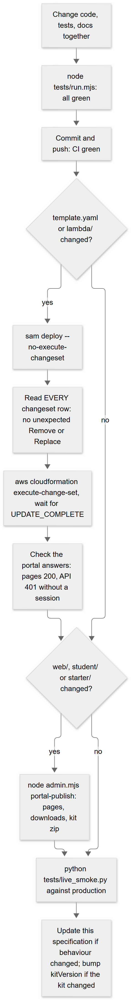

<details><summary>Diagram source (Mermaid, editable; GitHub also draws it)</summary>

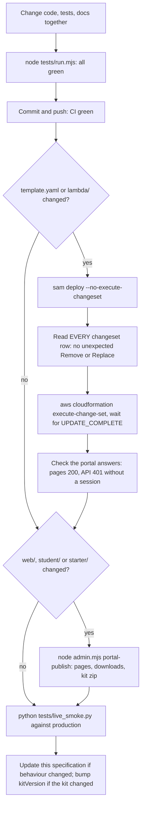

</details>
<!-- /diagram -->

Rules: deploy only from this folder with the safe routine; never execute a change set with an unexplained `Remove` or `Replace`; never run the live smoke test without understanding that it creates and deletes real (temporary) AWS and OpenRouter objects. **Rollback:** revert the commit and redeploy the previous template; restore a file from S3 versions; CloudFormation rolls back a failed update by itself.

### 7.4 Environments

There is **one production environment** and a **local simulation** (`tests/dev_server.py`, real code on in-memory AWS, with the demo students printed at startup). There is no staging stack.

---

## 8. Security specification

### 8.1 Principles

Least privilege per role; no standing secrets in students' hands; every limit enforced by the party that can enforce it (OpenRouter enforces the AI cap, DynamoDB conditions enforce counters, IAM enforces boundaries); derived state instead of stored state; safe order of operations; failures of optional services never block the teacher.

### 8.2 Controls

| Area | Control |
|---|---|
| Tokens | 128 random bits, only SHA-256 stored, shown once; expiry; revoke; regeneration requires teacher approval |
| Sessions | HMAC-signed, role-specific keys, short life, 401 on any mismatch |
| Teacher login | scrypt, constant-time compare, per-address lockout |
| Student isolation | the session decides the site folder and function name; a student can only reach their own `sites/<slug>/`, `sd-<slug>` and AI key |
| Bucket | private; only CloudFront reads `sites/*` and `portal/*` through origin access control; presigned PUT URLs expire in 10 minutes |
| Student functions | sandbox role (logs only) under a permission boundary; 256 MB; 10 s; no AWS credentials worth having; internet egress is open (accepted for a class) |
| Control plane | `DeployFunction` may manage only `sd-*` functions, pass only the sandbox role and only to Lambda, write only the student log groups |
| Gateway | direct calls refused (origin secret); nine ordered checks; request and response size limits; failure details never reach visitors or platform logs |
| Secrets | environment variables write-only; the AI management key readable by two functions through one named-secret statement; student AI keys never in any API response; a test fails on any committed key, token or email |
| Browser | no HTML parsing of text (DOM helper); no secrets in `web/`; `rel="noopener noreferrer"` on generated links |
| Supply chain | the MCP package is fetched from the portal by a **pinned** URL (a version never changes under a student; only the one-time `setup` command uses the newest alias), is published only by `portal-publish`, and its hash is in `mcp-version.json`; `setup` shows every change before writing, backs up, merges one entry and never rewrites a file it cannot parse; `init_project` writes only into an empty folder through a reader that refuses paths leaving it; the kit contains no secrets or personal data (scanned); the update command verifies a hash, accepts only managed paths, refuses unsafe paths; `npm install` scripts are not run on untrusted code during evaluations |
| Token on a student's computer | stored only in `.env.local`, written by `npm run login` after a git-ignore check; the checker errors if git tracks it; masked while typed; the MCP server and the rules keep it out of chat, logs and editor settings |
| Class storage | isolation by key (the API builds every database and S3 key from the caller's own key), hard caps and allowance, no AWS permission for any student role, private bucket with short-lived signed links (section 4.14) |
| Recovery | S3 versioning (30 days), DynamoDB point-in-time recovery, archived sites never auto-deleted |

### 8.3 IAM at a glance

| Role | Table | S3 | Lambda | Other |
|---|---|---|---|---|
| `DeployFunctionRole` | read, write, delete, scan; with storage also `StudentDataTable`: query, batch-write, delete (no reads of values) | sites bucket | create, update, delete, configure `sd-*` only | SSM read (two parameters), Secrets Manager (one secret), CloudFront invalidations and tenants, ACM, pass-role to the sandbox role only, logs for `sd-*` |
| `GatewayFunctionRole` | get, put, update | none | invoke `sd-*` only | none |
| `SweeperFunctionRole` | update, delete, scan | sites bucket | none | Secrets Manager (one secret), CloudFront tenants and invalidations |
| `StorageFunctionRole` (only with storage) | tokens table: get, update, and put or delete under `scoll#` only; `StudentDataTable`: get, put, delete, query | `userdata/*` objects; list limited to the `userdata/` prefix | none | none |
| `StudentSandboxRole` | none | none | none | write its own logs |

### 8.4 Residual risks (accepted for the MVP)

A student can call their own public `/api` from anywhere and can use their own capped AI key outside the platform until it is disabled or capped out. Student AI keys are readable by the platform roles with table access and by account administrators. Student functions have unrestricted internet egress. There is no Content-Security-Policy on the portal. One teacher account. Usage from the AI provider is counted late. The deploy token in a student's GitHub secret is as sensitive as a password: it is revocable by the teacher at any time.

---

## 9. Non-functional requirements

| Area | Specification |
|---|---|
| Availability | managed AWS services only; no servers to patch; single region |
| Latency targets (observed) | publish of a typical site about 25 s; backend ready in a few seconds; AI answer 1 to 2 s for a short Haiku reply |
| Capacity | Lambda concurrency quota **1,000** (granted 2026-10-22); in-flight caps currently 3 and 2 (12.3); API throttles in 4.7 |
| Cost model | pay per use (CloudFront, Lambda, API Gateway, DynamoDB on demand, S3); AI spend bounded per student by the cap and overall by the OpenRouter credit balance; a typical short AI answer costs well under $0.001 |
| Durability | S3 versioning; DynamoDB PITR; archived sites kept |
| Observability | CloudWatch logs per function (student logs retained 7 days); six alarms with email; the gateway logs one JSON line per call (slug, status, milliseconds) without bodies |
| Browser support | current evergreen browsers; pages work at phone width |
| Accessibility | semantic HTML, labelled inputs, focus outlines, progress bars with ARIA values |

---

## 10. Operations

### 10.1 Routine tasks

| Task | How |
|---|---|
| Create a student | teacher page, **New token**; hand over the token |
| Give a backend or AI | teacher page: **Backend: on**, **AI: on**, edit **Runs...** and **AI cap...** |
| Update the portal pages, the kit and the MCP package | `node admin.mjs portal-publish` (it uploads one new `class-platform-mcp-<version>.tgz`, moves the `class-platform-mcp.tgz` alias and `mcp-version.json`, and **keeps every older tarball**). To release a new package: bump `starter/mcp/package.json`, run the tests, publish; students move by running `setup` again |
| Deploy infrastructure | the safe routine in 7.3 |
| Reset the teacher password | `node admin.mjs teacher-setup <username>` |
| Verify production | `python tests/live_smoke.py` |

### 10.2 Alarms and alerts

| Alarm | Fires when |
|---|---|
| `lambda-concurrency-near-limit` | account-wide concurrency reaches `ConcurrencyAlarmThreshold` (8) in one minute |
| `lambda-throttles` | 5 or more throttled invocations in 5 minutes |
| `portal-function-errors` | 1 or more unhandled errors of `DeployFunction` in 5 minutes |
| `backend-gateway-errors` | 1 or more unhandled errors of `GatewayFunction` in 5 minutes |
| `sweeper-errors` | the daily sweeper failed (period 24 h) |
| `backend-5xx` | 20 or more 5xx answers from the Backend API in 5 minutes |
| `storage-errors` (only with storage) | 1 or more unhandled errors of `StorageFunction` in 5 minutes |

All notify `AlertsTopic`; the subscription is confirmed (a test alarm email was received). The cost budget on the account is the owner's own AWS Budget (not managed here).

### 10.3 Emergencies

Stop one student's AI or backend with the teacher switches (effective within about 10 s for the backend, immediately for the AI key). Stop all AI spend by disabling the `student:*` keys in the OpenRouter dashboard (setting `AiEnabled=false` only stops the platform managing keys). Stop all backends with `BackendEnabled="false"` and a deploy (functions stay, nothing is deleted). Recover a file with the S3 version commands. Details: [END_TO_END.md section 4](END_TO_END.md) and [AI_CONNECTOR.md section 7](AI_CONNECTOR.md).

---

## 11. Quality evidence at baseline

- Local suite: 36 steps green (including the specification check, the identifier guard and the diagram image check), including mutation-tested guards on the allowance, limiter, IAM scopes, AI lifecycle, helper error mapping, checker rules and the update command.
- CI: green on the baseline commit.
- Production: stack `UPDATE_COMPLETE`; live smoke test 74 checks passed at the baseline and 110 pass now (36 new ones are class storage, section J, including clearing and an IAM simulation of the portal function's role); the owner completed the student journey end to end (token, kit download, AI editor, push, deploy, class AI).
- AI evaluation of the kit: 13 agent runs, all pass the platform's gates; both adversarial prompts refused correctly.

---

## 12. Decisions, rejected alternatives and open items

### 12.1 Key decisions

| Decision | Why | Alternative rejected |
|---|---|---|
| Static hosting on S3 + CloudFront with one router function | cheapest, no servers, per-student isolation by path | one hosting product per student |
| One DynamoDB table, derived token status | atomic counters, nothing to keep in sync | status columns; several tables |
| Tokens stored hashed; plaintext shown once | a database leak cannot be replayed | reversible encryption |
| One Lambda per student behind a gateway | strong isolation, own logs and limits, teacher switch | shared multi-tenant function; Function URLs per student (no central limits) |
| Same-origin `/api` through CloudFront | no CORS, one address | cross-origin API with CORS allow-lists |
| Capped per-student OpenRouter keys | provider enforces the cap; no extra Lambda in the call path | a proxy Lambda (3 concurrent Lambdas per call at the old limit of 10); handing out the real key |
| Kit as scaffold + rules + checker + server validation | an AI cannot be trusted to follow prose alone | rules only; injecting code into students' packages |
| `AGENTS.md` canonical with identical copies | one source, any editor | per-editor rule sets that drift |
| Deterministic kit zip and manifest | stable hashes and safe updates | timestamps in the zip |
| Storage isolation by an opaque key and a separate API | all student functions share one role; per-student roles would let the portal create IAM roles and delay every deploy | per-student IAM roles with `LeadingKeys` conditions |
| DynamoDB and S3 for students, **no RDS** | on-demand, near-zero idle cost; an always-on database costs 20 to 50 times more, needs a private network, and one server would be shared | RDS or Aurora per class or per student |
| The token is saved by a guarded login command, not typed into files | a mistyped or committed token is the main way to leak access | asking students to create `.env` by hand |
| MCP server as an optional layer over the same scripts | works for editors that support it without a second implementation; `deploy` needs an explicit yes | MCP as the only path; a custom editor plugin |
| Documentation diagrams as PNG plus collapsed Mermaid | readable in every viewer; one editable source with a drift test | images only; Mermaid only |
| The MCP server is a package run by `npx` from a pinned portal URL, not part of the kit | no download for the student, one place to publish, versions that cannot change under a student | a GitHub-hosted package (needs git or a public repo and depends on a branch), a remote MCP server on AWS (cannot see the student's files, so cannot deploy), keeping it only inside the kit |
| One `setup` command that edits the editors' settings with consent, backup and a safe merge | the manual paste into a JSON file was the failure seen in the first Antigravity run | asking students to edit the settings by hand; silently overwriting files |
| Tests drive real code on in-memory AWS | fast, free, deterministic; live smoke covers the rest | mocking at the call level |

### 12.2 Lessons built into the design (selected)

Presigned URLs need a SigV4 client; cfn-lint misses circular dependencies (the change set catches them); the gateway must cache "no backend" briefly (2 s) so a fresh deploy is not refused; JSON from providers can start with whitespace; DynamoDB rejects floats; Windows Node can print a libuv assertion if a program calls `process.exit()` while sockets are closing; a test must not run a child synchronously when it hosts a server in the same process. More in [../learning.md](../learning.md).

### 12.3 Known limitations and open items (priority order)

| # | Item | Status |
|---|---|---|
| 1 | **Re-tune capacity after the quota increase:** in-flight caps (3 and 2), `ConcurrencyAlarmThreshold` (8, to about 800) and per-student reserved concurrency were set for the old limit of 10 | open; do with a load test |
| 2 | Publish the **public template repository** (`TEMPLATE_URL` in `web/github.js`) | waiting for the owner to create the empty repository |
| 3 | **Deploy activity history** ("did my push go live?"); the checklist currently ticks "published" from the last deploy of any kind | planned |
| 4 | A **capped per-student storage connector** (students need shared data; AI agents otherwise invent different external services) | **live** (section 4.14), deployed and live-tested 2026-10-24; a pilot is next |
| 5 | **Pilot** with two or three real students | planned |
| 6 | Alert when the OpenRouter credit balance runs low; teacher view of AI spend across students | planned |
| 7 | "Rotate this student's key" button (manual runbook exists) | planned |
| 8 | Custom-domain infrastructure into CloudFormation | known gap, documented |
| 9 | Several teacher accounts; Content-Security-Policy; "Request more runs" from the student | backlog |
| 10 | Whether each AI editor actually loads the rule files (agents in the evaluation were told to read `AGENTS.md`) | not verified |
| 12 | Class storage: **deployed and live-tested** (36 live checks, including the presigned upload to real S3, S3's own size refusal, CORS headers and the off switch). Still open: the API throttle was not load-tested; decide whether the data table needs point-in-time recovery; pilot with real students | partly done |
| 16 | The MCP package (`npx` from the portal URL, `setup`, `init_project`, roots) is tested end to end against the dev portal and **published** (a real `npx -y https://deploy.example.edu/class-platform-mcp.tgz version` was run against production); **not yet run in a real editor by the owner**: the editors' settings paths are the part most likely to differ between versions (Cursor and Claude Code are not set up by `setup`; the *Add to VS Code* install link is untried) | open: the owner's check in VS Code and Antigravity |
| 13 | MCP server in real editors: **VS Code and Antigravity both confirmed by the owner.** VS Code needs the one-click *Migrate* that newer versions offer (it rewrites `.vscode/mcp.json` to `.mcp.json` with absolute paths and `"type": "local"`); the kit keeps shipping `.vscode/mcp.json` because a portable `.mcp.json` would need `${workspaceFolder}` to be expanded, which is unconfirmed. Antigravity needs the pasted file to be pure JSON with the `mcpServers` wrapper (kit 1.5.1 prints exactly that). Not yet exercised in a real editor: `update_kit` and the update notice | mostly verified |
| 14 | **Re-run the AI evaluation** against the kit 1.2 to 1.5 rules (Deploying, class storage, keeping the kit current) | open |
| 15 | `platform update` now adds missing kit scripts (kit 1.5.0); a project on kit 1.1 to 1.4 needs `update --apply` twice (the first run brings the new `platform.mjs`) | resolved, with that one caveat |
| 11 | The kit's GitHub workflow has run on a real runner in the owner's test; a wider pilot will show real-world friction | partly verified |

---

## 13. Requirements traceability

| Req | Requirement | Implementation | Tests |
|---|---|---|---|
| R1 | Expiring tokens with extend, revoke, offline, regeneration | `portal.py` | `test_portal.py`, `test_portal_deploy.py` |
| R2 | Status derived from time; read-only grace period; sweeper archives | `portal.status_of`, `portal.sweep`, `app.sweep` | same |
| R3 | Student publishes a static site, only their own folder | `app.publish`, `app.portal_deploy` | `test_lambda.py`, `test_portal_deploy.py`, e2e steps |
| R4 | Safe zip handling | `app.site_entries`, `backends.inspect_zip` | `test_lambda.py`, `test_backend.py`, `test_web.mjs` |
| R5 | Wildcard host routing, SPA fallback | `RouterFunction` | router tests |
| R6 | One custom domain per student, teacher-gated | `domains.py` | `test_domains.py`, `test_tenant_config.py` |
| R7 | One backend per student, Python or Node, sandboxed | `backends.py`, `StudentSandboxRole` | `test_backend.py`, `test_template_backend.py` |
| R8 | Gateway checks in order; exact run allowance; in-flight limiter | `gateway.py` | `test_backend.py` (60 parallel callers) |
| R9 | Environment variables are write-only | `backends.set_env`, `view` | `test_backend.py` |
| R10 | AI key per student, capped, revocable, lifecycle-synced, never exposed | `ai.py`, `openrouter.py`, template secret scope | `test_ai.py`, `test_template_ai.py`, live smoke H |
| R11 | Deploy from GitHub with the token | `student/portal-deploy.mjs`, workflows | `test_portal_cli.mjs`, `test_kit_e2e.mjs`, live smoke I |
| R12 | Kit makes AI editors follow the architecture; checker blocks violations | `starter/` | `test_kit.mjs`, `test_class_ai.*`, AI evaluation |
| R13 | Kit updates are safe | `tools/platform.mjs`, `starter/zip.mjs` | `test_kit_update.mjs` |
| R14 | Alerts, recoverable files, backups | `template.yaml` | `test_template_ops.py`, live alarm test |
| R15 | No secret or email in the repository | tests that scan the repo | `test_template_ai.py`, `test_template_ops.py`, `test_kit.mjs` |
| R17 | Per-student data and files, capped, isolated, switchable, clearable by the teacher, never exposing a key or the content | `storage.py`, `storage_api.py`, `class_storage.*`, `template.yaml` | `test_storage.py`, `test_class_storage.*`, `test_template_storage.py`, `test_kit_e2e.mjs` |
| R18 | A student can deploy from their computer with one command, and an AI editor can do it with consent | `portal-deploy.mjs` (`login`, `status`), `tools/mcp.mjs`, `.vscode/mcp.json` | `test_portal_cli.mjs`, `test_mcp.mjs`, `test_kit.mjs` |
| R19 | An AI editor is connected with one command and no kit download, safely, and the student can start from an empty folder | `starter/mcp/*`, `build-mcp-package.mjs`, `publish-files.mjs`, `web/github.js` | `test_mcp_package.mjs`, `test_web.mjs`, `test_kit.mjs` |
| R16 | This specification matches the code | section 14 and `tests/test_spec.py` | `test_spec.py` |

---

## 14. Machine-checked facts

`tests/test_spec.py` reads the JSON block below and compares every value with the code and the template. If you change a limit, a timeout, a default, the kit version or the number of test steps, update this block **and** the prose above in the same commit.

```json spec-facts
{
  "frontend": { "maxZipMB": 50, "maxUnzippedMB": 200, "maxFiles": 2000 },
  "backend": { "maxZipMB": 5, "maxUnzippedMB": 50, "maxFiles": 500, "memoryMB": 256, "timeoutSeconds": 10, "logRetentionDays": 7, "maxEnvVars": 20, "maxEnvBytes": 4096 },
  "gateway": { "maxBodyBytes": 1048576, "maxResponseBytes": 1048576, "perIpPerMinute": 120, "inflightGlobal": 3, "inflightPerStudent": 2, "leakSeconds": 60 },
  "sessions": { "teacherHours": 8, "studentHours": 12, "maxFailedLogins": 5, "lockoutMinutes": 15 },
  "tokens": { "maxDays": 365, "graceDays": 3, "warnDays": 3 },
  "ai": { "minUsd": 0.01, "maxUsd": 20, "defaultUsd": 0.25, "refreshSeconds": 20, "studentTimeoutSeconds": 25, "defaultModel": "anthropic/claude-haiku-5.5", "envNames": ["OPENAI_API_KEY", "OPENAI_BASE_URL", "AI_MODEL"] },
  "storage": { "maxValueKB": 64, "maxItems": 5000, "maxFileMB": 5, "maxFiles": 100, "maxCollections": 50, "defaultDataMB": 5, "maxDataMB": 100, "defaultFilesMB": 50, "maxFilesMB": 500, "defaultOps": 10000, "defaultPeriod": "day", "listPageItems": 100, "envNames": ["CLASS_STORAGE_URL", "CLASS_STORAGE_KEY"] },
  "lambdas": {
    "DeployFunction": { "memory": 1024, "timeout": 29 },
    "GatewayFunction": { "memory": 256, "timeout": 29 },
    "StorageFunction": { "memory": 256, "timeout": 10 },
    "SweeperFunction": { "memory": 512, "timeout": 300 }
  },
  "apiThrottles": { "BackendApi": { "rate": 10, "burst": 20 }, "DeployApi": { "rate": 20, "burst": 50 }, "StorageApi": { "rate": 20, "burst": 40 } },
  "templateParameterDefaults": { "BackendEnabled": "false", "AiEnabled": "false", "StorageEnabled": "false", "OfflineGraceDays": "3", "ConcurrencyAlarmThreshold": "8", "AiDefaultLimitUsd": "0.25", "AiDefaultModel": "anthropic/claude-haiku-5.5", "AiSecretName": "openrouter" },
  "deployedParameters": { "BackendEnabled": "true", "AiEnabled": "true", "StorageEnabled": "true", "PortalAlias": "true" },
  "sweeperCron": "cron(0 3 * * ? *)",
  "s3Lifecycle": { "uploadsExpireDays": 1, "noncurrentVersionDays": 30 },
  "reservedSlugs": ["sites", "uploads", "archive", "deploy", "www", "api", "admin", "mail", "ftp", "app", "apps", "static", "assets", "bs", "lenden"],
  "kitVersion": "1.6.0",
  "mcpPackage": { "version": "1.0.0" },
  "testSteps": 38,
  "alarms": ["lambda-concurrency-near-limit", "lambda-throttles", "portal-function-errors", "sweeper-errors", "backend-gateway-errors", "backend-5xx", "storage-errors"]
}
```

---

## Appendix A: gateway error catalogue

| Status | `error` | When | Extra |
|---|---|---|---|
| 403 | `forbidden` | missing or wrong origin secret, or the token is revoked | |
| 404 | `not_found` | the path is not `/b/<slug>/...` | |
| 404 | `no_backend` | no backend deployed, still creating, or removed | |
| 413 | `payload_too_large` | request body over 1 MB | |
| 403 | `token_expired` | the student's token has expired | |
| 503 | `site_offline` | the site is offline or archived | |
| 503 | `backend_off` | the teacher turned the backend off | |
| 429 | `too_many_requests` | one visitor over 120 requests per minute | `retry-after: 30` |
| 429 | `busy` | in-flight caps reached, or AWS throttled | `retry-after: 1` |
| 429 | `allowance_exhausted` | the run allowance is used up | `resets_at`, `retry-after` |
| 504 | `function_timeout` | the function ran past its timeout | |
| 502 | `function_error` | the function crashed | details only in the student's logs |
| 502 | `bad_response` | invalid status, headers or JSON | |
| 502 | `response_too_large` | response over 1 MB | |
| 502 | `backend_unavailable` | AWS could not invoke the function | |

Portal API errors use the same `{"error": "message"}` shape with these statuses: `400` invalid input, `401` bad credentials or session, `403` not allowed (not enabled, token not active, too early to request regeneration), `404` unknown token or route, `409` conflict (name taken, backend not ready, function updating, request already pending), `429` login lockout, `502` AWS or OpenRouter refused, `503` feature not set up.

## Appendix B: glossary

| Term | Meaning |
|---|---|
| Token | the secret a student signs in with (`mds_...`); stored only as a hash |
| Slug | the student's site name, the `<name>` in `<name>.example.edu` |
| Run | one request that reached a student's function (counted against the allowance) |
| Gateway | the Lambda through which every student-backend request passes |
| Sweeper | the daily Lambda that archives expired sites and syncs AI keys |
| Class AI | the teacher-controlled, capped AI key given to a student's backend |
| Management key | the platform's OpenRouter key that can create and disable student keys |
| Kit | the starter project, rules, checker and helper a student downloads |
| Managed file | a kit file the update command may replace (listed in `platform.json`) |
| Change set | the preview CloudFormation shows before an update is executed |
