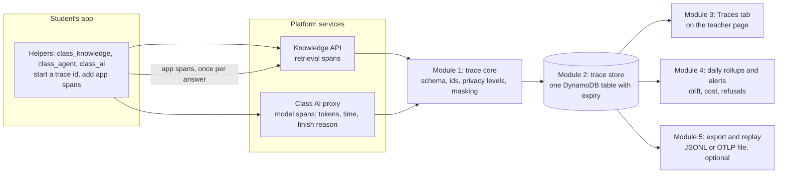
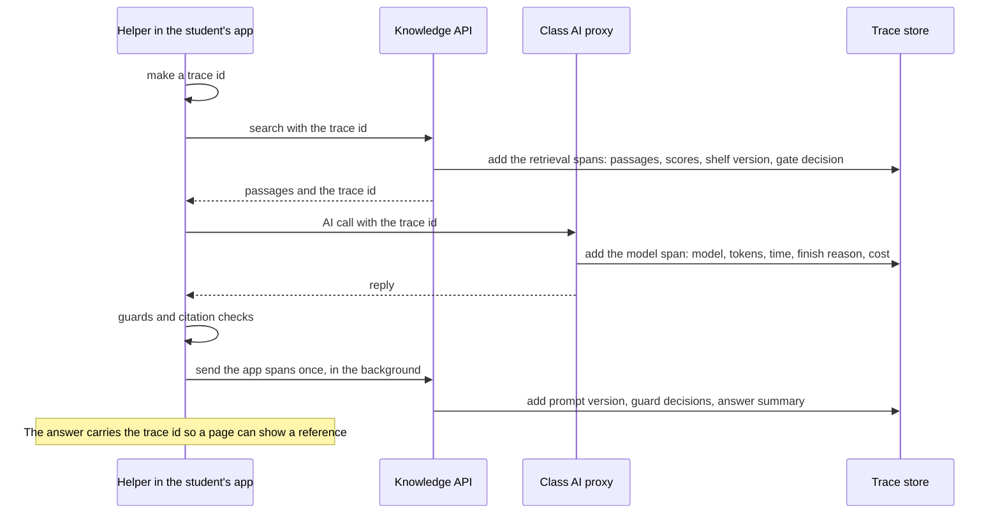

# Traceability plan: seeing exactly what happened in every answer

> **Status: a plan, nothing is built yet.** It was written for a budget of **$4 to $5 a month** for this feature, a platform that must stay simple and modular, and an owner who is not a tracing expert, so the plan makes the choices and lists only what must be confirmed. It belongs with [RAG_GUIDE.md](RAG_GUIDE.md) (the pipeline being traced), [AGENT_GUIDE.md](AGENT_GUIDE.md) (the agent being traced) and the guardrail and evaluation plan (which reads these traces).

---

## 1. The goal in one sentence

For **any answer** the platform gave, you can open one page and see **what was asked, what was found, what the model was told, what it replied, what the guards decided, what it cost, and whether the visitor liked it**, and you can ask the reverse question: **which answers used this document?**

## 2. The decision: our own simple format, shaped like the standard

| Option | Verdict |
|---|---|
| A hosted tracing service (LangSmith, Langfuse Cloud, Arize AX) | **Not in version 1.** Data leaves your account, it costs per trace, and customers who want their data to stay in their AWS would object. An **optional export** can come later |
| A self-hosted tracing server (Phoenix, Langfuse) running all month | **No.** A container that is always on costs roughly $10 to $30 a month and is another thing to operate |
| The full OpenTelemetry stack (SDK, collector) | **No.** Too heavy for student functions that are standard-library only |
| **Our own small trace record, shaped like OpenTelemetry and OpenInference (the naming Arize uses)** | **Yes.** It costs almost nothing, stays in your account, needs no new libraries, and can be exported to Phoenix, Langfuse or LangSmith later because the shapes map one to one |

So the answer to "OpenTelemetry with custom" is: **our own storage and viewer, with the standard's field names, so nothing is locked in.**

## 3. The design in five small modules

<!-- diagram:c71ae7e6 -->

Diagram source (Mermaid, editable; GitHub also draws it)

<!-- /diagram -->

| Module | Does | Why it is separate |
|---|---|---|
| **1. Trace core** | Defines the record, makes ids, applies the privacy level, masks secrets and personal data | One place for the rules; used by every service; tested alone |
| **2. Trace store** | One small DynamoDB table; **one item per trace** holding its spans; items expire automatically | No servers; retention is automatic; easy to delete |
| **3. Traces tab** | A list with filters, and one trace in detail | The only part a teacher sees |
| **4. Rollups and alerts** | A daily summary per app and shelf, and CloudWatch alarms | Drift, cost and refusal rate without a dashboard product |
| **5. Export and replay** | Download a day as a file; re-run stored questions with new settings | Optional; the bridge to Phoenix or Langfuse |

**No new libraries and no always-on servers.** One new table, narrow permissions for the two services that write to it, and a few teacher-page routes.

## 4. How one answer is traced

<!-- diagram:077d1c91 -->

Diagram source (Mermaid, editable; GitHub also draws it)

<!-- /diagram -->

Three rules keep it safe and simple:
1. **The platform traces by itself.** Every model call is traced by the AI proxy and every search by the knowledge API, **even if a student wrote their own code**. App spans are an extra, labelled "from the app".
2. **Tracing never slows or breaks an answer.** The app spans are sent in the background with a short timeout, and a failure only increments a "dropped" counter.
3. **One write per service per request**, so the cost stays tiny.

## 5. What a trace contains

| Stage | Recorded |
|---|---|
| Request | trace id, app, shelf, helper version, time, risk tier |
| Question | length, language, hash (text only at a higher privacy level) |
| Retrieval | shelf version, settings version, candidate passage ids, meaning and word scores, the best similarity, the confident decision and the thresholds used |
| Lineage | for each passage: document id, file hash, how it was cut and embedded |
| Prompt | template version, which passage ids went in, size |
| Model call | model id, settings, tokens in and out, time, finish reason, retries, cost |
| Guards (later) | rule-set version, each decision and reason |
| Answer | length, citations and which were used, whether it refused |
| Agent (if used) | each step: tool, arguments, refusal, approval, resume, budget use |
| After | the visitor's thumbs, a teacher's flag, an evaluation result |

## 6. Privacy: three levels, one setting per student

| Level | Stored | Kept for |
|---|---|---|
| **Metadata only (default)** | Everything in section 5 **except** the question, passages and answer **text** | **90 days** |
| **Metadata and text, masked** | Plus the question and answer, with secrets, phone numbers, email addresses and common ID numbers (including Indian ones) masked | **30 days** |
| **Full** | Plus the prompt and passage text | **30 days**, for debugging windows or explicit consent |

- The teacher chooses the level on the **student's Class knowledge card** (one drop-down).
- **Always kept in full for failures** (low confidence, guard flags, thumbs-down, errors), **but never above the level allowed**.
- **Never stored:** keys, tokens, passwords.
- Deleting a student, a token or a shelf **also deletes their traces** (tested).
- Hindi text is stored as it is, and hashes are made from normalised text.
- Only the teacher sees traces in version 1.

## 7. Cost: well inside $4 to $5

Estimates (to be confirmed against real usage): about 6 spans per answer, a 3 KB trace for metadata only, a 40 KB trace for full text.

| Volume per month | Metadata only | Everything at full text |
|---|---|---|
| 10,000 answers | **under $1** | **about $1** |
| 100,000 answers | about $2 | about $4 |

Cost drivers: DynamoDB writes and storage (the table expires items by itself), a small CloudWatch line per trace for alarms, and a few milliseconds of Lambda time.

**Guards that keep it under the ceiling:**
- a **daily trace limit per student** (like the search allowance), after which only counters are kept;
- a **maximum trace size**, with long text cut;
- a **monthly trace budget** that stops text capture first and metadata last;
- the privacy default is the cheapest level.

## 8. What the Traces tab shows

- A list: time, app, shelf, outcome (answered, refused, flagged, error), best similarity, time, tokens, cost, thumbs.
- Filters: app, shelf, outcome, date, flagged, thumbs-down, **by trace id** (the reference a visitor reports).
- One trace: the timeline of stages, the retrieved passages (ids and scores, and text only if the level allows), the model and its settings, the guard decisions, the answer summary.
- Actions: **flag**, and later **add to the test set** (turns a real failure into a permanent regression case).
- A **lineage search**: pick a document and see every recent answer that used it.

## 9. The roadmap (each step works on its own)

| Step | Deliverable | Done when |
|---|---|---|
| **T0. Schema** | The trace schema document, the privacy levels, the id and version conventions, and a sample trace | You have read and approved the sample |
| **T1. Platform traces** | The trace store, and the knowledge API and AI proxy write metadata-only traces; the trace id is returned in answers | 100% of searches and AI calls have a trace; no extra failures; a deletion test passes |
| **T2. Helper spans** | `answer()` and the agent send their spans; the starter page can show a reference | One answer shows search, prompt, model and answer in one trace |
| **T3. Traces tab** | The viewer, filters, the privacy drop-down, flag, retention | You find a bad answer and open it within a minute |
| **T4. Privacy hardening** | Masking, the text levels, access checks, deletion on removal, size and rate limits | Tests prove masking, expiry and deletion |
| **T5. Rollups and alerts** | A daily summary per app and shelf, CloudWatch alarms (errors, refusal rate shift, latency), lineage search, cost per shelf | A drift alert fires in a test; cost per shelf is visible |
| **T6. Export and replay** | Download a day as a file, import into Phoenix on a laptop, re-run stored questions with new settings and compare | A stored question is replayed against a new setting |

**Where it fits in the whole programme:**
1. Benchmark documents, then the per-shelf settings file (already agreed).
2. **T0 and T1**, so the benchmark and attack tests produce traces from the start.
3. Guard step G0 (threat model, attack set, baseline), which **uses the traces**.
4. T2 and T3, then guard steps G1 and G2.
5. T4 before any real business data; T5 and T6 afterwards.

## 10. What we will not do (on purpose)
- No hosted tracing service in version 1 (only an optional export file later).
- No always-on tracing server.
- No OpenTelemetry collector or SDK in student functions.
- No text capture unless you choose it per student.
- No student-visible traces in version 1.

## 11. Risks and answers

| Risk | Answer |
|---|---|
| Sensitive text in traces | Metadata by default, masking, short retention, encryption, deletion on removal |
| Cost creeps up | Per-student daily limit, size cap, a trace budget with an order of what to stop first |
| An app edits its own spans | Platform spans are trusted and marked; app spans are marked as such |
| Tracing breaks an answer | Background send, short timeout, drop counter |
| The format changes | The schema is versioned and tested; exporters map to the standard names |
| Hot or slow lookups | One item per trace, a day-based index, expiry; fine at this scale |

## 12. Settings you can veto (my defaults)

| Setting | My default |
|---|---|
| Default privacy level | Metadata only |
| Retention | 90 days metadata, 30 days text |
| Who sees traces | Teacher only |
| Hosted export | Off, and not in version 1 |
| Trace reference shown to visitors | Yes, a short reference under the answer |
| Daily trace limit per student | Same as the search allowance |
| Monthly trace budget | $4 |
