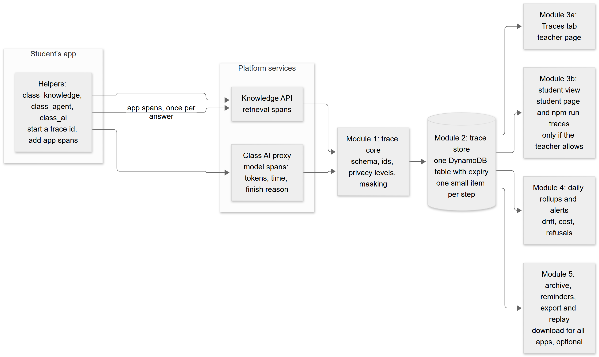
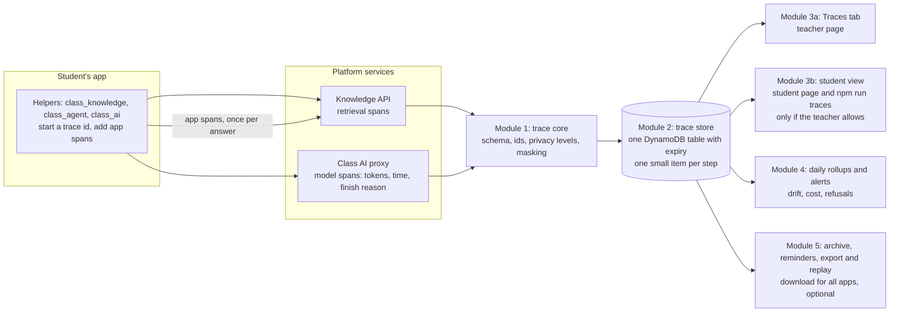
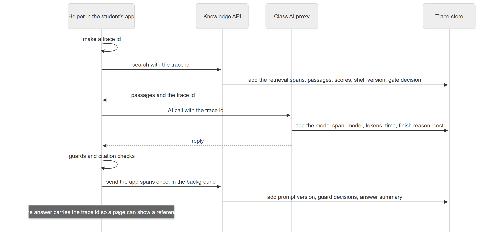
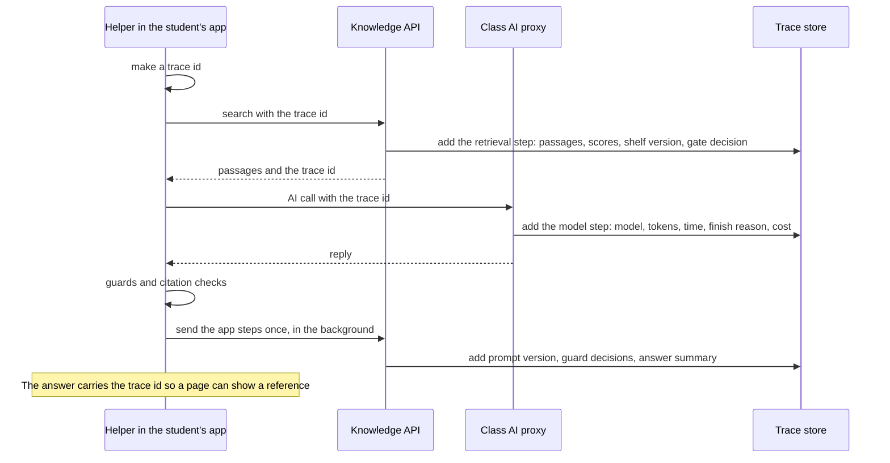

# Traceability plan: seeing exactly what happened in every answer

> **Status: T0 (schema, [TRACE_SCHEMA.md](TRACE_SCHEMA.md)) and T1 (store, settings, platform steps from the AI proxy and the knowledge search, teacher routes) are built and applied to the owner's platform; T2 (helper steps, trace reference on the starter page) is built and tested locally, not yet published to students. T3 (the teacher's Traces tab and per-student settings) is built and checked locally in a browser, not yet published. T4 (the student's view of their own traces: routes and `npm run traces`) is built and tested locally, not yet published. T7's archive, expiry banner, monthly email and download are built and tested locally, not yet published; replay and the Phoenix file are not built. T5 and T6 are not built. The owner has approved the defaults in section 12.** It was written for a budget of **$4 to $5 a month** for this feature, a platform that must stay simple and modular, and an owner who is not a tracing expert, so the plan makes the choices and lists only what must be confirmed. It belongs with [RAG_GUIDE.md](RAG_GUIDE.md) (the pipeline being traced), [AGENT_GUIDE.md](AGENT_GUIDE.md) (the agent being traced) and the guardrail and evaluation plan (which reads these traces).
>
> **Changes since the first version (owner decisions):** retention is **90 days for everything**, with **reminders and an easy download** for the teacher; **students can see the traces of their own app** when the teacher allows it (a toggle per student). The cost design was also corrected: traces are stored as **small items per step**, not one growing item (section 3).

---

## 1. The goal in one sentence

For **any answer** the platform gave, you can open one page and see **what was asked, what was found, what the model was told, what it replied, what the guards decided, what it cost, and whether the visitor liked it**, and you can ask the reverse question: **which answers used this document?**

## 2. The decision: our own simple format, shaped like the standard

| Option | Verdict |
|---|---|
| A hosted tracing service (LangSmith, Langfuse Cloud, Arize AX) | **Not in version 1.** Data leaves your account, it costs per trace, and customers who want their data to stay in their AWS would object. An **optional export file** comes later |
| A self-hosted tracing server (Phoenix, Langfuse) running all month | **No.** A container that is always on costs roughly $10 to $30 a month and is another thing to operate |
| The full OpenTelemetry stack (SDK, collector) | **No.** Too heavy for student functions that are standard-library only |
| **Our own small trace record, shaped like OpenTelemetry and OpenInference (the naming Arize uses)** | **Yes.** It costs almost nothing, stays in your account, needs no new libraries, and can be exported to Phoenix, Langfuse or LangSmith later because the shapes map one to one |

## 3. The design in five small modules

<!-- diagram:4cd39b79 -->

Diagram source (Mermaid, editable; GitHub also draws it)

<!-- /diagram -->

| Module | Does | Why it is separate |
|---|---|---|
| **1. Trace core** | Defines the record, makes ids, applies the privacy level, masks secrets and personal data | One place for the rules; used by every service; tested alone |
| **2. Trace store** | One small DynamoDB table; **one small item per step, grouped under the trace id**; items expire automatically after 90 days | No servers; retention is automatic; easy to delete |
| **3a. Traces tab** | A list with filters, and one trace in detail (teacher page) | The only part a teacher sees |
| **3b. Student view** | The same data, limited to the student's own app, on the student page and through `npm run traces` | Developers need it, and the teacher controls it |
| **4. Rollups and alerts** | A daily summary per app and shelf, and CloudWatch alarms | Drift, cost and refusal rate without a dashboard product |
| **5. Archive, reminders, export and replay** | Reminds the teacher before traces expire, downloads an archive for all apps, exports a file for Phoenix, replays stored questions with new settings | Optional; the bridge to other tools |

**No new libraries and no always-on servers.** One new table, narrow permissions for the two services that write to it, and a few teacher-page and student-page routes.

**Cost correction.** The first version said "one item per trace". But DynamoDB charges writes by the **size of the item written**, and a trace is written by several services, so one growing item would be rewritten again and again. **One small item per step** (grouped under the trace id, with a sparse "summary" item per trace for the list) costs a few times less. Reading a trace is one query.

## 4. How one answer is traced

<!-- diagram:72750d7b -->

Diagram source (Mermaid, editable; GitHub also draws it)

<!-- /diagram -->

Three rules keep it safe and simple:
1. **The platform traces by itself.** Every model call is traced by the AI proxy and every search by the knowledge API, **even if a student wrote their own code**. App steps are an extra, labelled "from the app".
2. **Tracing never slows or breaks an answer.** The app steps are sent in the background with a short timeout, and a failure only increments a "dropped" counter.
3. **One small write per step**, so the cost stays tiny.

## 5. What a trace contains

| Stage | Recorded |
|---|---|
| Request | trace id, app, shelf, helper version, time, risk tier |
| Question | length, language, hash (text only at a higher privacy level) |
| Retrieval | shelf version, settings version, candidate passage ids, meaning and word scores, the best similarity, the confident decision and the thresholds used |
| Lineage | for each passage: document id, file hash, how it was cut and embedded |
| Prompt | template version, which passage ids went in, size |
| Model call | model id, settings, tokens in and out, time, finish reason, retries, cost |
| Guards (later) | rule-set version, each decision and reason |
| Answer | length, citations and which were used, whether it refused |
| Agent (if used) | each step: tool, arguments, refusal, approval, resume, budget use |
| After | the visitor's thumbs, a teacher's flag, an evaluation result |

## 6. Privacy, retention, reminders and who can see traces

### 6.1 Privacy: three levels, one setting per student

| Level | Stored |
|---|---|
| **Metadata only (default)** | Everything in section 5 **except** the question, passages and answer **text** |
| **Metadata and text, masked** | Plus the question and answer, with secrets, phone numbers, email addresses and common ID numbers (including Indian ones) masked |
| **Full** | Plus the prompt and passage text |

- The teacher chooses the level on the **student's Class knowledge card** (one drop-down).
- **Always kept in full for failures** (low confidence, guard flags, thumbs-down, errors), **but never above the level allowed**.
- **Never stored:** keys, tokens, passwords.
- Deleting a student, a token or a shelf **also deletes their traces** (tested).
- Hindi text is stored as it is, and hashes are made from normalised text.
- **Visitors' privacy:** the starter page gets a short, editable line ("Questions are logged to improve this service") shown whenever text is stored.

### 6.2 Retention: 90 days for everything
- **One rule: every trace is kept 90 days**, then expires by itself.
- **Longer text retention means more personal text kept longer**, so the teacher can **shorten it per student** (30, 60 or 90 days, default 90), and the masked level stays the recommended text level.
- Storage for 90 days is part of the cost estimate in section 7.

### 6.3 Reminders and an easy download (Module 5)
- **The teacher is reminded before traces expire**, in two ways: a **banner on the Traces tab** ("Traces from 1 August to 14 August expire in 14 days: download an archive"), and an **optional monthly email** through the platform's existing alert email.
- **One download for everything:** a button that produces **one file for all apps** (or one app, or one shelf) for a **date range**, as a compressed JSON-lines file. It respects the privacy level in force: text appears only if it was stored.
- The download is **the teacher's responsibility once it leaves the platform** (it may contain personal text). The button says so.
- *Later, optional:* a **monthly automatic archive into the teacher's S3 bucket** (compressed, cheap to keep for a year), **off by default**.
- **Rule: the reminder and download ship before any trace can expire** (before day 60 after the first traces are stored).

### 6.4 Who can see traces
- **The teacher:** every app, all traces.
- **A student:** only the traces of **their own app**, **only if the teacher allows it**, with one drop-down per student on the Class knowledge card:

| Student can see | Meaning |
|---|---|
| **Off** | Nothing |
| **Metadata only (default)** | Steps, scores, timing, tokens, decisions; no text, even if text is stored |
| **As stored** | The same as the teacher sees for that student, including text if it was stored |

- Why students should see them: they are developers, like the logs they already read with `npm run logs`. A trace shows them *why* their app answered wrongly.
- **Isolation (tested):** the student's login decides which traces they can see; there is no way to name another student's trace, and a trace id from another app returns "not found".
- A student can never see keys or another app's data, and platform-only fields (internal cost rates) are hidden.
- Text captured in a student's traces includes **their visitors' questions**, which is why the default for students is metadata only, and why the visitor notice exists.

## 7. Cost: well inside $4 to $5

Estimates (to be confirmed against real usage and current prices): about 6 steps per answer; a metadata-only trace is about 4 KB in total, a full-text trace about 25 KB; DynamoDB on demand charges writes by size (per KB) and storage per GB-month; 90 days of data are kept at all times.

| Volume per month | Metadata only | Masked or full text |
|---|---|---|
| 10,000 answers | **about $0.30** | **about $1** |
| 100,000 answers | **about $1 to $2** | **about $4 to $5** (at the edge of the budget) |

Plus a few cents for the CloudWatch line per trace (alarms) and a few milliseconds of Lambda time.

**Guards that keep it under the ceiling:**
- a **daily trace limit per student** (the same as the search allowance), after which only counters are kept;
- a **maximum size** per step, with long text cut;
- a **monthly trace budget ($4)** that **stops text capture first and metadata last**;
- the default is the cheapest level, and teachers can shorten retention per student.

## 8. What the viewers show

**Teacher: the Traces tab**
- A list: time, app, shelf, outcome (answered, refused, flagged, error), best similarity, time, tokens, cost, thumbs.
- Filters: app, shelf, outcome, date, flagged, thumbs-down, **by trace id** (the reference a visitor reports).
- One trace: the timeline of stages, the retrieved passages (ids and scores, and text only if the level allows), the model and its settings, the guard decisions, the answer summary.
- Actions: **flag**, and later **add to the test set** (turns a real failure into a permanent regression case).
- A **lineage search**: pick a document and see every recent answer that used it.
- The retention banner and the **Download archive** button.

**Student: the same, limited to their app**
- A **Traces panel** on the student page, and **`npm run traces`** in the project (list recent, show one by id), so an AI editor can read a trace too. An editor tool can follow later.
- No archive button (the teacher handles that).

## 9. The roadmap (each step works on its own)

| Step | Deliverable | Done when |
|---|---|---|
| **T0. Schema** | The trace schema document, the privacy levels, the id and version conventions, and a sample trace | You have read and approved the sample |
| **T1. Platform traces** | The trace store, and the knowledge API and AI proxy write metadata-only traces; the trace id is returned in answers; 90-day expiry | 100% of searches and AI calls have a trace; no extra failures; a deletion test passes |
| **T2. Helper spans** | `answer()` and the agent send their steps; the starter page can show a reference and the visitor notice | One answer shows search, prompt, model and answer in one trace |
| **T3. Traces tab (teacher)** | The viewer, filters, the privacy drop-down, retention per student, flag | You find a bad answer and open it within a minute |
| **T4. Student view** | The per-student visibility toggle, the student routes and panel, `npm run traces` | A student sees only their own app; another app's id is "not found"; off means nothing |
| **T5. Privacy hardening** | Masking, the text levels, access checks, deletion on removal, size and rate limits | Tests prove masking, expiry and deletion |
| **T6. Rollups and alerts** | A daily summary per app and shelf, CloudWatch alarms (errors, refusal rate shift, latency), lineage search, cost per shelf | A drift alert fires in a test; cost per shelf is visible |
| **T7. Archive, reminders, export, replay** | The expiry banner and monthly email, **one download for all apps**, a file for Phoenix on a laptop, replay of stored questions with new settings | The download works for all apps, **and it ships before day 60 after T1** |

**Where it fits in the whole programme:**
1. Benchmark documents, then the per-shelf settings file (already agreed).
2. **T0 and T1**, so the benchmark and attack tests produce traces from the start.
3. Guard step G0 (threat model, attack set, baseline), which **uses the traces**.
4. T2, T3 and T4, then guard steps G1 and G2.
5. T5 before any real business data; T6 next; **T7 no later than day 60 after T1**.

## 10. What we will not do (on purpose)
- No hosted tracing service in version 1 (only an optional export file later).
- No always-on tracing server.
- No OpenTelemetry collector or SDK in student functions.
- No text capture unless the teacher chooses it per student.
- Students never see traces of another app, and never see text unless the teacher allows it.

## 11. Risks and answers

| Risk | Answer |
|---|---|
| Sensitive text in traces, kept 90 days | Metadata by default, masking, retention shortened per student, encryption, deletion on removal |
| Students seeing visitors' questions | Default is metadata only; text only if the teacher chooses; a visitor notice on the page |
| Cost creeps up | Per-student daily limit, size cap, a trace budget with an order of what to stop first |
| A downloaded archive leaks | The download says it carries the data's responsibility; text only if it was stored |
| An app edits its own steps | Platform steps are trusted and marked; app steps are marked as such |
| Tracing breaks an answer | Background send, short timeout, drop counter |
| The format changes | The schema is versioned and tested; exporters map to the standard names |
| Traces expire before they are saved | The reminder and download ship before day 60 |

## 12. Settings (approved by the owner unless marked)

| Setting | Value |
|---|---|
| Default privacy level | Metadata only |
| Retention | **90 days for everything** (shorten per student: 30, 60 or 90) |
| Reminder | Banner on the Traces tab, and an optional monthly email |
| Download | One file for all apps, one app or one shelf, for a date range |
| Who sees traces | Teacher always; **student for their own app, when the teacher allows** (Off, Metadata only (default), As stored) |
| Hosted export | Off, and not in version 1 |
| Trace reference shown to visitors | Yes, a short reference under the answer, plus a notice line when text is stored |
| Daily trace limit per student | Same as the search allowance |
| Monthly trace budget | $4 |
